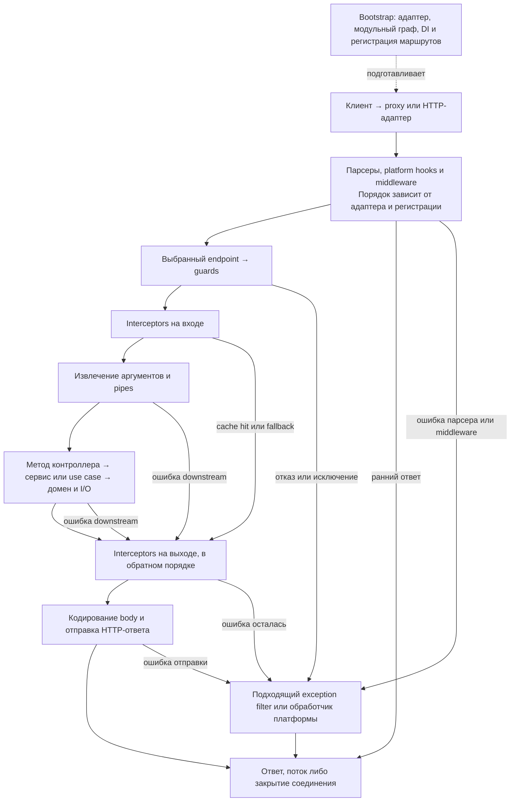

# Единый реестр паттернов и концепций NestJS

Практическая карта возможностей NestJS по порядку работы приложения. Для каждого этапа указаны точки подключения, встроенные API, варианты реализации и границы ответственности. Основной маршрут — входящий HTTP-запрос. GraphQL, WebSocket, RPC, очереди и другие входы описаны в той же терминологии, чтобы можно было сопоставить их с HTTP.

API и особенности реализации сверены с NestJS **12.5.1**. Возможности, зависящие от версии или адаптера, отмечены рядом. Интеграции вроде `@nestjs/graphql`, `@nestjs/cqrs` и `@nestjs/schedule` устанавливаются и версионируются отдельно. [Релиз NestJS 12.5.1](https://github.com/nestjs/nest/releases/tag/v12.5.1) · [Документация](https://docs.nestjs.com/) · [Миграции](https://docs.nestjs.com/migration-guide)

Подробные карточки с примерами расположены после обзора соответствующего этапа. В конце собраны первоисточники, разборы архитектурных репозиториев и инструменты статического анализа.

## Оглавление

| Этап | Что искать |
| --- | --- |
| [Карта HTTP-запроса](#карта-http-запроса) | Успех, ранняя остановка, исключение, приоритеты и области применения |
| [Проектирование и сборка приложения](#проектирование-и-сборка-приложения) | Модули, DI, провайдеры, конфигурация, bootstrap, hooks |
| [Вход и выбор маршрута](#вход-и-выбор-маршрута) | HTTP-адаптеры, протокол, парсеры, routing, версии и контекст |
| [Middleware](#middleware) | Ранняя обработка, подключение, завершение, работа с адаптером |
| [Guards](#guards) | Аутентификация, авторизация, throttling, порядок проверок |
| [Interceptors](#interceptors) | Вход и выход, RxJS, кэш, наблюдаемость, multipart |
| [Аргументы и pipes](#аргументы-и-pipes) | Декораторы параметров, все встроенные pipes, DTO и schema validation |
| [Handler и бизнес-слой](#handler-и-бизнес-слой) | Контроллер, use case, домен, БД, транзакции, внешние эффекты |
| [Успешный ответ](#успешный-ответ) | Автоматическая и ручная отправка, сериализация, streaming, SSE |
| [Ошибки и exception filters](#ошибки-и-exception-filters) | Отображение ошибок, scopes, типы исключений и отказ по этапам |
| [Варианты транспорта](#варианты-транспорта) | GraphQL, WebSocket, микросервисы, очереди, cron, события, CLI и MCP |
| [Тестирование и эксплуатация](#тестирование-и-эксплуатация) | Проверка маршрута, логи, метрики, readiness и shutdown |
| [Сквозной пример](#сквозной-пример) | Один endpoint с middleware, guard, interceptor, pipes, сервисом и filter |
| [Источники и тематический указатель](#источники-и-тематический-указатель) | Исходники на теге, тематические карточки и каталог материалов |

## Карта HTTP-запроса



`AppModule` собирает зависимости при запуске. На запросе исполняется **метод контроллера**, который обращается к провайдерам. Подробности о ранних отказах и сбоях после отправки заголовков собраны в разделе [Ошибки и exception filters](#ошибки-и-exception-filters). [Request lifecycle](https://docs.nestjs.com/faq/request-lifecycle) · [Исходник HTTP execution context](https://github.com/nestjs/nest/blob/v12.5.1/packages/core/router/router-execution-context.ts)

### Области и порядок

| Механизм | Где подключить | Порядок и остановка |
| --- | --- | --- |
| Middleware | `app.use()`, `MiddlewareConsumer`, API адаптера | Глобальная и затем подходящая модульная обвязка с учётом порядка фактической регистрации. Функция вызывает `next()`, завершает ответ или передаёт ошибку. |
| Guards | `APP_GUARD`, `app.useGlobalGuards()`, `@UseGuards()` на контроллере/методе | Глобальные → контроллер → метод. Первый отказ прерывает маршрут. |
| Interceptors | `APP_INTERCEPTOR`, `app.useGlobalInterceptors()`, `@UseInterceptors()` | Вход глобальные → контроллер → метод. Выход и распространение downstream-ошибки идут через вложенные interceptors в обратном порядке. |
| Pipes | `APP_PIPE`, `app.useGlobalPipes()`, `@UsePipes()`, аргумент декоратора | Для конкретного аргумента глобальные → контроллер → метод → pipes аргумента. [Параллельные цепочки аргументов](#встроенные-pipes-и-пользовательские-варианты). |
| Exception filters | `APP_FILTER`, `app.useGlobalFilters()`, `@UseFilters()` | Метод → контроллер → глобальный уровень → стандартный обработчик при отсутствии совпадения. Выбранный фильтр отвечает за исход ошибки. |
| Метаданные | `@SetMetadata()`, `Reflector.createDecorator()`, `applyDecorators()` для композиции декораторов | Регистрируют описание при объявлении. Поведение появляется, когда guard, interceptor, адаптер или другой потребитель читает это описание. |

Списки компонентов одного уровня лучше записывать одним вызовом декоратора, если порядок имеет значение. Глобальные `APP_*` регистрируются как провайдеры и позволяют Nest разрешить зависимости. `app.useGlobal*()` принимает готовые экземпляры. Экземпляр с зависимостями можно получить через `app.get()` для соответствующего статического провайдера. Правила глобального подключения для транспорта уточняются в разделе [Варианты транспорта](#варианты-транспорта). [Execution context](https://docs.nestjs.com/fundamentals/execution-context) · [Request lifecycle](https://docs.nestjs.com/faq/request-lifecycle)

### Где что происходит

| Наблюдение | Проверить первым |
| --- | --- |
| Handler вообще не вызван | Path/method/version, ранний ответ proxy или middleware, guard, cache hit, ошибка pipe. |
| В guard есть `req.body`, но значения ещё «сырые» | [Порядок разбора и валидации](#guards). Для multipart файлы обычно появляются после [upload interceptor](#загрузка-файлов). |
| Interceptor завершился, но клиент ещё получает данные | [Жизненный цикл ответа и транспортные hooks](#как-сформировать-выходной-контракт). |
| Некорректный JSON не ловит filter на методе | [Ошибки parser и глобальные фильтры](#что-происходит-на-каждом-входе). |
| Значение доступно через `ExecutionContext` | Определите транспорт и адаптер. У HTTP используйте `switchToHttp()`, у RPC — `switchToRpc()`, у WS — `switchToWs()`, у GraphQL — `GqlExecutionContext.create()`. |

### Паттерны, которые реализуют эти инструменты

| Концепция | Где проявляется в NestJS |
| --- | --- |
| Chain of Responsibility | Middleware передаёт запрос через `next()`, guards последовательно пропускают или останавливают его, а набор filters выбирает обработчик по типу ошибки. У каждого из этих механизмов свой контракт перехода. |
| Interceptor, AOP, Decorator | Interceptor оборачивает вызов и результат, а decorator записывает метаданные для подключения этой обвязки. Сквозные действия остаются рядом с границей транспорта. |
| Pipeline | Входной аргумент проходит последовательность преобразований и проверок через pipes. |
| Strategy, Factory, Adapter | DI выбирает реализацию под одним токеном, фабрика её собирает, а адаптер переводит внешний протокол в контракт приложения. |
| Facade, Ports & Adapters, DDD | Публичный API feature-модуля скрывает внутренние сервисы. Use case обращается к портам, а доменная модель хранит правила. |
| Repository, Unit of Work, CQRS | Repository управляет доступом к состоянию, Unit of Work координирует транзакцию, CQRS разделяет ответственность за изменение и чтение. |
| Observer, Pub/Sub, Saga | Подписчики реагируют на события. Saga координирует связанные асинхронные шаги и при необходимости компенсацию. |

### Разделение этапов запроса

**Когда применять.** Используйте middleware для раннего контекста, guards для допуска, pipes для разбора и валидации аргументов, interceptors для обвязки вызова, filters для отображения необработанных ошибок. Бизнес-решение остаётся в сценарии.

**Когда избыточно.** Одна проверка инварианта внутри сценария обходится без custom decorator и глобальной обвязки.

**Хороший пример.** Авторизационный guard проверяет принципала, `ParseUUIDPipe` нормализует идентификатор на входе, сценарий проверяет доступ к указанному заказу, interceptor измеряет длительность вызова.

**Плохой пример.** Guard ожидает, что глобальный `ValidationPipe` уже преобразовал и очистил `request.body`; interceptor ловит любую ошибку и возвращает успешный статус.

**Критерий.** Проверяйте границы обработчиков по [порядку и областям регистрации](#области-и-порядок). У транспортных проверок, бизнес-правила и отображения ошибки есть явные владельцы. [Request lifecycle](https://docs.nestjs.com/faq/request-lifecycle) · [Guards](https://docs.nestjs.com/guards) · [Interceptors](https://docs.nestjs.com/interceptors)

## Проектирование и сборка приложения

### Модули и провайдеры

| Инструмент или концепция | Для чего и когда выбирать |
| --- | --- |
| `@Module({ imports, controllers, providers, exports })` | Граф компонентов. Feature-модуль владеет возможностью и экспортирует публичные провайдеры. Экспортируемый провайдер импортируют через его модуль. |
| Корневой `AppModule`, feature/shared/core modules | Корневой модуль собирает граф. Feature-модуль группирует бизнес-возможность. Shared/Core — соглашения проекта для общих контрактов и инфраструктуры. |
| `@Global()` и `global: true` | Делают экспорт модуля доступным глобально после регистрации модуля. Применяйте для сквозной инфраструктуры с понятной конфигурацией. |
| `DynamicModule`, `ConfigurableModuleBuilder` | Условная сборка и именованные подключения. Builder объявляет тип настроек и генерирует методы регистрации. Названия `register`/`forRoot`/`forFeature` и их `Async`-варианты — соглашение конкретного API. |
| `@Injectable()`, constructor injection, `@Inject()`, `@Optional()` | Внедрение через class token либо явный symbol/string token. Property injection поддерживается, конструктор делает зависимости видимыми. TypeScript-интерфейсу требуется runtime-токен. |
| `useClass` | Указать класс реализации под токеном. Отдельная регистрация того же класса под другим токеном может создать отдельный экземпляр. |
| `useValue` | Подключить готовое значение, объект параметров, тестовую замену или внешний клиент с уже определённым владельцем. |
| `useFactory`, `inject` | Создать провайдер из зависимостей. Фабрика может возвращать Promise, Nest дождётся её при создании зависимого провайдера. |
| `useExisting` | Сделать алиас существующего токена. Для singleton это позволяет использовать тот же объект под двумя токенами. |
| `Scope.DEFAULT`, `REQUEST`, `TRANSIENT` | [Время жизни и распространение scope](#время-жизни-провайдера). |
| `REQUEST`, `INQUIRER`, `ContextIdFactory` | Получить объект запроса, информацию о потребителе или идентификатор DI-контекста. Для ручного контекста доступен `registerRequestByContextId()`. Особый вариант — durable providers и пользовательская стратегия выбора контекста. |
| `ModuleRef.get()`, `resolve()`, `create()` | Получить статический провайдер, разрешить scoped-провайдер в контексте либо создать класс через DI. Для постоянной зависимости проще конструктор. |
| `forwardRef()` | Отложить разрешение ссылки контейнером. [Когда нужен и как устранить цикл](#устранение-циклов). |
| `DiscoveryModule`/`DiscoveryService`, `Reflector`, `LazyModuleLoader` | Найти провайдеры по метаданным, прочитать метаданные или загрузить модуль по требованию. Lazy loading имеет ограничения для routes, lifecycle hooks и transport entry points. |

[NestJS Modules](https://docs.nestjs.com/modules) · [Custom providers](https://docs.nestjs.com/fundamentals/custom-providers) · [Dynamic modules](https://docs.nestjs.com/fundamentals/dynamic-modules) · [Async providers](https://docs.nestjs.com/fundamentals/async-providers) · [Injection scopes](https://docs.nestjs.com/fundamentals/injection-scopes) · [ModuleRef](https://docs.nestjs.com/fundamentals/module-ref) · [Circular dependency](https://docs.nestjs.com/fundamentals/circular-dependency) · [Discovery service](https://docs.nestjs.com/fundamentals/discovery-service) · [Lazy-loading modules](https://docs.nestjs.com/fundamentals/lazy-loading-modules)

### Bootstrap, конфигурация и hooks

| Шаг | Варианты |
| --- | --- |
| Создать проект | Nest CLI `nest new`, generators для module/controller/service/resource, standard/monorepo workspace, библиотеки. Выбор ESM/CJS и компилятора влияет на работу с runtime-метаданными. |
| Создать runtime | `NestFactory.create()` для HTTP, `createMicroservice()` для конкретного транспорта, `createApplicationContext()` для DI-контекста без сетевого слушателя. `connectMicroservice()` создаёт hybrid-приложение. |
| Прочитать настройки | `@nestjs/config`, `ConfigModule.forRoot()`, `ConfigService`, `registerAs()`, `forFeature()`, конфигурационная фабрика и `validate`/`validationSchema`. [Проверка настроек на старте](#конфигурация-при-запуске). |
| Подключить адаптер и общие политики | Ограничения parsers, префикс, versioning, cookies/CORS/CSRF, логгер, глобальные guards/pipes/interceptors/filters, статические файлы, websocket adapter, OpenAPI. Подготовьте до `app.init()` или `listen()` согласно API. |
| Инициализировать | `app.init()` регистрирует app/router и запускает initialization hooks. `listen()` инициализирует HTTP-приложение при необходимости и начинает принимать соединения. `startAllMicroservices()` запускает подключённые транспорты. |
| Подготовить сервисы | `OnModuleInit.onModuleInit()` после разрешения зависимостей модуля. `OnApplicationBootstrap.onApplicationBootstrap()` после модулей, до стандартного открытия HTTP listen. Async hooks могут задержать готовность. |
| Закрыть ресурсы | [Порядок shutdown hooks и остановка процесса](#lifecycle-и-graceful-shutdown). |

[CLI](https://docs.nestjs.com/cli/overview) · [Configuration](https://docs.nestjs.com/application/configuration) · [Lifecycle events](https://docs.nestjs.com/fundamentals/lifecycle-events) · [Standalone applications](https://docs.nestjs.com/standalone-applications) · [Hybrid application](https://docs.nestjs.com/faq/hybrid-application)

**Карточки этапа.** [Модуль на бизнес-возможность](#модуль-на-бизнес-возможность) · [Публичный API модуля](#публичный-api-модуля) · [Модульный монолит](#модульный-монолит) · [Токены и подстановка провайдеров](#токены-и-подстановка-провайдеров) · [Конфигурируемый модуль](#конфигурируемый-модуль) · [Стратегия и фабрика](#стратегия-и-фабрика) · [Время жизни провайдера](#время-жизни-провайдера) · [Устранение циклов](#устранение-циклов) · [Рефлексия и динамическое обнаружение](#рефлексия-и-динамическое-обнаружение) · [Конфигурация при запуске](#конфигурация-при-запуске)

### Модуль на бизнес-возможность

**Когда применять.** У возможностей разные правила, владельцы данных или темпы изменений. Группируйте код вокруг Orders, Payments и Shipping. Внутри каждой возможности выбирайте слои по сложности.

**Когда избыточно.** Для небольшой возможности контроллера, сервиса и модели может хватить. Отдельные пакеты и слои добавляйте при появлении отдельных контрактов.

**Хороший пример.** `orders/` содержит `OrdersModule`, контроллер, сценарии и работу с заказами. Добавление отмены заказа затрагивает эту возможность и её публичный контракт.

**Плохой пример.** Контроллеры, DTO, сервисы и ORM-модели всех возможностей разнесены по общим корневым папкам. При каждом изменении приходится восстанавливать владельца бизнес-правила по импортам.

**Критерий.** Путь запроса и все инварианты возможности можно проследить из её модуля. Monorepo CLI решает вопрос сборки нескольких приложений и библиотек. Границы доменов задаёт их собственный API. [NestJS Modules](https://docs.nestjs.com/modules) · [NestJS CLI monorepo](https://docs.nestjs.com/cli/monorepo) · [Encore](https://encore.dev/articles/nestjs-project-structure-best-practices#which-folder-structures-work-in-nestjs)

### Публичный API модуля

**Когда применять.** Клиенту нужен доступ к операции владельца данных. Экспортируйте узкий application service, фасад или токен. В `imports` укажите модуль-владелец этого провайдера.

**Когда избыточно.** У изолированной возможности `exports` может быть пустым. Для действительно общей bootstrap-инфраструктуры допустимо осознанное глобальное подключение.

**Хороший пример.**

```ts
@Module({
  providers: [OrdersFacade, OrdersStore],
  exports: [OrdersFacade],
})
class OrdersModule {}

@Module({
  imports: [OrdersModule],
  providers: [InvoicesService],
})
class InvoicesModule {}
```

**Плохой пример.** `InvoicesModule` заново регистрирует `OrdersStore`.

```ts
@Module({ providers: [OrdersStore, InvoicesService] })
class InvoicesModule {}
```

Общий `SharedModule` с реэкспортом хранилищ тоже скрывает владельца и связь с данными.

**Критерий.** Владелец контролирует изменения состояния. Повторная регистрация класса в двух модулях способна создать отдельные экземпляры. `@Global()` скрывает зависимость в списке импортов потребителя. В TypeScript дополнительно контролируйте импорты исходников, поскольку `exports` Nest управляет видимостью для DI. [NestJS Modules](https://docs.nestjs.com/modules) · [Common Errors](https://docs.nestjs.com/faq/common-errors) · [NestJS Doctor](https://www.nestjs.doctor/docs/rules/architecture#require-module-boundaries) · [Expona](https://expona.dev/blog/common-nestjs-anti-patterns#one-sharedmodule-importing-everything)

### Модульный монолит

**Когда применять.** Нужны независимые бизнес-границы и один операционный контур. У каждого модуля свой API, владелец данных и направление зависимостей. Компоненты могут разделять процесс и БД с согласованными правилами доступа.

**Когда избыточно.** Для маленького приложения достаточно нескольких feature-модулей и прямых вызовов через их API. Распределение оправдывается потребностью в отдельном развёртывании, масштабировании или изоляции отказов.

**Хороший пример.** Payment и Order владеют собственными переходами. Последствия завершения платежа оформлены через явный координатор или типизированное событие. Для гарантированной доставки между независимо падающими участниками применим [outbox](#transactional-outbox).

**Плохой пример.** Модули имеют отдельные папки, но напрямую пишут в таблицы друг друга. Внутрипроцессную шину считают подтверждённой доставкой после перезапуска.

**Критерий.** Из исходников видно, где проходит commit и где происходит побочный эффект. В примере Sebastian Iwanczyszyn обмен учебный. Разбор конкретных ограничений вынесен в указатель. [Modular Monolith, README и исходники](#архитектурные-репозитории) · [NestJS Modules](https://docs.nestjs.com/modules)

### Токены и подстановка провайдеров

**Когда применять.** У зависимости несколько адаптеров, нужна настройка при сборке приложения или требуется подмена на границе тестирования.

**Когда избыточно.** Для единственного внутреннего сервиса используйте класс как токен. Вводите интерфейс и отдельный runtime-токен там, где нужна самостоятельная граница.

**Хороший пример.**

```ts
const ORDER_STORE = Symbol('ORDER_STORE');

@Injectable()
class OrdersService {
  constructor(@Inject(ORDER_STORE) private readonly store: OrderStore) {}
}

@Module({
  providers: [
    PgOrderStore,
    { provide: ORDER_STORE, useExisting: PgOrderStore },
    OrdersService,
  ],
})
class OrdersModule {}
```

**Плохой пример.** Nest пытается разрешить зависимость без токена, соответствующего TypeScript-интерфейсу.

```ts
@Injectable()
class OrdersService {
  constructor(private readonly store: OrderStore) {}
}
```

Ручное создание провайдера внутри сценария также обходит сборку графа Nest.

**Критерий.** Один токен `Symbol` импортируется из места объявления. Способ привязки выбирайте по [таблице провайдеров](#модули-и-провайдеры). [Custom providers](https://docs.nestjs.com/fundamentals/custom-providers) · [Common Errors](https://docs.nestjs.com/faq/common-errors) · [NestJS Doctor](https://www.nestjs.doctor/docs/rules/architecture#no-manual-instantiation)

### Конфигурируемый модуль

**Когда применять.** Один пакет подключают с разными настройками или конфигурация зависит от асинхронной инфраструктуры.

**Когда избыточно.** Для единственного локального подключения достаточно статического модуля с `useFactory` и существующей конфигурацией приложения.

**Хороший пример.**

```ts
imports: [
  SearchModule.registerAsync({
    imports: [ConfigModule],
    inject: [ConfigService],
    useFactory: (config: ConfigService) => ({
      url: config.getOrThrow<string>('SEARCH_URL'),
    }),
  }),
]
```

**Плохой пример.** Переиспользуемый клиент читает `process.env` при импорте. Два подключения с разными именами используют один неразличимый токен и разделяют состояние.

**Критерий.** Dynamic module возвращает метаданные регистрации. Для нескольких именованных клиентов задайте отдельные токены и понятного владельца ресурсов. [Dynamic modules](https://docs.nestjs.com/fundamentals/dynamic-modules) · [Asynchronous providers](https://docs.nestjs.com/fundamentals/async-providers)

### Стратегия и фабрика

**Когда применять.** Одна операция выполняется несколькими способами, например доставка письмом или через push. Выбор делается при сборке приложения либо для каждого вызова.

**Когда избыточно.** Для одной ветки без вариаций используйте существующую функцию. Для короткой локальной развилки достаточно явного выбора.

**Хороший пример.** Если провайдер доставки выбирается при запуске, фабрика DI возвращает реализацию за одним токеном. Если канал зависит от входа, сценарий получает таблицу стратегий и проверяет допустимый ключ перед вызовом.

```ts
const sender = this.senders.get(command.channel);
if (!sender) throw new UnsupportedChannel(command.channel);
await sender.send(command.message);
```

**Плохой пример.** Каждый контроллер и worker сам проверяет канал, создаёт SDK-клиент и дублирует различающиеся правила выбора.

**Критерий.** Выбор находится в одном месте. Реализация стратегии тестируется отдельно, а недопустимый канал обрабатывается до побочного эффекта. [NestJS Custom providers](https://docs.nestjs.com/fundamentals/custom-providers) · [Пример Strategy у автора](https://nestjs.io/tutorials/implementing-the-strategy-pattern-in-nestjs-d908a6b8)

### Время жизни провайдера

**Когда применять.** Экземпляр `DEFAULT` общий в рамках регистрации. `TRANSIENT` подходит, когда каждому внедряющему потребителю нужен отдельный экземпляр. `REQUEST` подходит для зависимостей, чей экземпляр и данные принадлежат контексту запроса.

**Когда избыточно.** Ради нескольких полей передавайте их аргументом. Для корреляции логов рассмотрите AsyncLocalStorage, если аргументы пришлось бы протаскивать по всем промежуточным вызовам.

**Хороший пример.** Stateless `OrdersService` принимает `actorId` аргументом. Общий клиент БД переиспользует пул. Scope меняется у компонента с обоснованной изоляцией экземпляра.

**Плохой пример.** Singleton записывает `this.currentUser = request.user`. Вторая операция успевает заменить поле во время `await` первой. Другой вариант ошибки — сделать request-scoped общую зависимость для всего приложения ради одного поля.

**Критерий.** `REQUEST` распространяется вверх на потребителей, `TRANSIENT` не меняет scope потребителя. Lifecycle hooks приложения не вызываются для request-scoped классов. Проверяйте отдельные ограничения шлюзов, планировщиков и других долгоживущих компонентов. [Injection scopes](https://docs.nestjs.com/fundamentals/injection-scopes) · [Lifecycle events](https://docs.nestjs.com/fundamentals/lifecycle-events) · [Expona](https://expona.dev/blog/common-nestjs-anti-patterns#request-scoped-providers-everywhere)

### Устранение циклов

**Когда применять.** Связь двусторонняя в графе модулей, конструкторов или обычных импортов TypeScript. Сначала определите, какой именно граф замкнулся.

**Когда избыточно.** Если цикл создаёт один `index.ts`, достаточно прямого импорта. Если двум модулям нужен общий неизменяемый тип, вынесите тип в место с корректным направлением зависимости.

**Хороший пример.** Координатор оформления заказа вызывает публичные операции Orders и Payments. Регистрация оплаты и изменение состояния заказа остаются у их владельцев.

**Плохой пример.** Orders импортирует Payments, Payments импортирует Orders. Оба провайдера в конструкторах обращаются друг к другу и рассчитывают на определённый порядок создания.

**Критерий.** `forwardRef()` помогает контейнеру разрешить известную циклическую ссылку, а порядок создания провайдеров при цикле остаётся неопределённым. `ModuleRef.resolve()` и контекстные идентификаторы нужны для точечного динамического разрешения scoped-провайдеров. Если создаёте собственный контекст, требуемый провайдер `REQUEST` регистрируется в нём отдельно. Для устойчивого изменения направления зависимости используйте координатор, выделенный контракт или событие с оговорёнными гарантиями. [Circular dependency](https://docs.nestjs.com/fundamentals/circular-dependency) · [Module reference](https://docs.nestjs.com/fundamentals/module-ref) · [Trilon](https://trilon.io/blog/avoiding-circular-dependencies-in-nestjs) · [NestJS Doctor](https://www.nestjs.doctor/docs/rules/architecture#no-circular-module-deps)

### Рефлексия и динамическое обнаружение

**Когда применять.** Инфраструктурный модуль регистрирует открытый набор обработчиков, подписчиков или адаптеров по метаданным. Для политик маршрута подходят metadata decorator и `Reflector`.

**Когда избыточно.** Для нескольких известных обработчиков используйте явный список или фабрику. Для модулей с редким путём вызова измерьте startup до внедрения lazy-loading.

**Хороший пример.** `DiscoveryService` находит помеченные провайдеры, а bootstrap валидирует уникальность ключей и создаёт реестр. Для API policy guard разрешает приоритет метаданных метода и класса через `getAllAndOverride`.

**Плохой пример.** Каждый запрос заново обходит все провайдеры. Бизнес-сервис вызывает `ModuleRef.get(..., { strict: false })` для зависимостей, которые можно передать конструктором.

**Критерий.** Реестр формируется предсказуемо. Lazy-loaded модули кэшируются. Их lifecycle hooks имеют ограничения, а маршруты и transport handlers обычно должны быть доступны при настройке транспорта. [Discovery service](https://docs.nestjs.com/fundamentals/discovery-service) · [Execution context](https://docs.nestjs.com/fundamentals/execution-context) · [Trilon Metadata Deep Dive](https://trilon.io/blog/nestjs-metadata-deep-dive) · [Lazy-loading modules](https://docs.nestjs.com/fundamentals/lazy-loading-modules) · [NestJS Doctor](https://www.nestjs.doctor/docs/rules/architecture#no-service-locator)

### Конфигурация при запуске

**Когда применять.** Работоспособность зависит от адресов, секретов, таймаутов и окружения. На старте проверьте обязательные значения и преобразуйте их в нужные типы. Для feature flags определите владельца, безопасный default и срок удаления.

**Когда избыточно.** Несколько статических настроек можно выразить простым объектом. Многоуровневая система флагов нужна при реальном управлении rollout.

**Хороший пример.** Bootstrap валидирует `DATABASE_URL` и числовой бюджет запросов. Feature-модуль получает типизированную конфигурацию, а логгер редактирует секреты. Динамический флаг покрыт тестами в обоих состояниях.

**Плохой пример.** Драйвер лениво обнаруживает неполную конфигурацию при первом запросе. Каждый экземпляр сервиса читает `process.env` и по-своему применяет default.

**Критерий.** Неполная конфигурация даёт ясную диагностику до приёма трафика. Для секретов и настроек определён порядок ротации. [Configuration](https://docs.nestjs.com/application/configuration) · [Encore](https://encore.dev/articles/nestjs-project-structure-best-practices#how-should-you-handle-configuration) · [Wanago, конфигурация и деплой](#эксплуатация-и-производительность)

## Вход и выбор маршрута

| Уровень | Инструменты и решения |
| --- | --- |
| Внешняя граница | Reverse proxy, балансировщик, API gateway, TLS termination, лимиты размера и времени запроса. Настройте доверие к proxy и источники forwarded-заголовков на реальной топологии. |
| Express | `ExpressAdapter`, маршрут и middleware на Express, `Request`/`Response` и штатные возможности Express. Используется по умолчанию в NestJS 12 при обычном `NestFactory.create()`. |
| Fastify | `FastifyAdapter`, `register()` и hooks Fastify, нативные request/reply и плагины. `@RouteConfig()`, `@RouteConstraints()` и `@RouteSchema()` передают параметры в router Fastify. |
| Node | `NodeAdapter` из `@nestjs/platform-node` доступен в ветке 12.3+. Работает на `node:http` и предоставляет ряд Express-style методов. Совместимость middleware, parsing, ETag и отправки файлов проверяйте по документации адаптера. |
| Пользовательский адаптер | Реализовать контракт `HttpServer`/`AbstractHttpAdapter`, если базовые адаптеры не подходят. `app.getHttpAdapter()` и `HttpAdapterHost` дают доступ к платформе внутри DI. `getHttpServer()` возвращает Node server. |
| Body parsing | JSON и urlencoded через зарегистрированные парсеры. `useBodyParser()` для поддерживаемых типов и лимитов, `bodyParser: false` для самостоятельного подключения. `rawBody: true` сохраняет исходные байты при включённом parser, например для проверки подписи webhook. |
| Кодеки и другой вход | Multipart — [загрузка файлов](#загрузка-файлов). Для текстового, бинарного и нестандартного контента настройте явный content type, parser и лимит. Файлы большого размера обрабатывайте потоково. |
| Сопоставление пути | `@Controller()` + `@RequestMapping()` или декоратор метода. Возможны статические сегменты, параметры, wildcard, host routing при поддержке адаптера. `RouterModule.register()` задаёт модульные префиксы. `setGlobalPrefix()` поддерживает исключения. |
| HTTP-методы | `@Get`, `@Post`, `@Put`, `@Patch`, `@Delete`, `@Options`, `@Head`, `@All`. В API 12.5.1 также `@Search`, `@QueryMethod`, `@Propfind`, `@Proppatch`, `@Mkcol`, `@Copy`, `@Move`, `@Lock`, `@Unlock`. Проверьте поддержку метода выбранным адаптером и proxy. `@Query()` извлекает query string. |
| Версионирование | `enableVersioning()` с `URI`, `HEADER`, `MEDIA_TYPE` или `CUSTOM`. `@Version()`, версия контроллера, default version, `VERSION_NEUTRAL`. Версия участвует в выборе маршрута. |
| Конфликты маршрутов | В v12 доступны `routeConflictPolicy` для duplicate/shadow и `routeResolutionStrategy` для порядка декларации или специфичности. Проверьте маршрут с литералом рядом с динамическим `:id` на реальном адаптере. |
| Контекст запроса | Middleware или hook для request ID, `REQUEST` для DI. [Корреляция и перенос контекста](#контекст-выполнения). |
| Контракт и документация | `@nestjs/swagger`, `SwaggerModule.createDocument()`, декораторы параметров/ответов/безопасности, CLI plugin, OpenAPI схемы и примеры. `@ApiProperty()` описывает схему. Runtime-валидация подключается отдельно. |

[HTTP adapters](https://docs.nestjs.com/http/performance) · [Controllers](https://docs.nestjs.com/controllers) · [Global prefix](https://docs.nestjs.com/faq/global-prefix) · [Router module](https://docs.nestjs.com/recipes/router-module) · [Versioning](https://docs.nestjs.com/http/versioning) · [Raw body](https://docs.nestjs.com/faq/raw-body) · [Async Local Storage](https://docs.nestjs.com/recipes/async-local-storage) · [OpenAPI](https://docs.nestjs.com/openapi/introduction) · [Опции приложения v12.5.1](https://github.com/nestjs/nest/blob/v12.5.1/packages/common/interfaces/nest-application-options.interface.ts)

**Карточки этапа.** [Версионирование и OpenAPI](#версионирование-и-openapi) · [Контекст выполнения](#контекст-выполнения)

### Версионирование и OpenAPI

**Когда применять.** У API несколько клиентов с независимыми релизами или требуется формальный контракт для генерации SDK.

**Когда избыточно.** Совместимое добавление необязательного поля само по себе обычно обходится без новой версии. Для внутренних вызовов в одном процессе достаточно TypeScript-контракта.

**Хороший пример.** `v1` и `v2` адаптируют разные DTO к одному application use case. OpenAPI описывает точные формы ошибок и ответы, а интеграционные тесты проверяют обе версии. При использовании mapped types выбирайте API для соответствующего transport/runtime metadata.

**Плохой пример.** Добавить `@ApiProperty()` и считать поле проверенным на входе. Продублировать бизнес-правила в контроллерах версий и обновить только одну из реализаций.

**Критерий.** Документация, runtime и сгенерированный контракт согласованы. У старой версии есть оговорённый период поддержки. [Versioning](https://docs.nestjs.com/http/versioning) · [OpenAPI mapped types](https://docs.nestjs.com/openapi/mapped-types) · [Trilon Swagger](https://trilon.io/blog/nestjs-swagger-tips-tricks)

### Контекст выполнения

**Когда применять.** Guard, interceptor или decorator нужен в нескольких транспортах. Контекст корреляции нужен в глубине вызова, например для общего логгера.

**Когда избыточно.** Для одного HTTP-обработчика достаточно адаптерного API или аргумента. Для передачи роли, tenant и транзакции сохраняйте явный контракт там, где от него зависит бизнес-решение.

**Хороший пример.**

```ts
asyncLocalStorage.run({ requestId }, () => next());
```

На входе в worker создаётся отдельный локальный контекст на сообщение. Для Nest enhancer `ExecutionContext` явно выбирает HTTP, RPC, WS или GraphQL API.

**Плохой пример.** Записывать корреляцию на singleton-объект или вызывать `switchToHttp().getRequest()` во всех адаптерах, включая RPC и GraphQL.

**Критерий.** Параллельные операции получают независимые идентификаторы. Через границу процесса переносите контекст трассировки в заголовках запроса или сообщения. [Execution context](https://docs.nestjs.com/fundamentals/execution-context) · [AsyncLocalStorage](https://docs.nestjs.com/recipes/async-local-storage) · [GraphQL other features](https://docs.nestjs.com/graphql/other-features)

## Middleware

Middleware работает с request/response на входе. Допустимые исходы — вызвать `next()`, самостоятельно отправить ответ или передать ошибку в соответствующий error path. Пара `return next()` в middleware и `await next.handle()` в interceptor имеет разный смысл. `next.handle()` возвращает Observable, а Nest middleware передаёт управление сетевому router. [Middleware](https://docs.nestjs.com/middleware) · [Interceptors](https://docs.nestjs.com/interceptors)

| Форма | Как использовать |
| --- | --- |
| Функция | `app.use(fn)` для глобальной простой политики либо `consumer.apply(fn)` для выбранных маршрутов. Подходит для лёгкой обвязки без DI. |
| Класс | `@Injectable()` + `NestMiddleware.use(req, res, next)`. Регистрация через `configure(consumer)` модуля с интерфейсом `NestModule`. Поддерживает DI. |
| Группа и область | `consumer.apply(a, b).exclude(...).forRoutes(...)`. `forRoutes()` принимает контроллеры, пути и объекты `{ path, method }`. Приоритет между несколькими глобальными и модульными регистрациями проверяется по фактическому bootstrap. |
| Platform hooks | Express middleware и четырёхаргументный error middleware, Fastify hooks вроде `onRequest`/`preValidation`/`preHandler`/`onResponse`, NodeAdapter middleware. У Fastify различайте legacy middleware с raw request и hooks с Fastify request/reply. |
| Защита HTTP | `enableCors()`, `useSecurityHeaders()`, `enableCsrfProtection()` в актуальной ветке, либо адаптерные security plugins. Проверка CSRF зависит от типа credentials. CORS задаёт браузерную политику. Аутентификация и права — отдельные этапы. |
| Cookies и сессии | Опция `cookies` и декораторы `@Cookies()`/`@SignedCookies()` в v12. Для сессий выберите адаптерное middleware/plugin, session store и параметры cookie. Для сайта за балансировщиком учитывайте общий session store и proxy. |
| HTTP-инфраструктура | Request ID/ALS, принятый IP, базовый access log, early maintenance, статические файлы, компрессия. Итоговые bytes/status и disconnect наблюдают на уровне транспорта. |

**Граница выбора.** Если задача зависит от метаданных контроллера, например `@Roles()`, используйте guard или interceptor. Если нужно нормализовать конкретный аргумент, используйте pipe. Если middleware читает `body`, проверьте, когда parser зарегистрирован. Подключённое вручную раннее `app.use()` может выполниться до стандартного body parser. [Middleware](https://docs.nestjs.com/middleware) · [Security headers](https://docs.nestjs.com/security/helmet) · [CORS](https://docs.nestjs.com/security/cors) · [CSRF](https://docs.nestjs.com/security/csrf) · [Cookies](https://docs.nestjs.com/http/cookies) · [Session](https://docs.nestjs.com/http/session) · [HTTP compression](https://docs.nestjs.com/http/compression) · [Bootstrap в исходниках](https://github.com/nestjs/nest/blob/v12.5.1/packages/core/nest-application.ts)

### Защита на HTTP-границе

**Когда применять.** У browser API определите политику CORS и cookie, защиту от CSRF при автоматически отправляемых credentials и security headers. Для дорогих или публичных операций задайте ограничения частоты и размера запросов.

**Когда избыточно.** У API без браузерного клиента может не быть потребности в CORS. Политику rate limiting можно вынести в имеющийся gateway, если он получает доверенный ключ и покрывает требуемые маршруты.

**Хороший пример.** Cookie для сессии имеет осознанные `Secure`/`HttpOnly`/`SameSite`. Разрешённые origins перечислены явно. Хранилище лимитов общее для реплик, если лимит обещан для всего сервиса. За прокси настройте доверие только к своему proxy и протестируйте итоговый ключ лимита.

**Плохой пример.** Считать CORS проверкой прав доступа. Расчёт лимита на разных репликах использует только локальную память, хотя контракт задаёт единый лимит.

**Критерий.** Настройки проверяются на развёрнутой схеме с proxy, TLS и несколькими экземплярами. Политика cookies согласована с браузерным потоком. [CORS](https://docs.nestjs.com/security/cors) · [CSRF](https://docs.nestjs.com/security/csrf) · [Helmet](https://docs.nestjs.com/security/helmet) · [Rate limiting](https://docs.nestjs.com/security/rate-limiting) · [Sessions](https://docs.nestjs.com/http/session)

## Guards

`CanActivate.canActivate(context)` возвращает `boolean`, `Promise<boolean>` или `Observable<boolean>`. Nest проверяет guards последовательно и прекращает обработку при отказе. В HTTP результат `false` даёт `403 Forbidden`. Чтобы выразить отсутствие аутентификации, guard может выбросить `UnauthorizedException`, а для собственной политики — другое подходящее исключение. [Guards](https://docs.nestjs.com/guards) · [GuardsConsumer](https://github.com/nestjs/nest/blob/v12.5.1/packages/core/guards/guards-consumer.ts)

| Назначение | Инструменты и варианты |
| --- | --- |
| Аутентификация | Собственный `AuthGuard` с сервисом аутентификации, `@nestjs/passport` и `AuthGuard('jwt')`/другая стратегия, проверка session, API key или идентичности за доверенным gateway. Authentication guard обычно формирует principal для следующих этапов. |
| Маршрут по умолчанию защищён | `APP_GUARD` и явный `@Public()` через `Reflector.createDecorator()` либо `SetMetadata()`. Guard читает policy с метода или класса. |
| Роль, permissions, claims, атрибуты | `@Roles()`/`@Permissions()`, RBAC, claims-based access либо policy/ability (ABAC). `Reflector.get()` читает одну цель, `getAllAndOverride()` выбирает первое заданное значение, `getAllAndMerge()` объединяет значения. |
| Проверка ресурса | Владелец, tenant и состояние. [Проверка в use case и SQL-предикат](#аутентификация-и-проверка-доступа). |
| Throttling | `ThrottlerModule`, `ThrottlerGuard`, `@Throttle()`, `@SkipThrottle()` из `@nestjs/throttler`. Выберите ключ по IP, principal или tenant и storage, способный обеспечить выбранный лимит между репликами. Ограничение на gateway защищает более раннюю границу. |
| Приоритет и композиция | Сначала контекст и authentication, затем проверки, которым нужен principal. Для группы API доступны `applyDecorators()` и mixin/factory, но порядок guard-ов должен оставаться читаемым. |
| Транспорт | `ExecutionContext.getHandler()`, `getClass()`, `getType()` и transport switch. Перенос policy между HTTP, GraphQL и WS требует одного формата principal и транспортного механизма его извлечения. |

**Пограничный случай.** Guard может принять решение по разобранным HTTP-данным, но значения из `@Param()`/`@Body()` ещё не прошли pipe. При необходимости безопасно разберите свой идентификатор или перенесите проверку правила доступа в сценарий после pipe. [Authentication](https://docs.nestjs.com/security/authentication) · [Passport](https://docs.nestjs.com/recipes/passport) · [Authorization](https://docs.nestjs.com/security/authorization) · [Rate limiting](https://docs.nestjs.com/security/rate-limiting) · [Execution context](https://docs.nestjs.com/fundamentals/execution-context)

### Аутентификация и проверка доступа

**Когда применять.** Аутентификация устанавливает личность. Guard может потребовать роль или permission. При доступе к конкретному объекту проверьте принадлежность пользователя tenant и политику объекта.

**Когда избыточно.** Публичный маршрут не требует политики доступа. Для простого правила владения достаточно условия в запросе и понятного действия при отсутствии строки.

**Хороший пример.**

```ts
const order = await orders.findForTenant(orderId, principal.tenantId);
if (!order || !policy.canRead(principal, order)) throw new OrderUnavailable();
```

`principal` получен из доверенного механизма аутентификации. Tenant не берётся из произвольного входного поля. Для пользовательских сессий, refresh tokens и OAuth сохраняйте явную политику истечения и отзыва.

**Плохой пример.** Guard проверяет наличие токена, а сервис ищет заказ только по ID. Служебный маршрут использует `tenantId`, который непосредственно пришёл из формы.

**Критерий.** Есть отрицательные тесты для другого tenant, другого владельца и отсутствующей роли. Общую проверку для HTTP, RPC и worker размещайте в use case или общей policy. Если проверка зависит от состояния строки, связывайте её с SQL-предикатом или транзакцией операции. Решение о возврате `403` или `404` задаётся публичным контрактом. [Authentication](https://docs.nestjs.com/security/authentication) · [Authorization](https://docs.nestjs.com/security/authorization) · [Passport](https://docs.nestjs.com/recipes/passport) · [Expona](https://expona.dev/blog/my-nestjs-code-review-checklist#authorization-guard-plus-permission-check-ownership-verified-for-resources)

## Interceptors

`NestInterceptor.intercept(context, next)` получает `CallHandler`. С помощью `next.handle()` запускается обработка downstream — последующие interceptors, аргументы и метод. Interceptor может использовать `Observable` либо Promise с Observable для асинхронной подготовки. Если вернуть свой Observable без вызова `next.handle()`, downstream пропускается. [Interceptors](https://docs.nestjs.com/interceptors) · [InterceptorsConsumer](https://github.com/nestjs/nest/blob/v12.5.1/packages/core/interceptors/interceptors-consumer.ts)

| Задача | Доступные инструменты |
| --- | --- |
| Обвязка до и после | Вход — до `next.handle()`. `tap` наблюдает значение/ошибку, `finalize` выполняется на complete, error или unsubscribe. При измерении полной доставки учитывайте завершение HTTP-ответа отдельно. |
| Изменить результат | `map` для синхронного преобразования, подходящий flattening operator для асинхронного. [Формирование выходного контракта](#как-сформировать-выходной-контракт). |
| Преобразовать ошибку | `catchError` переводит ошибку или даёт безопасный fallback. Если нужно передать её фильтру, перебросьте через `throwError(() => error)`. Исключение guard и ошибка отправки после pipeline могут находиться вне этого оператора. |
| Ранний успешный ответ | `of(value)` для cache hit или fallback. `CacheInterceptor`, `@CacheKey()` и `@CacheTTL()` из `@nestjs/cache-manager`. [Ключи, доступ и инвалидация](#cache-aside-и-условные-запросы). |
| Таймаут и отмена | RxJS `timeout()` или политика из `@nestjs/resilience`. Отмена подписки и отмена уже начатого Promise — разные операции. Передайте `AbortSignal` до драйвера, если требуется остановить I/O. |
| Идемпотентность | `@nestjs/idempotency` или [собственный протокол повтора](#идемпотентные-операции). Для очереди см. [дедупликацию событий](#подтверждение-доставки-и-повторы). |
| Транзакция | Обычно граница use case или Unit of Work. Interceptor подходит, когда вся обёрнутая операция действительно является одной транзакцией, подписка ожидается внутри неё и все репозитории используют один transaction context. Для streaming и сетевых вызовов длинная транзакция ухудшает изоляцию ресурсов. |
| Упорядочить ожидание | Downstream вызывайте один раз на запрос, если контракт явно не предусматривает повтор. Ставить общий `retry()` вокруг handler опасно для мутаций, потому что повторная подписка может повторить эффект. |
| Multipart | Upload interceptor читает части запроса до validation pipes. Дальше `@UploadedFile()`/`@UploadedFiles()` и file validation. |

### Загрузка файлов

| Вариант | Как подключить |
| --- | --- |
| Один или несколько файлов | `FileInterceptor(field)` или `FilesInterceptor(field, maxCount)`. |
| Несколько именованных полей | `FileFieldsInterceptor([{ name, maxCount }])`. |
| Любые file fields или только текстовые | `AnyFilesInterceptor()` или `NoFilesInterceptor()`. Для разрешённых полей предпочтительна явная схема формы. |
| Express и NodeAdapter | `MulterModule.register()`/`registerAsync()` и соответствующие interceptors из установленного платформенного пакета. Настройте storage, file limits и правила cleanup. |
| Fastify | `MultipartModule` и одноимённые interceptors из `@nestjs/platform-fastify` в актуальной ветке, либо нативный plugin `@fastify/multipart`. Для потокового потребления документация v12 описывает `FileStreamInterceptor`. |
| Проверка и обработка | `ParseFilePipe`, `ParseFilePipeBuilder`, `MaxFileSizeValidator`, `FileTypeValidator` и собственный `FileValidator`. Лимиты адаптера ограничивают чтение раньше, чем запускается pipe. Проверьте поведение при недостающем файле, превышении лимита и прерывании передачи. |

[Caching](https://docs.nestjs.com/data/caching) · [Serialization](https://docs.nestjs.com/application/serialization) · [Idempotency keys](https://docs.nestjs.com/reliability/idempotency) · [Resilience](https://docs.nestjs.com/reliability/resilience) · [File upload and streaming](https://docs.nestjs.com/http/file-upload)

**Карточки этапа.** [Файлы, потоки и webhooks](#файлы-потоки-и-webhooks) · [Cache-aside и условные запросы](#cache-aside-и-условные-запросы) · [Идемпотентные операции](#идемпотентные-операции)

### Файлы, потоки и webhooks

**Когда применять.** Размер файла требует потоковой обработки, или внешняя система доставляет подписанные события с повторными попытками.

**Когда избыточно.** Небольшие фиксированные данные можно передать в обычном ответе. Отдельный worker нужен при долгой обработке, скачках нагрузки или требованиях к повтору.

**Хороший пример.** Загрузки ограничены по размеру. Скачивание передаёт поток с явной обработкой отмены и ошибок. Webhook подтверждает подпись по сырым байтам, затем надёжно записывает событие с уникальным ID источника и только после записи подтверждает приём.

**Плохой пример.** Считать весь большой файл в память на каждый запрос; проверять подпись над пересобранным JSON; подтверждать webhook до сохранения, затем полагаться на фоновый Promise в том же процессе.

**Критерий.** Размер, повтор, прерывание соединения и разные состояния записи проверены. Интеграция с multipart и raw body учитывает фактический адаптер Nest. [File upload](https://docs.nestjs.com/http/file-upload) · [Streaming responses](https://docs.nestjs.com/http/streaming-responses) · [Raw body](https://docs.nestjs.com/faq/raw-body) · [Webhooks](https://docs.nestjs.com/http/webhooks)

### Cache-aside и условные запросы

**Когда применять.** Измерения показывают повторяющееся дорогое чтение. Допустимый срок устаревания и изоляция ключей известны. Для HTTP-представлений могут подойти `ETag` и условный запрос.

**Когда избыточно.** У дешёвого или редко повторяемого запроса от кэша мало пользы. Для горячего SQL первым улучшением может быть индекс и ограничение результата.

**Хороший пример.** `orders:tenantA:order42:v2` различает tenant и версию представления. После commit запись инвалидации удаляет ключ, TTL ограничивает устаревание при пропущенной инвалидации. Если конкурентный reader может вернуть в кэш старое значение после удаления, используйте версионирование или другую явно выбранную схему согласования.

**Плохой пример.** Один ключ `/orders/42` для разных разрешений и tenant. Инвалидация происходит до rollback или commit без дальнейшей синхронизации. Реплики считают свои локальные кэши согласованными.

**Критерий.** Проверены промах, истечение, потерянная инвалидация и параллельный прогрев. `ETag` отражает конкретное представление, а политика HTTP-кэширования учитывает приватность. [NestJS Caching](https://docs.nestjs.com/data/caching) · [Wanago, cache и ETag](#http-и-публичные-контракты)

### Идемпотентные операции

**Когда применять.** Клиент или брокер повторяет операцию после неизвестного результата. Один логический запрос или событие должно менять состояние один раз.

**Когда избыточно.** Для естественно идемпотентного обновления и простых запросов чтения отдельный ключ часто не нужен. Проверьте связанные побочные эффекты, включая почту и платёж.

**Хороший пример.** Хранилище атомарно резервирует ключ в области `(tenant, операция, ключ)`, сохраняет отпечаток значимых полей и результат. Повтор с тем же input возвращает согласованный результат. Повтор с иным input получает конфликт. Для эффекта в одной БД запись результата и бизнес-эффекта координируются транзакцией. При внешнем платеже используйте согласованный ключ провайдера и механизм сверки при неизвестном исходе.

**Плохой пример.** Два параллельных запроса могут одновременно пройти промах.

```ts
const cached = await cache.get(key);
if (cached !== undefined) return cached;

const receipt = await chargePayment();
await cache.set(key, receipt);
return receipt;
```

**Критерий.** Проверены конкурентный повтор, несовпадающий payload, падение во время обработки и поведение по истечении TTL. Один Redis-lock без общего протокола восстановления не закрывает сценарий падения после внешнего эффекта. [NestJS Idempotency keys](https://docs.nestjs.com/reliability/idempotency) · [Пример interceptor и его исходные допущения](https://nestjs.io/tutorials/implementing-idempotency-in-nestjs-with-an-interceptor-76f333c7)

## Аргументы и pipes

### Извлечение аргументов

| Декоратор или API | Откуда берётся значение |
| --- | --- |
| `@Param()`, `@Param('id')` | Параметры URL. Идентификаторы обычно требуют parse/validation. |
| `@Query()`, `@Query('limit')` | Query string после разбора адаптером. Проверьте представление массивов и вложенных ключей. |
| `@Body()`, `@Body('field')`, `@RawBody()` | Разобранное тело, отдельное поле или сырые байты с включённым raw body. |
| `@Headers()`, `@Ip()`, `@HostParam()` | Заголовки, IP по политике доверия адаптера и параметры host маршрута. В HTTP v12.5.1 они не входят в список встроенных pipeable типов аргументов. |
| `@Cookies()`, `@SignedCookies()`, `@Session()` | Cookies и сессия. Подписанные cookies требуют настройки подписывания. Сессия обеспечивается middleware/plugin. `httpAdapter.setCookie()` и `clearCookie()` дают общий API записи cookies в текущей ветке. |
| `@UploadedFile()`, `@UploadedFiles()` | Файлы, подготовленные upload interceptor/плагином адаптера. |
| `@Req()`/`@Request()`, `@Res()`/`@Response()`, `@Next()` | Нативные request, response и next. Область `@Res()`/`@Next()` меняет ownership ответа. |
| `@SseSignal()` | Сигнал отключения SSE-клиента в актуальном core, включая время подготовки асинхронного handler. |
| `createParamDecorator()`, `@Bind()` | Пользовательский extractor через `ExecutionContext` или привязка параметрических декораторов. Пример — `@CurrentUser()`. Если значение пользовательского параметра должно проходить class validation, настройте `validateCustomDecorators`. |

[Контроллеры](https://docs.nestjs.com/controllers) · [Custom decorators](https://docs.nestjs.com/custom-decorators) · [Декораторы HTTP-параметров](https://github.com/nestjs/nest/blob/v12.5.1/packages/common/decorators/http/route-params.decorator.ts) · [Список pipeable типов](https://github.com/nestjs/nest/blob/v12.5.1/packages/core/router/router-execution-context.ts)

### Встроенные pipes и пользовательские варианты

| Инструмент | Контракт |
| --- | --- |
| `ParseIntPipe`, `ParseFloatPipe` | Разбирают числовые параметры. Диапазон, безопасный целочисленный предел и бизнес-ограничения проверьте отдельно. |
| `ParseBoolPipe` | Разбирает поддерживаемый логический ввод. [Пример выбора преобразования](#dto-и-валидация-на-входе). |
| `ParseUUIDPipe` | Проверяет UUID с возможной настройкой версии. |
| `ParseEnumPipe` | Проверяет принадлежность значению перечисления. |
| `ParseArrayPipe` | Разбирает/проверяет массив, поддерживает тип элементов и строковый delimiter в соответствующей конфигурации. |
| `ParseDatePipe` | Разбирает дату. Для строгого формата, например только ISO timestamp с timezone, используйте явную схему или custom pipe. |
| `DefaultValuePipe` | Подставляет default перед обязательным parse pipe. У параметрических pipes могут быть собственные параметры optional/default. Проверяйте отсутствие, пустую строку и `null` по отдельности. |
| `ValidationPipe` | Class-based DTO с `class-validator` и `class-transformer`. `transform`, `whitelist`, `forbidNonWhitelisted`, `exceptionFactory`, groups, `skipMissingProperties` и настройки преобразования образуют контракт. |
| `StandardSchemaValidationPipe` | В v12 принимает Standard Schema через метаданные, например `@Body({ schema })`. Можно использовать совместимую схему Zod, Valibot или другого поставщика. |
| `ParseFilePipe` | Проверяет файл или массив файлов с валидаторами. `ParseFilePipeBuilder` помогает собрать правило размера/типа и опции ошибки. |
| `PipeTransform<T, R>` | Собственная синхронная или асинхронная валидация, нормализация, преобразование. `ArgumentMetadata` содержит тип аргумента, metatype, данные декоратора и доступную schema. При отказе pipe выбрасывает исключение. |
| Валидация адаптером | Например AJV/`@RouteSchema()` у Fastify. Она может сработать до Nest handler и раньше его guards/pipes. Согласуйте форму ошибок и ответственность за один и тот же контракт. |
| Валидация бизнес-правил | Домен, use case или ограничение БД. Pipe проверяет вход, а атомарные и зависящие от состояния правила проверяются внутри операции. |

DTO с декораторами требуется импортировать как runtime-класс. Вложенные class-based DTO обычно используют `@ValidateNested()` и `@Type()`, для массива учитывают правила проверки каждого элемента. Mapped types `PartialType`, `PickType`, `OmitType` и `IntersectionType` помогают выразить форму. В OpenAPI и GraphQL используйте варианты соответствующего пакета, чтобы их метаданные учитывались.

Каждый применимый параметр проходит свою последовательность pipes. Для разных параметров асинхронные цепочки могут исполняться параллельно. Межполевую проверку делайте на всём DTO или после извлечения аргументов. Тестируйте отсутствующие поля, пустые строки, неизвестные поля и глубоко вложенные значения. [Pipes](https://docs.nestjs.com/pipes) · [Validation](https://docs.nestjs.com/application/validation) · [Экспорт built-in pipes](https://github.com/nestjs/nest/blob/v12.5.1/packages/common/pipes/index.ts) · [OpenAPI mapped types](https://docs.nestjs.com/openapi/mapped-types) · [GraphQL mapped types](https://docs.nestjs.com/graphql/mapped-types)

### DTO и валидация на входе

**Когда применять.** Любые данные с HTTP, GraphQL, очереди или другого внешнего входа требуют проверки перед использованием.

**Когда избыточно.** Для одного параметра достаточно встроенного parse pipe. Внутренний типизированный вызов с уже проверенным аргументом обходится без повторного HTTP DTO.

**Хороший пример.**

```ts
class ListOrdersDto {
  @Type(() => Number)
  @IsInt()
  @Min(1)
  @Max(100)
  limit = 25;
}

app.useGlobalPipes(new ValidationPipe({
  transform: true,
  whitelist: true,
  forbidNonWhitelisted: true,
}));
```

Ввод для булевых полей разбирайте явно, например через `ParseBoolPipe`, поскольку строка `'false'` не превращается в `false` через обычный `Boolean()`.

**Плохой пример.** Вход объявлен TypeScript-интерфейсом и целиком передаётся в слой записи.

```ts
@Post()
create(@Body() body: CreateOrderInput) {
  return this.orders.insert(body);
}
```

Runtime-валидация интерфейса отсутствует, допустимые поля для ввода определяйте явно.

**Критерий.** Реакция на недопустимый ввод проверяется тестом. `whitelist` использует validation metadata. Глобальные настройки применяйте с учётом обратной совместимости. [NestJS Validation](https://docs.nestjs.com/application/validation) · [Wanago #4](https://wanago.io/2020/06/01/api-nestjs-error-handling-validation/) · [Expona](https://expona.dev/blog/my-nestjs-code-review-checklist)

## Handler и бизнес-слой

| Задача | Варианты и критерий |
| --- | --- |
| Транспортный handler | `@Controller()` и метод маршрута получают готовые аргументы. Map DTO → команда, вызывают сервис и формируют выход. Для HTTP, GraphQL, worker и RPC используйте один сценарий, когда они реализуют одно бизнес-действие. |
| Прикладная логика | Для CRUD — service или несколько предметных методов. При сложной оркестрации — application use case, workflow или command handler. `@Injectable()` связывает сервис с графом DI. |
| Прикладная логика | Service для CRUD. [Use case или command handler для оркестрации](#сервис-домена-и-сценарий). |
| Бизнес-правила | Функция, доменный сервис, Entity, Value Object или [Aggregate для общего инварианта](#агрегат-и-объект-значение). |
| Архитектурная граница | Feature module, [модульный монолит](#модульный-монолит), [Ports & Adapters или Clean Architecture](#порты-и-адаптеры). |
| Транзакции | Граница сценария и один transactional manager/client. Unit of Work помогает координировать несколько репозиториев. В транзакцию помещают все атомарные записи, например aggregate и outbox. |
| Транзакции | [Граница сценария и Unit of Work](#транзакция-на-уровне-сценария). Для атомарной записи намерения публикации — [outbox](#transactional-outbox). |
| Конкуренция | [Ограничения БД, атомарный SQL и блокировки](#конкурентные-изменения-и-ограничения). Для scheduler — [lease и fencing](#планирование-и-распределённые-блокировки). |
| Чтение и кэш | [Проекции и пагинация](#ограниченный-набор-результатов), [cache-aside](#cache-aside-и-условные-запросы), [GraphQL DataLoader](#graphql-и-realtime). |
| Внешние HTTP-вызовы | Fetch, `@nestjs/http-client`, `@nestjs/axios` или SDK за портом. Deadline, cancellation, retry с backoff/jitter, circuit breaker, bulkhead и fallback выбираются по завершению операции и её безопасности для повтора. |
| Внешние HTTP-вызовы | Fetch, `@nestjs/http-client`, `@nestjs/axios` или SDK за портом. [Бюджет времени, повтор и изоляция сбоя](#устойчивый-внешний-вызов). |
| Долгий сценарий | Durable workflow, saga с компенсациями или оркестратор. Шаги, deadline, retries и состояние восстанавливаются по выбранному контракту. Для одноступенчатой работы обычно хватает очереди. |
| Долгий сценарий | [Durable workflow или saga](#saga-и-durable-workflow) для восстановления многошаговой операции. Для одного шага обычно достаточно [очереди](#очередь-и-изоляция-cpu). |
[Providers](https://docs.nestjs.com/providers) · [Data overview](https://docs.nestjs.com/data/overview) · [CQRS](https://docs.nestjs.com/recipes/cqrs) · [HTTP client](https://docs.nestjs.com/application/http-client) · [Caching](https://docs.nestjs.com/data/caching) · [Outbox](https://docs.nestjs.com/reliability/outbox) · [Durable workflows](https://docs.nestjs.com/reliability/workflows) · [Distributed locks](https://docs.nestjs.com/reliability/locks)

**Карточки этапа.** [Порты и адаптеры](#порты-и-адаптеры) · [Агрегат и объект-значение](#агрегат-и-объект-значение) · [Сервис домена и сценарий](#сервис-домена-и-сценарий) · [CQRS по мере роста](#cqrs-по-мере-роста) · [Транзакция на уровне сценария](#транзакция-на-уровне-сценария) · [Конкурентные изменения и ограничения](#конкурентные-изменения-и-ограничения) · [Transactional outbox](#transactional-outbox) · [Ограниченный набор результатов](#ограниченный-набор-результатов) · [Модель данных, миграции и soft delete](#модель-данных-миграции-и-soft-delete) · [Устойчивый внешний вызов](#устойчивый-внешний-вызов)

### Порты и адаптеры

**Когда применять.** Сценарий с бизнес-правилами должен работать с несколькими входами или зависеть от изменяемой инфраструктуры. Внутренний слой объявляет нужные ему операции. Инфраструктура реализует их, а модуль Nest связывает компоненты.

**Когда избыточно.** Простой CRUD может использовать встроенный ORM-сервис напрямую внутри feature-модуля. Выделяйте собственный порт по поведению, которое нужно контролировать или менять.

**Хороший пример.** `ConfirmOrder` зависит от `OrderRepository` с операциями загрузки и сохранения заказа. TypeORM-адаптер преобразует строки в доменную модель. Контроллер вызывает сценарий и преобразует результат в HTTP DTO.

**Плохой пример.** Сценарий принимает `QueryBuilder`, `Request` и `Response`, а бизнес-ошибка создаётся в модели через `HttpException`.

**Критерий.** Владельцу порта достаточно знать доменные типы. DTO, объект домена и ORM-запись могут эволюционировать отдельно. Если форма совпадает и сценарий прост, отдельные классы имеют смысл при появлении отличающегося контракта. [DDD Cookbook, infrastructure](https://github.com/adrian-d-hidalgo/nestjs-ddd-cookbook/blob/c80422198451bde8f0392608e8d2a39fc875f1c0/05-infrastructure-layer.md) · [Clean Architecture Example](https://github.com/gbourgeat/nestjs-ddd-clean-architecture-example/blob/a108ade60b22abb4f7f553f875a3343dca956b00/docs/architecture/clean-architecture.md) · [Encore](https://encore.dev/articles/nestjs-project-structure-best-practices#how-should-you-separate-dtos-and-entities)

### Агрегат и объект-значение

**Когда применять.** Несколько изменений обязаны сохранять общий инвариант. Агрегат задаёт границу согласованности, объект-значение валидирует содержимое и имеет равенство по значению.

**Когда избыточно.** Для справочника с базовыми ограничениями достаточно проверок входа и ограничений БД. Выделяйте модель вокруг поведения, которое действительно повторяется или усложняется.

**Хороший пример.**

```ts
order.cancel(clock.now());
await orders.save(order);
```

Метод `cancel` проверяет разрешённый переход и фиксирует причину или событие согласно правилам домена. При конкурентном сохранении адаптер использует версию или блокировку.

**Плохой пример.** Правило перехода расходится между контроллерами, если каждый присваивает статус напрямую.

```ts
order.status = 'cancelled';
await orders.save(order);
```

**Критерий.** Изменения проходят через поведение корня агрегата, а параллельные записи сохраняют инвариант на уровне выбранной транзакционной границы. [DDD Cookbook, domain](https://github.com/adrian-d-hidalgo/nestjs-ddd-cookbook/blob/c80422198451bde8f0392608e8d2a39fc875f1c0/03-domain-layer.md) · [Modular Monolith, Order](https://github.com/Sebastian-Iwanczyszyn/modular-monolith-with-ddd-nestjs/tree/bd83b807071bee1ee2e7b963110fc2d9af8c09e8/src/modules/order/domain)

### Сервис домена и сценарий

**Когда применять.** Правило использует несколько доменных объектов или внешние эффекты нужно упорядочить. Доменный сервис выражает само правило. Application use case организует загрузку, вызов правила, сохранение и взаимодействие с портами.

**Когда избыточно.** Поместите правило в объект, которому оно принадлежит. Для простого вычисления достаточно функции без DI.

**Хороший пример.** Сценарий получает тариф и заказ через порты, передаёт их в функцию расчёта стоимости и сохраняет результат в транзакции. Функцию можно проверить обычным unit-тестом.

**Плохой пример.** `OrderDomainService` читает HTTP-сессию, управляет ORM-транзакцией и готовит JSON. Тот же расчёт для worker приходится дублировать.

**Критерий.** Изменение транспорта или хранилища локализовано вокруг сценария. Бизнес-термины и ошибки остаются в доменной части. [DDD Cookbook, application](https://github.com/adrian-d-hidalgo/nestjs-ddd-cookbook/blob/c80422198451bde8f0392608e8d2a39fc875f1c0/04-application-layer.md) · [DDD Cookbook, domain services and use cases](https://github.com/adrian-d-hidalgo/nestjs-ddd-cookbook/blob/c80422198451bde8f0392608e8d2a39fc875f1c0/13-domain-services-and-use-cases.md)

### CQRS по мере роста

**Когда применять.** Команды и чтение имеют разную форму, нагрузку или правила. Можно начать с отдельных методов или классов, затем подключить `@nestjs/cqrs` для диспетчеризации команд, запросов, событий и саг.

**Когда избыточно.** Для линейного CRUD прямой вызов сервиса легче проследить. Разные классы для read и write могут работать с одной БД.

**Хороший пример.** `CancelOrderCommand` вызывает handler, проверяет правила и сохраняет агрегат. `ListOrdersQuery` читает проекцию с пагинацией и собственным контрактом авторизации. Если проекция обновляется асинхронно, API явно описывает допустимую задержку.

**Плохой пример.** Каждый getter превращён в сообщение. Прямой ответ клиенту обещает актуальную проекцию сразу после commit команды при асинхронном обновлении.

**Критерий.** Раздельность моделей снижает связанность. Транзакции и согласованность проекций проектируются явно. Event sourcing требует отдельного решения о хранении и восстановлении состояния из событий. [NestJS CQRS](https://docs.nestjs.com/recipes/cqrs) · [DDD Cookbook, decision matrices](https://github.com/adrian-d-hidalgo/nestjs-ddd-cookbook/blob/c80422198451bde8f0392608e8d2a39fc875f1c0/10-decision-matrices.md)

### Транзакция на уровне сценария

**Когда применять.** Изменения нескольких строк или таблиц образуют один атомарный переход. Сценарий определяет границу, а адаптер обеспечивает один transaction context.

**Когда избыточно.** У одиночного атомарного `UPDATE` отдельная обвязка может быть лишней. Порты Unit of Work нужны, когда они реально координируют несколько операций.

**Хороший пример.**

```ts
await dataSource.transaction(async (manager) => {
  await manager.getRepository(OrderRow).insert(orderRow);
  await manager.getRepository(OutboxRow).insert(eventRow);
});
```

Для Prisma используйте клиент `tx` внутри interactive transaction, для Drizzle и Kysely — объект транзакции, для raw PostgreSQL — тот же клиент соединения между `BEGIN` и `COMMIT`/`ROLLBACK`.

**Плохой пример.** Репозиторий для первой записи заранее получен от глобального DataSource.

```ts
await dataSource.transaction(async (manager) => {
  await globalOrdersRepository.insert(orderRow);
  await manager.getRepository(OutboxRow).insert(eventRow);
});
```

Первая запись может закрепиться вне транзакции. Долгий сетевой вызов внутри callback удерживает ресурсы БД и усложняет обработку отказа.

**Критерий.** Тест с ошибкой после первой записи показывает полный rollback. Ошибки требуемого isolation level обрабатываются по контракту БД. Сетевые эффекты координируются после commit или через outbox. [NestJS TypeORM](https://docs.nestjs.com/data/typeorm) · [Wanago, транзакции по стекам](#postgresql-и-хранилища)

### Конкурентные изменения и ограничения

**Когда применять.** Пересекающиеся запросы могут одновременно менять состояние. Выбирайте по инварианту между атомарным SQL, уникальным ограничением, оптимистичной проверкой версии и пессимистической блокировкой.

**Когда избыточно.** Для локального преобразования проверенной копии блокировка БД не нужна. Для простого изменения одной строки обычно достаточно предиката в одном запросе.

**Хороший пример.**

```sql
UPDATE inventory
SET available = available - $2
WHERE sku = $1 AND $2 > 0 AND available >= $2
RETURNING available;
```

Сценарий проверяет наличие возвращённой строки и переводит отсутствие в согласованный отказ. Уникальный ключ обеспечивает отсутствие дублирующих записей независимо от числа реплик.

**Плохой пример.** Чтение и запись разнесены без версии или блокировки.

```ts
const item = await inventory.findBySku(sku);
if (item.available >= quantity) {
  await inventory.setAvailable(sku, item.available - quantity);
}
```

**Критерий.** Инвариант сохраняется при двух параллельных соединениях. Для deadlock или serialization failure повторяют всю разрешённую к повтору транзакцию с ограничением числа попыток. Это отдельно от HTTP-идемпотентности. [PostgreSQL Transaction Isolation](https://www.postgresql.org/docs/current/transaction-iso.html)

### Transactional outbox

**Когда применять.** Бизнес-запись и намерение опубликовать событие должны пережить отказ процесса или брокера.

**Когда избыточно.** Для побочного действия, потеря которого допустима, достаточно локального вызова после commit. Для атомарного изменения внутри одной БД используйте обычную транзакцию.

**Хороший пример.**

```text
Транзакция БД   сохранить заказ + добавить eventId и payload в outbox
Издатель        забрать запись → опубликовать → получить подтверждение → отметить
Потребитель     дедупликация по eventId + локальный эффект в одной транзакции
```

При нескольких издателях нужна конкурентно-безопасная выдача записей с восстановлением зависших попыток. Порядок, retries, мониторинг backlog и хранение опубликованных записей задаются отдельно. Если важен порядок агрегата, обеспечьте его механизмом маршрутизации и/или последовательностью агрегата.

**Плохой пример.** Вызвать брокер внутри SQL-транзакции и ожидать откат публикации вместе с rollback. После успеха публикации и падения до отметки outbox будет отправлен повторно, если издатель восстанавливает записи.

**Критерий.** Commit создаёт и заказ, и запись outbox. Отказ брокера не теряет намерение. Дубликат безопасен. Outbox обеспечивает устойчивую передачу намерения, а exactly-once бизнес-эффект зависит от реализации получателя и внешних систем. [NestJS Outbox](https://docs.nestjs.com/reliability/outbox) · [DDD Cookbook, advanced patterns](https://github.com/adrian-d-hidalgo/nestjs-ddd-cookbook/blob/c80422198451bde8f0392608e8d2a39fc875f1c0/14-advanced-patterns.md)

### Ограниченный набор результатов

**Когда применять.** Списки растут, выдача сортируется, а связанные данные могут породить N+1. Сначала определите фильтр, стабильный порядок и ограничение размера.

**Когда избыточно.** Небольшой справочник с фиксированной верхней границей или выдача с обязательным переходом на произвольную страницу могут использовать простую offset-пагинацию.

**Хороший пример.**

```sql
SELECT id, created_at, status
FROM orders
WHERE tenant_id = $1 AND (created_at, id) < ($2, $3)
ORDER BY created_at DESC, id DESC
LIMIT $4;
```

Пример показывает следующую страницу при неизменяемых, non-null ключах сортировки. Для первой страницы предикат курсора опускается. Под рабочий запрос проверяется составной индекс и план. Связанные данные загружаются батчем или подходящим join.

**Плохой пример.** Пагинировать только по timestamp с совпадающими значениями. У каждого элемента списка есть отдельный запрос за связью. API возвращает все поля модели по умолчанию.

**Критерий.** Тест покрывает одинаковые ключи сортировки и границу страниц. Характеристики при новых вставках и обновлении ключей оговорены. `EXPLAIN` и измерения подтверждают стоимость реального запроса. [Wanago, параллельные примеры ORM и SQL](#postgresql-и-хранилища)

### Модель данных, миграции и soft delete

**Когда применять.** Реляционные ограничения и форма хранения выражают важные инварианты. Версии приложения могут временно сосуществовать во время миграции. Soft delete нужен при явном требовании восстановления, истории или политики хранения.

**Когда избыточно.** Обычного удаления и аудита может быть достаточно. Отдельные представления, JSONB, несколько схем и PostGIS оправданы наблюдаемыми требованиями к выборке или данным.

**Хороший пример.** Сначала добавить совместимое изменение, обновить приложение, заполнить старые строки, затем усилить ограничение или удалить старую колонку. Для soft delete заранее определить, как работают уникальность активных записей, связи, восстановление и выборки по умолчанию.

**Плохой пример.** Сразу переименовать используемую колонку при rolling deploy. Пометить строку удалённой и забыть про обходящие фильтры raw SQL и агрегаты.

**Критерий.** Схема выражает ключевые ограничения. Миграция проверена на существующих данных и под ожидаемой конкурентной нагрузкой. Для выбора ORM сначала зафиксируйте требуемый SQL и транзакционные возможности. [Data overview](https://docs.nestjs.com/data/overview) · [Примеры TypeORM, Prisma, Drizzle, Kysely и raw SQL](#postgresql-и-хранилища)

### Устойчивый внешний вызов

**Когда применять.** Зависимость ограничивает доступность или задержку сервиса. Deadline, отмена, retry, circuit breaker и bulkhead решают разные сценарии отказа. Выбирайте их по измеряемой проблеме.

**Когда избыточно.** Для короткого безопасного чтения может хватить timeout. Для одного неидемпотентного вызова с неизвестным исходом обычный автоматический retry способен удвоить эффект.

**Хороший пример.** Запрос делит общий бюджет между попытками, передаёт отмену клиенту и повторяет лишь допустимые временные ошибки с ограничением числа попыток и случайным разбросом задержки. Bulkhead ограничивает конкуренцию дорогостоящего клиента. Breaker быстро возвращает согласованную ошибку или допустимый fallback, пока зависимость восстанавливается.

**Плохой пример.** Произвольные повторные попытки на каждом уровне. Timeout ограничивает только ожидание вызывающего, а нижележащая работа продолжает расходовать ресурсы.

**Критерий.** У вызова известны бюджет, классификация ошибок и результат исчерпания попыток. Размер пула, отмена и параллельная нагрузка проверены. Для действующего стека сверяйте интеграцию `@nestjs/axios` или нового клиента и конкретные возможности пакета. [Resilience](https://docs.nestjs.com/reliability/resilience) · [Trilon @nestjs/resilience](https://trilon.io/blog/introducing-nestjs-resilience) · [HTTP client](https://docs.nestjs.com/application/http-client)

## Успешный ответ

### Кто отправляет результат

| Способ | Что происходит |
| --- | --- |
| `return value` или `Promise<value>` | Nest ждёт результат и передаёт его адаптеру. Объекты и массивы обычно идут в JSON, примитивы по правилам адаптера. По умолчанию `POST` получает `201`, остальные методы — `200`. |
| `return Observable<T>` в обычном HTTP | Nest ждёт завершения и использует последнее значение. Бесконечный Observable для такого endpoint ответа не завершит. Для поэлементной выдачи выберите SSE или поддерживаемый потоковый body. |
| `@HttpCode()`, `@Header()`, `HttpStatus` | Декларативные статус и заголовки. В текущем HTTP runtime после guards исходные значения выставляются до interceptors. Они могут быть изменены до отправки заголовков. |
| `@Res({ passthrough: true })` | Handler настраивает cookies/headers/status через API адаптера и возвращает значение. Отправка возвращаемого body остаётся у Nest. |
| `@Res()`/`@Response()` или `@Next()` | Library-specific path. Handler отвечает за отправку или делегирование. Цепочка guards, interceptors и pipes сохраняется, но стандартная отправка возвращённого body выключается для обычного ответа. |
| `@Redirect()` | Перенаправление с URL/статусом по умолчанию. Handler при необходимости может вернуть `{ url, statusCode }`. |
| `@Render()`, view engine | HTML-шаблон с моделью от controller handler. `useStaticAssets()` отдельно покрывает файлы и статическую выдачу платформы. |
| Файл | `StreamableFile` из `Buffer`/Node `Readable`. Опции типа, disposition и длины. Правила отправки и сжатия зависят от платформы. |
| Поток HTTP | В v12.5.1 handler может вернуть Node `Readable`, Web `ReadableStream`, `AsyncIterable`, например async generator, или стандартный Web `Response`. Обрабатывайте отключение клиента и освобождение источника. Для формата с несколькими логическими записями выберите NDJSON, SSE или протокол клиента и задайте backpressure, лимиты и тип данных. |
| SSE | `@Sse()` + Observable из `MessageEvent` для server-to-client. Учитывайте `@SseSignal()`, отмену подписки, `finalize`, heartbeat и прокси-буферизацию. |
| Cache validators | `ETag`/`If-None-Match`, `Last-Modified` и `Cache-Control` по семантике ресурса. Генерация и автоответ `304` различаются между адаптерами. |

[Controllers](https://docs.nestjs.com/controllers) · [MVC](https://docs.nestjs.com/http/mvc) · [Streaming responses](https://docs.nestjs.com/http/streaming-responses) · [Server-Sent Events](https://docs.nestjs.com/http/server-sent-events) · [HTTP adapters](https://docs.nestjs.com/http/performance) · [RouterResponseController](https://github.com/nestjs/nest/blob/v12.5.1/packages/core/router/router-response-controller.ts)

### Как сформировать выходной контракт

| Вариант | Когда выбирать |
| --- | --- |
| `ClassSerializerInterceptor` и `@SerializeOptions()` | Class-based модель, правила `@Exclude()`, `@Expose()`, groups и преобразование. [Проверка формы результата](#сериализация-и-контракт-ответа). |
| `ClassSerializerInterceptor` и `@SerializeOptions()` | Class-based модель, правила `@Exclude()`, `@Expose()`, groups и преобразование. Проверьте форму plain object, экземпляр класса и вложенность. |
| `StandardSchemaSerializerInterceptor` и `@SerializeOptions({ schema })` | Исходящий контракт Standard Schema в v12. Полезно проверять и преобразовывать данные перед отправкой. |
| Fastify response schema | Сериализация средствами Fastify, если выбрана его route schema. Проверяйте status-коды, поля и взаимодействие с Nest interceptor. |
| Envelope и headers | Интерцептор может добавить поля JSON-ответа. Для файлов, потоков, SSE, redirect и `204` сохраняйте контракт формата, а для cookies/headers используйте выделенный API. |
| Транспорт завершился | `finish`/`close` или адаптерный hook, cleanup источника, abort внешней работы там, где поддерживается. Возврат из handler означает готовность результата. Во время отправки он ещё может быть потерян. |

[Serialization](https://docs.nestjs.com/application/serialization) · [Interceptors](https://docs.nestjs.com/interceptors) · [Fastify integration](https://docs.nestjs.com/http/performance)

### Сериализация и контракт ответа

**Когда применять.** Ответу нужно скрыть внутренние поля, стабилизировать форму или использовать разные представления одной сущности.

**Когда избыточно.** Для нескольких полей хватит явного преобразования на границе. Массовые DTO и глобальные перехватчики оправданы общим контрактом.

**Хороший пример.**

```ts
return { id: user.id, name: user.displayName };
```

Поля ORM-запроса тоже ограничены нужной проекцией. Если используются декораторы `class-transformer`, проверьте их действие на реальной форме результата с учётом экземпляров классов, plain objects и настроек interceptor.

**Плохой пример.** Возвращать `{ ...user }` из ORM и полагаться на TypeScript-тип возвращаемого значения. Добавление нового поля в схему меняет ответ публичного API.

**Критерий.** Контрактный тест видит фактический JSON, включая вложенность и точный набор полей. Обязательные поля задокументированы. [NestJS Serialization](https://docs.nestjs.com/application/serialization) · [NestJS OpenAPI](https://docs.nestjs.com/openapi/types-and-parameters) · [Encore](https://encore.dev/articles/nestjs-project-structure-best-practices#how-should-you-separate-dtos-and-entities)

## Ошибки и exception filters

### Что происходит на каждом входе

| Источник ошибки | Кто получает её |
| --- | --- |
| Разрыв соединения, отказ proxy, ошибка TLS | Сетевой слой или внешний gateway. HTTP handler в этот момент может ещё не существовать. |
| Ошибка HTTP parser, неизвестный route, ранний middleware | Exception layer платформы или Nest в зависимости от точки входа. Filter контроллера/метода ещё недоступен. В v12.5.1 для этой ветки используйте глобальный singleton filter, если нужна общая обработка Nest. |
| Guard вернул `false` или выбросил ошибку | HTTP получает стандартный `403` либо соответствующее выброшенное исключение. Подходящий filter может его обработать. Interceptors маршрута ещё не запускались. |
| Pipe, handler, repository, downstream I/O | Ошибка может пройти через `catchError` interceptors. Если она осталась ошибкой, Nest выбирает подходящий exception filter. |
| Interceptor выбросил ошибку | Уже открытый внешний interceptor может её обработать. Оставшаяся ошибка доходит до filter. |
| Сериализация или начало отправки | Сбой сериализующего interceptor находится в его выходном pipeline. Сбой при отправке после него проходит через exception boundary HTTP router или адаптера. |
| Ошибка после начала stream или ручной отправки | Уже отправленный статус изменить нельзя. Используйте восстановление по протоколу, cleanup, отчёт об ошибке или завершение потока. |
| Detached Promise, timer, отсутствие `await` | Ошибка находится вне обработки controller invocation. Владелец фонового процесса или очередь должны перехватить её и выбрать retry либо failure. |

### Инструменты фильтрации

| Инструмент | Применение |
| --- | --- |
| `HttpException` | Явная транспортная ошибка с HTTP status и публичным body. В актуальном API доступны настройки `cause` и `errorCode`. В ответ выносите устойчивый код и безопасное сообщение. |
| Domain/application error | Выразить ожидаемый отказ независимо от транспорта. Filter или транспортный handler отображает его в HTTP status, GraphQL error или RPC failure. |
| Локальный `try/catch` или явный `Result` | Восстановить работу, добавить контекст или обработать ожидаемый доменный отказ там, где есть данные для решения. При возврате `Result` endpoint должен явно отобразить отказ на свой протокол. |
| `ExceptionFilter.catch(exception, host)` | Собственный протокол ошибок. `@Catch(SomeError)` ограничивает фильтр типом, `@Catch()` ловит все исключения в области действия. `ArgumentsHost` переключается на нужный транспорт. |
| `@UseFilters()` и `APP_FILTER` | Локальный или глобальный scope. Ближайший подходящий filter завершает обработку. В HTTP v12.5.1 список кандидатов разворачивается, поэтому внутри одной регистрации последний подходящий проверяется первым. |
| `BaseExceptionFilter`, `HttpAdapterHost` | Расширить стандартный HTTP handler через `super.catch()` либо отправить ответ через общий API адаптера. Для общего фильтра проверяйте `isHeadersSent()`. |
| Стандартный обработчик | Формирует статус и body для `HttpException`. Неизвестные ошибки обычно становятся `500` с общим сообщением. Некоторые HTTP-shaped ошибки адаптера распознаются отдельно. Технические детали остаются в логах. |
| `RpcException`, `BaseRpcExceptionFilter`, `WsException`, `BaseWsExceptionFilter` | Ошибки сообщений, RPC или WebSocket оформляются по своим протоколам. GraphQL использует execution result с `errors` и, при необходимости, полями `extensions`. |

### Встроенные классы HTTP-исключений

| Статусы | Классы в `@nestjs/common` v12.5.1 |
| --- | --- |
| `400`, `401`, `403`, `404` | `BadRequestException`, `UnauthorizedException`, `ForbiddenException`, `NotFoundException` |
| `405`, `406`, `408`, `409`, `410`, `412` | `MethodNotAllowedException`, `NotAcceptableException`, `RequestTimeoutException`, `ConflictException`, `GoneException`, `PreconditionFailedException` |
| `413`, `415`, `418`, `421`, `422` | `PayloadTooLargeException`, `UnsupportedMediaTypeException`, `ImATeapotException`, `MisdirectedException`, `UnprocessableEntityException` |
| `500`, `501`, `502`, `503`, `504`, `505` | `InternalServerErrorException`, `NotImplementedException`, `BadGatewayException`, `ServiceUnavailableException`, `GatewayTimeoutException`, `HttpVersionNotSupportedException` |

Для иных статусов используйте `HttpException` с `HttpStatus` или класс интеграции, например ошибку throttler. `IntrinsicException` — базовый тип встроенных ошибок. [Exception filters](https://docs.nestjs.com/exception-filters) · [Экспорт exception classes](https://github.com/nestjs/nest/blob/v12.5.1/packages/common/exceptions/index.ts) · [HTTP filter selection](https://github.com/nestjs/nest/blob/v12.5.1/packages/core/router/router-exception-filters.ts) · [BaseExceptionFilter](https://github.com/nestjs/nest/blob/v12.5.1/packages/core/exceptions/base-exception-filter.ts)

### Отображение ошибок на границе

**Когда применять.** Бизнес-сценарий вызывают из разных транспортов или API должен различать ожидаемые ошибки, временные сбои и неожиданные исключения.

**Когда избыточно.** У простого HTTP-only контроллера допустим встроенный `NotFoundException` в транспортном слое. Общая иерархия ошибок оправдана общим протоколом.

**Хороший пример.** `OrderAlreadyClosed` отображается в `409` для HTTP, в согласованный код ошибки GraphQL и в ожидаемый результат команды для worker. Неожиданная ошибка даёт клиенту общий ответ и оставляет диагностические детали в защищённом журнале.

**Плохой пример.** Любой сбой превращается в `400`, а клиент получает текст и стек из драйвера. Доменный объект использует `HttpException` для каждого инварианта.

**Критерий.** Клиенту доступны стабильные код и статус для принятия решения. Логи хранят причину и корреляцию. Повторяемость отделена от HTTP-статуса и зависит от смысла операции. [Exception filters](https://docs.nestjs.com/exception-filters) · [Microservice exception filters](https://docs.nestjs.com/microservices/exception-filters) · [Expona](https://expona.dev/blog/my-nestjs-code-review-checklist#errors-domain-errors-mapped-no-stack-traces-leaked)

## Варианты транспорта

Пайплайн enhancers относится к поддерживаемой точке входа Nest. Custom decorators, guards, interceptors и filters должны извлекать данные из правильного контекста. Выходные форматы и гарантии доставки задаёт транспорт. [Platform agnosticism](https://docs.nestjs.com/fundamentals/platform-agnosticism) · [Execution context](https://docs.nestjs.com/fundamentals/execution-context)

### GraphQL

- Вход проходит через HTTP или транспорт подписок, GraphQL driver разбирает документ и схему, затем запускаются корневые resolvers. Выберите code-first или schema-first, поддерживаемый driver и явную форму context. `@Resolver()`, `@Query()`, `@Mutation()`, `@Subscription()`, `@ResolveField()`, `@Args()`, `@Parent()`, `@Context()` и `@Info()` описывают обработчики и аргументы.
- Guards, interceptors и filters на field resolvers включаются через `fieldResolverEnhancers` по нужным типам. Это добавляет работу на каждый вызов поля. Для подписок отдельно проверяйте подключение. Для batching/DataLoader, сложности запроса и жизненного цикла подписок см. [GraphQL и realtime](#graphql-и-realtime).
- `GqlExecutionContext.create(context)` даёт root/args/context/info. `GqlArgumentsHost` позволяет exception filter перейти к GraphQL-контексту, а ошибки отображаются в GraphQL execution result. [Quick start](https://docs.nestjs.com/graphql/quick-start) · [Resolvers](https://docs.nestjs.com/graphql/resolvers) · [Other features](https://docs.nestjs.com/graphql/other-features) · [Complexity](https://docs.nestjs.com/graphql/complexity) · [Subscriptions](https://docs.nestjs.com/graphql/subscriptions) · [Federation](https://docs.nestjs.com/graphql/federation)

### WebSocket

- `@WebSocketGateway()`, `@WebSocketServer()`, `OnGatewayInit`, `OnGatewayConnection` и `OnGatewayDisconnect` описывают gateway и жизненный цикл соединения. Handshake/upgrade и transport auth — уровень адаптера. Проверка для отдельного event — уровень gateway или guard.
- `@SubscribeMessage()` вызывает handler сообщения. `@MessageBody()`, `@ConnectedSocket()` и предусмотренный адаптером `@Ack()` извлекают аргументы. Используйте `switchToWs()`, прикладной результат/ack, согласованное именованное событие или Observable, когда протокол поддерживает несколько ответов. Nest enhancers применяются к message handlers; одинаковые правила отдельно привязывают к connect/disconnect, если это нужно.
- Socket.IO, `WsAdapter` или custom adapter отличаются протоколом, acknowledgements, комнатами, масштабированием и правилами reconnect. Транспортные ошибки оформляются `WsException` и WS filter. [Gateways](https://docs.nestjs.com/websockets/gateways) · [Adapter](https://docs.nestjs.com/websockets/adapter) · [WS guards](https://docs.nestjs.com/websockets/guards) · [WS filters](https://docs.nestjs.com/websockets/exception-filters)

### RPC и сообщения Nest Microservices

- Вход — десериализация, pattern и context транспорта. В v12 `registerPreRequestHook()` позволяет обернуть выполнение до guards. Дальше — guards, interceptors, pipes, метод контроллера и RPC exception filter по обработчику.
- `@MessagePattern()` и `ClientProxy.send()` — запрос-ответ. `send()` возвращает cold Observable, для отправки нужна подписка. `@EventPattern()` и `ClientProxy.emit()` — доставка события, а `emit()` инициирует её сразу; подтверждение транспорта и бизнес-эффект — отдельные контракты. `@Payload()` и `@Ctx()` извлекают payload и carrier. `ClientsModule`/`ClientProxyFactory` регистрируют клиентов.
- Встроенные варианты транспорта включают TCP, Redis, MQTT, NATS, RabbitMQ, Kafka и gRPC. Доступны custom transport strategy, serializers/deserializers и настройки брокера. gRPC предоставляет `@GrpcService()`, `@GrpcMethod()`, `@GrpcStreamMethod()`, `@GrpcStreamCall()` и контракт из protobuf. Для брокеров проверьте ack/offset, повтор, порядок и dead-letter.
- `connectMicroservice(..., { inheritAppConfig: true })` может унаследовать HTTP global enhancers. Применяйте к обоим транспортам только компоненты, которые читают корректный context и возвращают подходящий результат. [Basics](https://docs.nestjs.com/microservices/basics) · [Pre-request hooks](https://docs.nestjs.com/microservices/pre-request-hooks) · [gRPC](https://docs.nestjs.com/microservices/grpc) · [RabbitMQ](https://docs.nestjs.com/microservices/rabbitmq) · [Kafka](https://docs.nestjs.com/microservices/kafka) · [Custom transport](https://docs.nestjs.com/microservices/custom-transport) · [Hybrid app](https://docs.nestjs.com/faq/hybrid-application)

### Остальные точки входа

| Вход | Поток и инструменты |
| --- | --- |
| Webhook | [Raw body, проверка подписи и надёжное подтверждение](#файлы-потоки-и-webhooks). Согласуйте валидацию, очередь, порядок событий и срок подтверждения с протоколом поставщика. [Webhooks](https://docs.nestjs.com/http/webhooks) |
| BullMQ/Bull | `BullModule`, `@InjectQueue()`, `@Processor()` и `WorkerHost.process()` в BullMQ, `@Process()` в API Bull. Валидируйте job data на входе. HTTP enhancers автоматически не применяются. [Жизненный цикл задания и изоляция CPU](#очередь-и-изоляция-cpu) · [Queues](https://docs.nestjs.com/application/queues) |
| Cron, interval, timeout | `@nestjs/schedule`, `ScheduleModule.forRoot()`, `@Cron()`, `@Interval()`, `@Timeout()` и `SchedulerRegistry`. Метод вызывает use case и фиксирует исход. [Повторы запуска и конкуренция реплик](#планирование-и-распределённые-блокировки) · [Task scheduling](https://docs.nestjs.com/application/task-scheduling) |
| Внутрипроцессное событие | `@nestjs/event-emitter`, `EventEmitterModule.forRoot()`, `EventEmitter2.emit()`/`emitAsync()` и `@OnEvent()`. При вызове из CQRS возможны `EventBus` и `@EventsHandler()`. Для устойчивой доставки между процессами нужны брокер, хранение или outbox. [Events](https://docs.nestjs.com/application/events) · [CQRS](https://docs.nestjs.com/recipes/cqrs) |
| CLI/standalone | `createApplicationContext()` → разбор аргументов, при необходимости Nest Commander → провайдер/сценарий → exit status/вывод → `app.close()`. HTTP pipeline отсутствует. [Standalone applications](https://docs.nestjs.com/standalone-applications) · [Nest Commander](https://docs.nestjs.com/recipes/nest-commander) |
| MCP | MCP transport → протокольный запрос → зарегистрированный tool/resource/prompt → validation/use case → MCP result. Streamable HTTP и stdio имеют разные входы, аутентификацию и error semantics. Защищайте отдельно transport boundary и доступ к выполняемой операции. [MCP overview](https://docs.nestjs.com/mcp/overview) · [Primitives](https://docs.nestjs.com/mcp/primitives) · [Transports](https://docs.nestjs.com/mcp/transports) · [Testing](https://docs.nestjs.com/mcp/testing) |

**Карточки этапа.** [GraphQL и realtime](#graphql-и-realtime) · [Команда, событие и транспорт](#команда-событие-и-транспорт) · [Подтверждение доставки и повторы](#подтверждение-доставки-и-повторы) · [Очередь и изоляция CPU](#очередь-и-изоляция-cpu) · [Планирование и распределённые блокировки](#планирование-и-распределённые-блокировки) · [Saga и durable workflow](#saga-и-durable-workflow)

### GraphQL и realtime

**Когда применять.** Нескольким клиентам нужны выборочные поля или обновления. Подбирайте GraphQL для выборки, SSE для однонаправленного потока сервера и WebSocket для двустороннего обмена.

**Когда избыточно.** Стабильный ресурс с простой формой и редкими обновлениями можно обслужить REST и обычным запросом обновления.

**Хороший пример.** GraphQL DataLoader объединяет чтение связанных сущностей в один набор ключей на операцию. Контекст учитывает пользователя. Для подписок задаются политика доступа, освобождение ресурсов при disconnect и правила горизонтального масштабирования. Дорогое чтение ограничено по сложности и размеру результата.

**Плохой пример.** Field resolver выполняет отдельный SQL на каждый элемент. Глобальный DataLoader отдаёт кэшированную строку между контекстами пользователей. Локальный pub/sub считается общим для всех реплик.

**Критерий.** Проверяются число запросов, разграничение доступа и освобождение соединений. [Настройки enhancers полей](#graphql) · [GraphQL Other features](https://docs.nestjs.com/graphql/other-features) · [Complexity](https://docs.nestjs.com/graphql/complexity) · [Subscriptions](https://docs.nestjs.com/graphql/subscriptions) · [SSE](https://docs.nestjs.com/http/server-sent-events) · [WebSocket gateways](https://docs.nestjs.com/websockets/gateways)

### Команда, событие и транспорт

**Когда применять.** Команда просит конкретного владельца выполнить действие. Событие сообщает о произошедшем факте. Запрос-ответ полезен, если потребителю нужно дождаться результата. Для интеграционного события определите контракт, версию и гарантии доставки.

**Когда избыточно.** Если два компонента в одном процессе и вызывающему нужен результат сразу, типизированный вызов модуля проще отдельной шины и очереди.

**Хороший пример.** `ConfirmPayment` адресуют владельцу платежа. `PaymentConfirmed` публикуют после сохранения результата. Локальный обработчик использует доменное событие внутри контекста. Внешний потребитель получает явный integration DTO с `eventId`, временем, именем и версией события.

**Плохой пример.** `PaymentConfirmed` публикуется до фиксации платежа. Сериализуется весь ORM-объект, а потребитель рассчитывает на поля, используемые только внутренними сценариями.

**Критерий.** Из контракта видно, кто делает работу, кто ждёт и где проходит граница доставки. [Контракт send и emit](#rpc-и-сообщения-nest-microservices) · [Microservices basics](https://docs.nestjs.com/microservices/basics) · [Application events](https://docs.nestjs.com/application/events) · [Modular Monolith](#архитектурные-репозитории)

### Подтверждение доставки и повторы

**Когда применять.** Брокер способен повторно доставить сообщение после потери consumer или подтверждения. Операция имеет устойчивый идентификатор и определённую классификацию ошибок.

**Когда избыточно.** Для некритичной внутрипроцессной реакции может хватить синхронного вызова или локального EventEmitter. Для критичного эффекта явно зафиксируйте требования при падении процесса.

**Хороший пример.** RabbitMQ consumer при ручном подтверждении сохраняет запись inbox и локальный эффект одной транзакцией, затем подтверждает сообщение. Временные сбои повторяются с задержкой. Сообщение с постоянной ошибкой направляется в настроенный dead-letter маршрут для разбора.

**Плохой пример.** `ack` происходит до commit, либо consumer мгновенно отправляет неисправимое сообщение обратно в ту же очередь бесконечным циклом.

**Критерий.** Проверены падение после commit и до ack, временный отказ и исчерпание повторов. Настройки RabbitMQ, Kafka, NATS, Redis transport и BullMQ различаются. Проверяйте подтверждение, replay и долговечность каждого. [RabbitMQ](https://docs.nestjs.com/microservices/rabbitmq) · [Kafka](https://docs.nestjs.com/microservices/kafka) · [Queues](https://docs.nestjs.com/application/queues)

### Очередь и изоляция CPU

**Когда применять.** Задания занимают дольше HTTP-бюджета, поступают всплесками, требуют повторов или расходуют CPU. Очередь управляет доставкой и нагрузкой. Для тяжёлых расчётов используйте выполнение за пределами HTTP event loop.

**Когда избыточно.** Обычный быстрый I/O обслуживается асинхронным вызовом с deadline. Отдельная очередь полезна при явном контракте асинхронной работы.

**Хороший пример.** API записывает задание и возвращает его ID. Worker обрабатывает его с ограниченной конкурентностью, повторяемым сохранением результата и наблюдением за задержкой очереди. CPU-bound этап работает в отдельном процессе или worker thread с ограниченной параллельностью.

**Плохой пример.** Тяжёлый синхронный расчёт выполняется в обработчике HTTP либо в BullMQ processor, работающем в том же event loop, а увеличение concurrency ухудшает задержки.

**Критерий.** Проверены пик входа, зависшее или повторное задание, ограничение памяти, статус задания и остановка worker. Bull и BullMQ имеют разные API интеграции Nest, сверяйте декораторы и обработчики выбранного пакета. [NestJS Queues](https://docs.nestjs.com/application/queues) · [Wanago, очереди и фоновые задачи](#транспорты-и-фоновые-задачи)

### Планирование и распределённые блокировки

**Когда применять.** Cron стартует на каждой реплике, ресурсу нужен единственный активный обработчик или задания не должны перекрываться.

**Когда избыточно.** Для запуска из единственного управляемого scheduler можно ограничиться уникальным идентификатором прогона и идемпотентной командой. Для одиночного локального процесса может хватить локального контроля перекрытия.

**Хороший пример.** Глобальный cron создаёт задание с уникальным ключом периода. Для долгого lease защищаемое хранилище сравнивает fencing token и отклоняет запись от старого владельца после передачи блокировки.

**Плохой пример.** Локальный флаг решает дублирование на нескольких репликах. Истёкший lease трактуется прежним worker как сохранённое право на запись.

**Критерий.** Проверены одновременный запуск, истечение lease, задержка прежнего владельца и восстановление работы. Механизм держится на гарантиях стора и проверках на стороне ресурса. [Task scheduling](https://docs.nestjs.com/application/task-scheduling) · [Distributed locks](https://docs.nestjs.com/reliability/locks) · [Trilon](https://trilon.io/blog/distributed-locks-with-nestjs-locks)

### Saga и durable workflow

**Когда применять.** Сценарий охватывает несколько независимо коммитящих систем, должен переживать рестарт, ждать сигналов или выполнять компенсацию.

**Когда избыточно.** Изменения в одной БД обычно покрывает транзакция. Для устойчивого одноступенчатого задания бывает достаточно очереди.

**Хороший пример.** Состояние checkout хранит шаги резервирования, оплаты и отгрузки. Повтор шага использует тот же ключ. После окончательного отказа оплаты оркестратор просит снять резерв. Переходы, таймеры, повтор и ручное вмешательство фиксируются.

**Плохой пример.** Long-running сценарий целиком живёт в одном RxJS-потоке или in-memory Promise. После рестарта сервис не знает, выполнен ли внешний шаг.

**Критерий.** Повтор шагов после перезапуска безопасен. Компенсация выражает бизнес-действие и сама имеет контракт отказа. `@Saga()` в CQRS отображает поток событий в команды. Ошибки обработки событий можно отслеживать через `UnhandledExceptionBus`. Для долговечности нужны отдельно выбранные хранилище, среда выполнения, правила версий и повторов. [NestJS CQRS](https://docs.nestjs.com/recipes/cqrs) · [Durable workflows](https://docs.nestjs.com/reliability/workflows) · [DDD Cookbook, Sagas](https://github.com/adrian-d-hidalgo/nestjs-ddd-cookbook/blob/c80422198451bde8f0392608e8d2a39fc875f1c0/14-advanced-patterns.md#sagas-orchestrated-cross-bc-transactions)

## Тестирование и эксплуатация

| Задача | Инструменты и проверка |
| --- | --- |
| Доменный unit | Прямой вызов функции или класса с fake clock/repository. [Границы unit-тестов](#тестирование). |
| DI и wiring | `Test.createTestingModule()`, `compile()`, `get()`/`resolve()`, `overrideProvider()`, `overrideGuard()`, `overrideInterceptor()`, `overridePipe()`, `overrideFilter()` и `overrideModule()`. |
| Контракт HTTP | `createNestApplication()` с реальным адаптером, Supertest, HTTP-клиент против тестового порта или Fastify `inject()`. Проверяйте body/status/headers, scope, отказ guard, ошибку pipe, filter, 404 и parser failure. |
| Инфраструктурная интеграция | [Реальная БД для миграций, rollback и гонок](#тестирование). На отдельной очереди проверяйте устойчивость worker и отсутствие повторного эффекта. |
| Логи и контекст | `Logger`/`ConsoleLogger`, `LoggerService` и `app.useLogger()`. [Поля логов и корреляция](#логи-метрики-и-трассировка). |
| Трассировка и метрики | OpenTelemetry, Observe, instrumentation адаптера, handler, БД и consumer. Измеряйте отдельно handler и запись ответа. [Кардинальность и trace propagation](#логи-метрики-и-трассировка). |
| Готовность | `@nestjs/terminus`, `TerminusModule` и `HealthCheckService`. [Liveness, readiness и миграции](#liveness-readiness-и-развёртывание). |
| Остановка | `return503OnClosing` и `forceCloseConnections` в текущей HTTP-ветке. [Порядок остановки и проверка под нагрузкой](#lifecycle-и-graceful-shutdown). |
| Ревью и диагностика | Request lifecycle trace, Nest Devtools, Common Errors, анализ module graph, ESLint и NestJS Doctor. Правила анализатора проверяйте по поведению и архитектуре конкретного приложения. |

[Testing](https://docs.nestjs.com/fundamentals/testing) · [Logger](https://docs.nestjs.com/application/logger) · [OpenTelemetry](https://docs.nestjs.com/observability/opentelemetry) · [Health checks](https://docs.nestjs.com/reliability/terminus) · [Deployment](https://docs.nestjs.com/deployment) · [Lifecycle](https://docs.nestjs.com/fundamentals/lifecycle-events) · [Common Errors](https://docs.nestjs.com/faq/common-errors) · [Devtools](https://docs.nestjs.com/devtools/overview)

**Карточки этапа.** [Тестирование](#тестирование) · [Логи, метрики и трассировка](#логи-метрики-и-трассировка) · [Измерение производительности](#измерение-производительности) · [Liveness, readiness и развёртывание](#liveness-readiness-и-развёртывание) · [Lifecycle и graceful shutdown](#lifecycle-и-graceful-shutdown)

### Тестирование

**Когда применять.** Разные уровни проверяют разные свойства. Unit — правила локального сценария. Integration — реальный адаптер, DI, миграции и транзакции. E2E — подтверждённый транспортный контракт.

**Когда избыточно.** Доменную функцию можно создавать напрямую. Nest TestingModule нужен, когда проверяется композиция провайдеров, глобальная обвязка или публичный контракт.

**Хороший пример.**

```ts
const moduleRef = await Test.createTestingModule({
  imports: [OrdersModule],
})
  .overrideProvider(ORDER_STORE)
  .useValue(fakeOrderStore)
  .compile();

try {
  const orders = moduleRef.get(OrdersService);
  // Проверка поведения сценария с подменённой границей.
} finally {
  await moduleRef.close();
}
```

Тесты HTTP создают приложение с тем же bootstrap-конфигом, что production, включая pipes, guards и фильтры, и закрывают его после сценария. Проверка rollback и гонок использует реальную БД с независимыми соединениями.

**Плохой пример.** Мок подтверждает вызов ORM, поэтому тест объявляют проверкой атомарности. E2E пропускает `ValidationPipe` приложения и принимает запрос, который отклоняется в production.

**Критерий.** Проверяются наблюдаемые эффекты, в том числе предсказуемый отказ. Каждый открытый module/application/consumer закрывается. Подмена привязана к фактическому Nest runtime-токену. [NestJS Testing](https://docs.nestjs.com/fundamentals/testing) · [Trilon TDD](https://trilon.io/blog/tdd-with-nestjs-integration-tests) · [Trilon ESLint](https://github.com/TrilonIO/eslint-plugin)

### Логи, метрики и трассировка

**Когда применять.** Для диагностики нужны три масштаба. Структурированные события объясняют конкретный результат, метрики показывают деградацию, трассировка связывает несколько сервисов и транспортов.

**Когда избыточно.** Для небольшого сервиса начните с JSON-логов, базовых latency/error-метрик и request ID. Разворачивайте трассировку, когда самостоятельная диагностика маршрута занимает заметное время.

**Хороший пример.** Логи содержат `requestId`/`traceId`, имя операции, исход и длительность. Чувствительные поля очищаются перед записью. Метрики агрегируются по шаблону маршрута, trace context передаётся в очереди. Средства APM подключаются с осмысленной выборкой.

**Плохой пример.** В лог попадают токены и сырое тело запроса. ID клиента используется как метка каждой метрики и создаёт высокую кардинальность. Записи очереди теряют корреляцию с входным запросом.

**Критерий.** Можно проследить сбой через HTTP, БД и consumer и понять частоту и задержки. Источники телеметрии не раскрывают credentials или лишние персональные данные. [Logger](https://docs.nestjs.com/application/logger) · [Distributed tracing](https://docs.nestjs.com/observability/distributed-tracing) · [OpenTelemetry](https://docs.nestjs.com/observability/opentelemetry)

### Измерение производительности

**Когда применять.** Есть целевой показатель и наблюдаемая проблема. Сначала разложите задержку между event loop, CPU, БД, сетью, очередями и сериализацией.

**Когда избыточно.** Смена адаптера, request scope или микросервисная декомпозиция без профиля могут добавить затраты без полезного эффекта.

**Хороший пример.** Сравнивайте Express и Fastify на одинаковом трафике, той же сериализации, TLS, proxy и конфигурации БД. Проверьте multipart и middleware совместимость. Для keep-alive учитывайте реальный SDK, Node.js agent, размеры пулов и таймауты proxy.

**Плохой пример.** Бенчмарк пустого endpoint переносится на запрос с SQL. В новых версиях Node.js характеристики agent считаются такими же, как в старом примере.

**Критерий.** Зафиксированы пропускная способность, p95/p99, ошибки и потребление памяти на репрезентативном запросе. [HTTP adapters](https://docs.nestjs.com/http/performance) · [Keep-alive](https://docs.nestjs.com/faq/keep-alive-connections) · [Fastify migration](https://docs.nestjs.com/recipes/fastify-migration)

### Liveness, readiness и развёртывание

**Когда применять.** Оркестратор распределяет трафик и перезапускает процессы. Разные проверки отвечают за достижение готовности и работоспособность процесса.

**Когда избыточно.** Простому локальному CLI health endpoints не нужны. Для одного сервиса используйте лёгкие probes с ограниченным временем вместо тяжёлой проверки всех систем.

**Хороший пример.** Readiness проверяет минимальные обязательные зависимости и прекращение приёма трафика при остановке. Liveness сообщает, что процесс способен работать. Образ собирается воспроизводимо, платформа TLS и proxy документирована, миграции координируются отдельно.

**Плохой пример.** Краткий отказ внешнего API делает liveness всех реплик красным. Каждая новая реплика запускает конфликтующую миграцию одновременно с остальными.

**Критерий.** Реплика выходит из балансировки до остановки. Поведение проверено при старте, отказе зависимости и rolling deploy. [NestJS Health checks](https://docs.nestjs.com/reliability/terminus) · [Deployment](https://docs.nestjs.com/deployment) · [Wanago, Docker и ECS](#эксплуатация-и-производительность)

### Lifecycle и graceful shutdown

**Когда применять.** Процесс владеет HTTP-соединениями, очередями, таймерами или пулами. Остановка запускается через `app.close()` или сигнал ОС при включённых `enableShutdownHooks()`.

Хуки выполняются в порядке `OnModuleDestroy.onModuleDestroy()` → `BeforeApplicationShutdown.beforeApplicationShutdown()` → закрытие инфраструктуры приложения → `OnApplicationShutdown.onApplicationShutdown()`. Hooks относятся к приложению. Для request-scoped экземпляров действуют [ограничения времени жизни](#время-жизни-провайдера).
**Когда избыточно.** Stateless провайдеру без ресурсов hook не нужен. Используйте уже подключённые lifecycle hooks библиотеки, когда они закрывают ресурс.

**Хороший пример.**

```ts
const app = await NestFactory.create(AppModule);
app.enableShutdownHooks(['SIGTERM', 'SIGINT']);
await app.listen(port);
```

Компоненты прекращают приём новой работы, завершают или безопасно возвращают текущую, освобождают соединения. Порядок и предел ожидания согласованы с оркестратором. Для standalone CLI вызывайте `app.close()` после команды.

**Плохой пример.** SIGTERM вызывает немедленный `process.exit()`. Два независимых обработчика сигнала пытаются закрыть один ресурс, пока worker ещё выполняет задачу.

**Критерий.** Smoke-проверка отправляет сигнал во время запроса или job и проверяет завершение в пределах бюджета. Реплика выходит из readiness до остановки, незаконченные jobs обрабатываются по контракту очереди. Влияние настроек HTTP-остановки на новые и незавершённые запросы проверяется под нагрузкой. Выход процесса зависит от активных handles. Порядок hooks сверяйте с major Nest. [Lifecycle events](https://docs.nestjs.com/fundamentals/lifecycle-events) · [Standalone applications](https://docs.nestjs.com/standalone-applications) · [Trilon NestJS 11](https://trilon.io/blog/announcing-nestjs-11-whats-new)

## Сквозной пример

В учебном GET endpoint middleware ставит заголовок, guard проверяет поддерживаемую версию клиента, interceptor формирует envelope, pipes разбирают ID и boolean, а filter отображает ошибку домена в `404`. В примере выбрана простая политика версии на основании заголовка. Для стандартного роутинга по версиям используйте `enableVersioning()` из раздела [Вход и выбор маршрута](#вход-и-выбор-маршрута).

```ts
import 'reflect-metadata';
import {
  ArgumentsHost, CallHandler, CanActivate, Catch, Controller,
  DefaultValuePipe, ExceptionFilter, ExecutionContext, Get,
  HttpStatus, Injectable, MiddlewareConsumer, Module, NestInterceptor,
  NestMiddleware, NestModule, Param, ParseBoolPipe, ParseIntPipe, Query,
  UseGuards, UseInterceptors,
} from '@nestjs/common';
import { APP_FILTER, HttpAdapterHost } from '@nestjs/core';
import { map } from 'rxjs';

@Injectable()
export class TraceHeaderMiddleware implements NestMiddleware {
  use(_request: unknown, response: { setHeader(name: string, value: string): unknown }, next: () => void) {
    response.setHeader('x-example-stage', 'middleware');
    next();
  }
}

@Injectable()
export class ClientVersionGuard implements CanActivate {
  canActivate(context: ExecutionContext): boolean {
    const request = context.switchToHttp().getRequest<{
      headers: Record<string, string | string[] | undefined>;
    }>();
    return request.headers['x-client-version'] === '1';
  }
}

@Injectable()
export class EnvelopeInterceptor implements NestInterceptor {
  intercept(_context: ExecutionContext, next: CallHandler) {
    return next.handle().pipe(map((data) => ({ data })));
  }
}

export class OrderNotFound extends Error {}

@Injectable()
export class OrdersService {
  get(id: number, includeItems: boolean) {
    if (id !== 1) throw new OrderNotFound();
    return includeItems ? { id, items: [] } : { id };
  }
}

@Catch(OrderNotFound)
export class OrderNotFoundFilter implements ExceptionFilter<OrderNotFound> {
  constructor(private readonly adapterHost: HttpAdapterHost) {}

  catch(_error: OrderNotFound, host: ArgumentsHost) {
    const response = host.switchToHttp().getResponse();
    this.adapterHost.httpAdapter.reply(
      response,
      { code: 'ORDER_NOT_FOUND' },
      HttpStatus.NOT_FOUND,
    );
  }
}

@Controller('orders')
@UseGuards(ClientVersionGuard)
@UseInterceptors(EnvelopeInterceptor)
class OrdersController {
  constructor(private readonly orders: OrdersService) {}

  @Get(':id')
  get(
    @Param('id', ParseIntPipe) id: number,
    @Query('includeItems', new DefaultValuePipe(false), ParseBoolPipe)
    includeItems: boolean,
  ) {
    return this.orders.get(id, includeItems);
  }
}

@Module({
  controllers: [OrdersController],
  providers: [
    OrdersService,
    { provide: APP_FILTER, useClass: OrderNotFoundFilter },
  ],
})
export class AppModule implements NestModule {
  configure(consumer: MiddlewareConsumer) {
    consumer.apply(TraceHeaderMiddleware).forRoutes(OrdersController);
  }
}
```

Сохраните модуль как `sample.ts`. Запуск в `main.ts` на ESM/NodeNext выглядит так.

```ts
import { NestFactory } from '@nestjs/core';
import { AppModule } from './sample.js';

const app = await NestFactory.create(AppModule);
app.enableShutdownHooks();
await app.listen(3000);
```

| Запрос | Результат | Где остановился поток |
| --- | --- | --- |
| `GET /orders/1` с `x-client-version: 1` | `200`, `{"data":{"id":1}}` | Сервис вернул результат, interceptor добавил envelope. |
| `GET /orders/1?includeItems=true` с тем же заголовком | `200`, `{"data":{"id":1,"items":[]}}` | Query pipe преобразовал строку в boolean. |
| `GET /orders/abc` с тем же заголовком | `400` | Pipe отклонил ID внутри цепочки interceptor, сервис не вызывался. |
| `GET /orders/1?includeItems=maybe` с тем же заголовком | `400` | Pipe отклонил boolean до вызова сервиса. |
| `GET /orders/1` без заголовка версии | `403` | Guard остановил запрос до interceptor и pipes. |
| `GET /orders/2` с заголовком версии | `404`, `{"code":"ORDER_NOT_FOUND"}` | Filter отобразил доменную ошибку. Успешный envelope к ней не применялся. |

## Источники и тематический указатель

[К оглавлению реестра](#оглавление)

Публичные оглавления и страницы сверены 18 ноября 2026 года. Документация NestJS описывает контракт текущей версии. Исторические статьи, примеры архитектуры и правила анализаторов полезны с учётом их стека и допущений.

- [Охват подборки](#охват-подборки)
- [Статический анализ](#статический-анализ)
- [Архитектурные репозитории](#архитектурные-репозитории)
- [Официальная документация](#официальная-документация)
- [Wanago по темам](#wanago-по-темам)
- [NestJS.io по темам](#nestjsio-по-темам)
- [Trilon по темам](#trilon-по-темам)
- [Awesome NestJS по темам](#awesome-nestjs-по-темам)
- [Справка NestJS Doctor](#справка-nestjs-doctor)

### Охват подборки

| Источник | Разобранные материалы |
| --- | --- |
| [NestJS Documentation](https://docs.nestjs.com/) и [Common Errors](https://docs.nestjs.com/faq/common-errors) | 170 публичных страниц документации по карте сайта. Индекс включает разделы Overview, Fundamentals, Application, Data, HTTP, Security, Recipes, FAQ и специализированные темы. [Карта сайта](https://docs.nestjs.com/sitemap.xml) |
| [Wanago · API with NestJS](https://wanago.io/courses/api-with-nestjs/) | Все 187 выпусков серии на 19 страницах архива, каждый связан с темой и оригинальной статьёй. |
| [Trilon Blog](https://trilon.io/blog) | 44 публикации по оглавлению и карте сайта. Отдельно видны материалы NestJS, история версий и публикации смежной тематики. |
| [NestJS Doctor · Architecture Rules](https://www.nestjs.doctor/docs/rules/architecture) | 37 страниц документации, включая все основные категории правил, конфигурацию, отчёты, CI и устройство анализатора. [Карта сайта](https://www.nestjs.doctor/sitemap.xml) |
| [NestJS.io](https://nestjs.io/tutorials) | 198 материалов в 12 категориях. 187 переизданий сопоставлены с оригиналами Wanago по названию и авторству. |
| [Awesome NestJS](https://github.com/nestjs/awesome-nestjs) | Оглавление и тематические разделы README целиком. В указателе есть ссылки на все группы каталога и ориентиры для выбора. |
| [Expona · Anti-patterns](https://expona.dev/blog/common-nestjs-anti-patterns) и [Code Review Checklist](https://expona.dev/blog/my-nestjs-code-review-checklist) | Обе статьи разобраны по темам и сопоставлены с правилами NestJS и тестами поведения. |
| [Encore · Project Structure](https://encore.dev/articles/nestjs-project-structure-best-practices) | Статья разобрана в части структуры feature-модулей, DTO, ошибок, конфигурации, тестов, логирования и monorepo. |
| [Trilon ESLint Plugin](https://github.com/TrilonIO/eslint-plugin) | README, четыре правила, конфигурации и спецификации правил на закреплённой ревизии. |
| [DDD Cookbook](https://github.com/adrian-d-hidalgo/nestjs-ddd-cookbook), [Modular Monolith](https://github.com/Sebastian-Iwanczyszyn/modular-monolith-with-ddd-nestjs), [Clean Architecture Example](https://github.com/gbourgeat/nestjs-ddd-clean-architecture-example) | Документация трёх репозиториев и ключевые пути исполнения у двух приложений. Ссылки на детали закреплены на прочитанных ревизиях. |

Граница просмотра для обзорных каталогов и статей проходит по опубликованным спискам и явно указанным материалам. Внешние рекомендательные ссылки, сторонние проекты из Awesome NestJS, видео и платные курсы учитываются на уровне каталога. Примеры репозиториев изучались по исходникам.

### Статический анализ

#### Что проверять вручную

| Проверка | Что смотреть | Материал |
| --- | --- | --- |
| Контроллер как адаптер | Владелец бизнес-правила, повторное использование из HTTP и очереди, возвращаемая форма | [Expona, логика в контроллерах](https://expona.dev/blog/common-nestjs-anti-patterns#business-logic-in-controllers) |
| Модульная связанность | Импорты Nest, файловые импорты, runtime-токены и narrow exports | [Encore, дизайн модулей](https://encore.dev/articles/nestjs-project-structure-best-practices#how-should-you-design-nestjs-modules) |
| DTO и безопасность | Runtime-валидация, проверка доступа к объекту, отсутствие лишних полей и деталей внутренних ошибок | [Expona Code Review Checklist](https://expona.dev/blog/my-nestjs-code-review-checklist) |
| Время жизни зависимости | Появление request scope вверх по цепочке и изоляция данных операций | [Expona, request scope](https://expona.dev/blog/common-nestjs-anti-patterns#request-scoped-providers-everywhere) |
| База и тесты | Запросы по tenant, N+1, ограниченный результат, граница транзакции и реальные ограничения | [Expona Code Review Checklist](https://expona.dev/blog/my-nestjs-code-review-checklist) |

#### NestJS Doctor

[Architecture Rules](https://www.nestjs.doctor/docs/rules/architecture) описывает десять проверок. Границы бизнес-логики охватывают `no-business-logic-in-controllers`, `no-repository-in-controllers`, `no-orm-in-controllers` и `no-orm-in-services`. Граф и экспорт проверяют `no-circular-module-deps`, `require-module-boundaries` и `no-barrel-export-internals`. Для DI предусмотрены `no-manual-instantiation`, `no-service-locator` и `prefer-constructor-injection`.

Результат формируется по структуре кода. Несколько веток в контроллере могут принадлежать транспортной логике. `ModuleRef` может быть намеренной частью инфраструктуры. Прямой ORM в CRUD-сервисе может соответствовать границам проекта. Для неоднозначного правила сверяйте конкретный диагностический участок и настройку проекта. [Architecture Rules](https://www.nestjs.doctor/docs/rules/architecture) · [Rule scopes](https://www.nestjs.doctor/docs/rules#rule-scopes) · [Configuration](https://www.nestjs.doctor/docs/configuration)

Кроме архитектуры, анализатор покрывает [Security](https://www.nestjs.doctor/docs/rules/security), [Correctness](https://www.nestjs.doctor/docs/rules/correctness), [Performance](https://www.nestjs.doctor/docs/rules/performance) и [Schema](https://www.nestjs.doctor/docs/rules/schema). [Отчёт по графу](https://www.nestjs.doctor/docs/report/module-graph) помогает увидеть связи модулей, [boot trace](https://www.nestjs.doctor/docs/report/boot-trace) — цепочки при запуске. Для CI предусмотрены пороги и фильтрация. Итоговый score зависит от набора правил и их весов. [CI gates](https://www.nestjs.doctor/docs/ci/gates) · [Scoring](https://www.nestjs.doctor/docs/pipeline/scoring)

#### Trilon ESLint Plugin

| Правило | Что автоматизирует |
| --- | --- |
| [`check-inject-decorator`](https://github.com/TrilonIO/eslint-plugin/blob/07eb3177343683accfadf9492f2dd17da02355b8/docs/rules/check-inject-decorator.md) | Проверку распознаваемого использования `@Inject()` и объявлений токенов. |
| [`detect-circular-reference`](https://github.com/TrilonIO/eslint-plugin/blob/07eb3177343683accfadf9492f2dd17da02355b8/docs/rules/detect-circular-reference.md) | Сигнал о вызове `forwardRef()`. Циклы обычных импортов и граф модулей проверяются отдельно. |
| [`enforce-close-testing-module`](https://github.com/TrilonIO/eslint-plugin/blob/07eb3177343683accfadf9492f2dd17da02355b8/docs/rules/enforce-close-testing-module.md) | Наличие закрытия Nest testing module в распознаваемом teardown. |
| [`enforce-custom-provider-type`](https://github.com/TrilonIO/eslint-plugin/blob/07eb3177343683accfadf9492f2dd17da02355b8/docs/rules/enforce-custom-provider-type.md) | Стиль объявления custom provider с явным типом. Правило входит в strict-конфигурацию. |

### Архитектурные репозитории

#### NestJS DDD Cookbook

Учебный справочник с примерами, критериями выбора и порядком усложнения. Особенно полезна связь между бизнес-правилом, application use case, ORM-адаптером и внешним DTO. Начните с матрицы выбора, если нужно решить, сколько слоёв требуется конкретной возможности. [README](https://github.com/adrian-d-hidalgo/nestjs-ddd-cookbook/blob/c80422198451bde8f0392608e8d2a39fc875f1c0/README.md) · [Оглавление](https://github.com/adrian-d-hidalgo/nestjs-ddd-cookbook/blob/c80422198451bde8f0392608e8d2a39fc875f1c0/SUMMARY.md)

- **Выбор архитектуры и границы.** [01 · Getting Started](https://github.com/adrian-d-hidalgo/nestjs-ddd-cookbook/blob/c80422198451bde8f0392608e8d2a39fc875f1c0/01-getting-started.md) · [02 · Project Structure](https://github.com/adrian-d-hidalgo/nestjs-ddd-cookbook/blob/c80422198451bde8f0392608e8d2a39fc875f1c0/02-project-structure.md) · [07 · Shared Kernel](https://github.com/adrian-d-hidalgo/nestjs-ddd-cookbook/blob/c80422198451bde8f0392608e8d2a39fc875f1c0/07-shared-kernel.md) · [10 · Decision Matrices](https://github.com/adrian-d-hidalgo/nestjs-ddd-cookbook/blob/c80422198451bde8f0392608e8d2a39fc875f1c0/10-decision-matrices.md)
- **Слои и контракты.** [03 · Domain](https://github.com/adrian-d-hidalgo/nestjs-ddd-cookbook/blob/c80422198451bde8f0392608e8d2a39fc875f1c0/03-domain-layer.md) · [04 · Application](https://github.com/adrian-d-hidalgo/nestjs-ddd-cookbook/blob/c80422198451bde8f0392608e8d2a39fc875f1c0/04-application-layer.md) · [05 · Infrastructure](https://github.com/adrian-d-hidalgo/nestjs-ddd-cookbook/blob/c80422198451bde8f0392608e8d2a39fc875f1c0/05-infrastructure-layer.md) · [06 · Presentation](https://github.com/adrian-d-hidalgo/nestjs-ddd-cookbook/blob/c80422198451bde8f0392608e8d2a39fc875f1c0/06-presentation-layer.md) · [13 · Domain Services and Use Cases](https://github.com/adrian-d-hidalgo/nestjs-ddd-cookbook/blob/c80422198451bde8f0392608e8d2a39fc875f1c0/13-domain-services-and-use-cases.md)
- **Применение и проверка.** [08 · Testing](https://github.com/adrian-d-hidalgo/nestjs-ddd-cookbook/blob/c80422198451bde8f0392608e8d2a39fc875f1c0/08-testing.md) · [09 · Recipes](https://github.com/adrian-d-hidalgo/nestjs-ddd-cookbook/blob/c80422198451bde8f0392608e8d2a39fc875f1c0/09-recipes.md) · [11 · Pitfalls](https://github.com/adrian-d-hidalgo/nestjs-ddd-cookbook/blob/c80422198451bde8f0392608e8d2a39fc875f1c0/11-common-pitfalls.md) · [12 · Execution Flows](https://github.com/adrian-d-hidalgo/nestjs-ddd-cookbook/blob/c80422198451bde8f0392608e8d2a39fc875f1c0/12-execution-flows.md) · [15 · Implementation Checklist](https://github.com/adrian-d-hidalgo/nestjs-ddd-cookbook/blob/c80422198451bde8f0392608e8d2a39fc875f1c0/15-implementation-checklist.md)
- **Устойчивая доставка и оркестрация.** [14 · Outbox, Inbox, Sagas](https://github.com/adrian-d-hidalgo/nestjs-ddd-cookbook/blob/c80422198451bde8f0392608e8d2a39fc875f1c0/14-advanced-patterns.md)

#### Modular Monolith with DDD in NestJS

Демонстрация Order, Payment, Shipment и Notification с command handlers, доменными и интеграционными событиями. Использует `@nestjstools/messaging`. Wrapper задаёт локальный канал и RabbitMQ, тестовый режим меняет канал интеграционных событий на in-memory. [README](https://github.com/Sebastian-Iwanczyszyn/modular-monolith-with-ddd-nestjs/blob/bd83b807071bee1ee2e7b963110fc2d9af8c09e8/README.md) · [Messaging wrapper](https://github.com/Sebastian-Iwanczyszyn/modular-monolith-with-ddd-nestjs/blob/bd83b807071bee1ee2e7b963110fc2d9af8c09e8/src/common/messaging/messaging-wrapper.module.ts) · [Модули](https://github.com/Sebastian-Iwanczyszyn/modular-monolith-with-ddd-nestjs/tree/bd83b807071bee1ee2e7b963110fc2d9af8c09e8/src/modules)

`CreateOrderHandler` сначала сохраняет заказ, затем публикует integration event. При падении между действиями запись и событие могут разойтись. README явно перечисляет границы примера по транзакциям, outbox/inbox, auth и отдельным worker-процессам. [CreateOrderHandler](https://github.com/Sebastian-Iwanczyszyn/modular-monolith-with-ddd-nestjs/blob/bd83b807071bee1ee2e7b963110fc2d9af8c09e8/src/modules/order/application/command/handler/create-order.handler.ts) · [Ограничения примера](https://github.com/Sebastian-Iwanczyszyn/modular-monolith-with-ddd-nestjs/blob/bd83b807071bee1ee2e7b963110fc2d9af8c09e8/README.md#repository-does-not-include)

#### Clean Architecture Example · Route Solver

Внешние точки входа в application use cases собраны в `RestApiModule` через фабрики. TypeORM-адаптер подключён к `RoadSegmentRepository` в `DatabaseModule`. У проекта есть отдельные инфраструктурные адаптеры погоды и поиска маршрута, тесты с in-memory repository, реальные интеграционные тесты БД и проверка правил импортов через dependency-cruiser. [README](https://github.com/gbourgeat/nestjs-ddd-clean-architecture-example/blob/a108ade60b22abb4f7f553f875a3343dca956b00/README.md) · [RestApiModule](https://github.com/gbourgeat/nestjs-ddd-clean-architecture-example/blob/a108ade60b22abb4f7f553f875a3343dca956b00/src/presentation/rest-api/rest-api.module.ts) · [DatabaseModule](https://github.com/gbourgeat/nestjs-ddd-clean-architecture-example/blob/a108ade60b22abb4f7f553f875a3343dca956b00/src/infrastructure/database/database.module.ts) · [Тесты](https://github.com/gbourgeat/nestjs-ddd-clean-architecture-example/tree/a108ade60b22abb4f7f553f875a3343dca956b00/test)

- **Модель и сценарии.** [Clean Architecture и правила зависимостей](https://github.com/gbourgeat/nestjs-ddd-clean-architecture-example/blob/a108ade60b22abb4f7f553f875a3343dca956b00/docs/architecture/clean-architecture.md) · [Domain Patterns](https://github.com/gbourgeat/nestjs-ddd-clean-architecture-example/blob/a108ade60b22abb4f7f553f875a3343dca956b00/docs/architecture/domain-patterns.md) · [Ubiquitous Language](https://github.com/gbourgeat/nestjs-ddd-clean-architecture-example/blob/a108ade60b22abb4f7f553f875a3343dca956b00/docs/domain/ubiquitous-language.md) · [Create Road Segment](https://github.com/gbourgeat/nestjs-ddd-clean-architecture-example/blob/a108ade60b22abb4f7f553f875a3343dca956b00/docs/features/create-road-segment.md)
- **Инфраструктура и проверка.** [Docker](https://github.com/gbourgeat/nestjs-ddd-clean-architecture-example/blob/a108ade60b22abb4f7f553f875a3343dca956b00/docs/infrastructure/docker.md) · [CI/CD](https://github.com/gbourgeat/nestjs-ddd-clean-architecture-example/blob/a108ade60b22abb4f7f553f875a3343dca956b00/docs/infrastructure/ci-cd.md) · [Git](https://github.com/gbourgeat/nestjs-ddd-clean-architecture-example/blob/a108ade60b22abb4f7f553f875a3343dca956b00/docs/workflows/git.md) · [Pre-commit](https://github.com/gbourgeat/nestjs-ddd-clean-architecture-example/blob/a108ade60b22abb4f7f553f875a3343dca956b00/docs/workflows/pre-commit-hooks.md) · [Task runner](https://github.com/gbourgeat/nestjs-ddd-clean-architecture-example/blob/a108ade60b22abb4f7f553f875a3343dca956b00/docs/tools/task-runner.md)


### Официальная документация

Якоря ведут к разбору темы и её источникам в реестре. Прямые ссылки ведут на дополнительные страницы документации. Маршруты и доступность новых пакетов сверяйте со своей версией NestJS. [Исходники документации](https://github.com/nestjs/docs.nestjs.com/tree/7b56f809ec0295b8e4b8424192c923fc341b2a91)

- **Вход в документацию и основные понятия.** [Введение](#единый-реестр-паттернов-и-концепций-nestjs) · [Вход и выбор маршрута](#вход-и-выбор-маршрута) · [Handler и бизнес-слой](#handler-и-бизнес-слой) · [Проектирование и сборка приложения](#проектирование-и-сборка-приложения) · [Middleware](#middleware) · [Ошибки и exception filters](#ошибки-и-exception-filters) · [Аргументы и pipes](#аргументы-и-pipes) · [Карта HTTP-запроса](#карта-http-запроса) · [Тестирование и эксплуатация](#тестирование-и-эксплуатация) · [First steps](https://docs.nestjs.com/first-steps) · [Support](https://docs.nestjs.com/support)
- **Контейнер, lifecycle и тестирование.** [Проектирование и сборка приложения](#проектирование-и-сборка-приложения) · [Карта HTTP-запроса](#карта-http-запроса) · [Варианты транспорта](#варианты-транспорта) · [Тестирование и эксплуатация](#тестирование-и-эксплуатация)
- **Подсистемы приложения.** [Проектирование и сборка приложения](#проектирование-и-сборка-приложения) · [Аргументы и pipes](#аргументы-и-pipes) · [Interceptors](#interceptors) · [Тестирование и эксплуатация](#тестирование-и-эксплуатация) · [Варианты транспорта](#варианты-транспорта) · [Handler и бизнес-слой](#handler-и-бизнес-слой) · [Internationalization](https://docs.nestjs.com/application/i18n) · [Mail](https://docs.nestjs.com/application/mail) · [File storage](https://docs.nestjs.com/application/file-storage)
- **Данные и кэш.** [Handler и бизнес-слой](#handler-и-бизнес-слой) · [Interceptors](#interceptors)
  - [Drizzle](https://docs.nestjs.com/data/drizzle)
  - [MongoDB](https://docs.nestjs.com/data/mongodb)
  - [Prisma](https://docs.nestjs.com/data/prisma)
  - [MikroORM](https://docs.nestjs.com/data/mikroorm)
  - [Sequelize](https://docs.nestjs.com/data/sequelize)
- **Безопасность.** [Guards](#guards) · [Middleware](#middleware) · [Encryption and Hashing](https://docs.nestjs.com/security/encryption-and-hashing)
- **HTTP и адаптеры.** [Вход и выбор маршрута](#вход-и-выбор-маршрута) · [Middleware](#middleware) · [Interceptors](#interceptors) · [Успешный ответ](#успешный-ответ)
- **Наблюдаемость.** [Тестирование и эксплуатация](#тестирование-и-эксплуатация)
  - [Observability - Overview](https://docs.nestjs.com/observability/overview)
  - [Observability - SDK](https://docs.nestjs.com/observability/sdk)
  - [Observability - Manual instrumentation](https://docs.nestjs.com/observability/manual-instrumentation)
  - [Observability - Error monitoring](https://docs.nestjs.com/observability/error-monitoring)
  - [Observability - Dashboard](https://docs.nestjs.com/observability/dashboard)
  - [Observability - Production rules](https://docs.nestjs.com/observability/production-rules)
  - [Observability - MCP server](https://docs.nestjs.com/observability/mcp-server)
  - [Observability - Choosing an APM for NestJS](https://docs.nestjs.com/observability/choosing-an-apm)
- **Надёжность.** [Interceptors](#interceptors) · [Handler и бизнес-слой](#handler-и-бизнес-слой) · [Тестирование и эксплуатация](#тестирование-и-эксплуатация)
- **GraphQL.** [Варианты транспорта](#варианты-транспорта) · [Аргументы и pipes](#аргументы-и-pipes) · [Вход и выбор маршрута](#вход-и-выбор-маршрута)
  - [GraphQL + TypeScript - Mutations](https://docs.nestjs.com/graphql/mutations)
  - [GraphQL + TypeScript - Scalars](https://docs.nestjs.com/graphql/scalars)
  - [GraphQL + TypeScript - Directives](https://docs.nestjs.com/graphql/directives)
  - [GraphQL + TypeScript - Interfaces](https://docs.nestjs.com/graphql/interfaces)
  - [GraphQL + TypeScript - Unions and Enums](https://docs.nestjs.com/graphql/unions-and-enums)
  - [GraphQL + TypeScript - Field middleware](https://docs.nestjs.com/graphql/field-middleware)
  - [GraphQL + TypeScript - Plugins](https://docs.nestjs.com/graphql/plugins)
  - [GraphQL + TypeScript - Extensions](https://docs.nestjs.com/graphql/extensions)
  - [GraphQL + TypeScript - CLI Plugin](https://docs.nestjs.com/graphql/cli-plugin)
  - [GraphQL + TypeScript - Generating SDL](https://docs.nestjs.com/graphql/generating-sdl)
  - [GraphQL + TypeScript - Sharing models](https://docs.nestjs.com/graphql/sharing-models)
- **WebSocket.** [Варианты транспорта](#варианты-транспорта) · [Pipes - Gateways](https://docs.nestjs.com/websockets/pipes) · [Interceptors - Gateways](https://docs.nestjs.com/websockets/interceptors)
- **MCP.** [Варианты транспорта](#варианты-транспорта) · [MCP - Migration](https://docs.nestjs.com/mcp/migration)
- **Интеграции AI.**
  - [AI - Overview](https://docs.nestjs.com/ai/overview)
  - [AI - Models](https://docs.nestjs.com/ai/models)
  - [AI - Tools](https://docs.nestjs.com/ai/tools)
  - [AI - Agents](https://docs.nestjs.com/ai/agents)
  - [AI - Embeddings](https://docs.nestjs.com/ai/embeddings)
  - [AI - Testing](https://docs.nestjs.com/ai/testing)
- **Микросервисы и транспорты.** [Варианты транспорта](#варианты-транспорта) · [Ошибки и exception filters](#ошибки-и-exception-filters)
  - [Redis - Microservices](https://docs.nestjs.com/microservices/redis)
  - [MQTT - Microservices](https://docs.nestjs.com/microservices/mqtt)
  - [NATS - Microservices](https://docs.nestjs.com/microservices/nats)
  - [Pipes - Microservices](https://docs.nestjs.com/microservices/pipes)
  - [Guards - Microservices](https://docs.nestjs.com/microservices/guards)
  - [Interceptors - Microservices](https://docs.nestjs.com/microservices/interceptors)
- **CLI, библиотеки и сборка.** [Проектирование и сборка приложения](#проектирование-и-сборка-приложения) · [Libraries - CLI](https://docs.nestjs.com/cli/libraries) · [Usage - CLI](https://docs.nestjs.com/cli/usages) · [Scripts - CLI](https://docs.nestjs.com/cli/scripts)
- **OpenAPI.** [Вход и выбор маршрута](#вход-и-выбор-маршрута) · [Успешный ответ](#успешный-ответ)
  - [Operations - OpenAPI](https://docs.nestjs.com/openapi/operations)
  - [Security - OpenAPI](https://docs.nestjs.com/openapi/security)
  - [Decorators - OpenAPI](https://docs.nestjs.com/openapi/decorators)
  - [CLI Plugin - OpenAPI](https://docs.nestjs.com/openapi/cli-plugin)
  - [Other features - OpenAPI](https://docs.nestjs.com/openapi/other-features)
- **Рецепты.** [Guards](#guards) · [Вход и выбор маршрута](#вход-и-выбор-маршрута) · [Тестирование и эксплуатация](#тестирование-и-эксплуатация) · [Handler и бизнес-слой](#handler-и-бизнес-слой) · [Варианты транспорта](#варианты-транспорта)
  - [REPL](https://docs.nestjs.com/recipes/repl)
  - [CRUD generator](https://docs.nestjs.com/recipes/crud-generator)
  - [SWC (fast compiler)](https://docs.nestjs.com/recipes/swc)
  - [Hot reload](https://docs.nestjs.com/recipes/hot-reload)
  - [Serve static](https://docs.nestjs.com/recipes/serve-static)
  - [Next.js](https://docs.nestjs.com/recipes/nextjs)
  - [Supabase](https://docs.nestjs.com/recipes/supabase)
  - [Socket activation](https://docs.nestjs.com/recipes/socket-activation)
  - [Migrating from Express](https://docs.nestjs.com/recipes/express-migration)
- **Диагностика и deployment FAQ.** [Тестирование и эксплуатация](#тестирование-и-эксплуатация) · [Вход и выбор маршрута](#вход-и-выбор-маршрута) · [Проектирование и сборка приложения](#проектирование-и-сборка-приложения) · [Карта HTTP-запроса](#карта-http-запроса)
  - [Nest vs Fastify, Express and Hono - FAQ](https://docs.nestjs.com/faq/nest-vs-fastify-express-hono)
  - [Serverless - FAQ](https://docs.nestjs.com/faq/serverless)
  - [Cloudflare Workers - FAQ](https://docs.nestjs.com/faq/cloudflare-workers)
  - [HTTP adapter - FAQ](https://docs.nestjs.com/faq/http-adapter)
  - [HTTPS & Multiple Servers - FAQ](https://docs.nestjs.com/faq/multiple-servers)
  - [Version compatibility - FAQ](https://docs.nestjs.com/faq/versions)
- **Devtools.** [Тестирование и эксплуатация](#тестирование-и-эксплуатация) · [Devtools - CI/CD integration](https://docs.nestjs.com/devtools/ci-cd-integration)
- **Экосистема.** [Discover - Who is using Nest?](https://docs.nestjs.com/discover/companies)

### Wanago по темам

Параллельные примеры одной задачи сгруппированы по стекам. Старые примеры TypeORM, Prisma middleware, кэширования и Express сверяйте с версией своего пакета.

#### Ядро и архитектура

- **Сборка приложения и DI.**
  - [#1 · Controllers, routing and the module structure](https://wanago.io/2020/05/11/nestjs-api-controllers-routing-module/)
  - [#6 · Looking into dependency injection and modules](https://wanago.io/2020/06/15/api-with-nestjs-6-looking-into-dependency-injection-and-modules/)
  - [#57 · Composing classes with the mixin pattern](https://wanago.io/2021/12/13/api-nestjs-mixin-pattern/)
  - [#61 · Dealing with circular dependencies](https://wanago.io/2022/02/28/api-nestjs-circular-dependencies/)
  - [#70 · Defining dynamic modules](https://wanago.io/2022/08/15/api-with-nestjs-dynamic-modules/)
  - [#148 · Understanding the injection scopes](https://wanago.io/2024/04/01/api-nestjs-injection-scopes/)
- **CQRS и ориентация в проекте.**
  - [#21 · An introduction to CQRS](https://wanago.io/2020/12/07/api-nestjs-introduction-cqrs/)
  - [#52 · Generating documentation with Compodoc and JSDoc](https://wanago.io/2021/10/18/api-nestjs-documentation-compodoc-jsdoc/)
  - [#59 · Introduction to a monorepo with Lerna and Yarn workspaces](https://wanago.io/2022/01/31/api-nestjs-monorepo-lerna-yarn-workspaces/)
  - [#68 · Interacting with the application through REPL](https://wanago.io/2022/07/18/api-nestjs-repl/)
  - [#144 · Creating CLI applications with the Nest Commander](https://wanago.io/2024/02/05/api-nestjs-cli-nest-commander/)

#### HTTP и публичные контракты

- **Обработка входа, форма ответа и API.**
  - [#4 · Error handling and data validation](https://wanago.io/2020/06/01/api-nestjs-error-handling-validation/)
  - [#5 · Serializing the response with interceptors](https://wanago.io/2020/06/08/api-nestjs-serializing-response-interceptors/)
  - [#49 · Updating with PUT and PATCH with MongoDB and Mongoose](https://wanago.io/2021/09/27/api-nestjs-put-patch-mongodb-mongoose/)
  - [#60 · The OpenAPI specification and Swagger](https://wanago.io/2022/02/14/api-nestjs-openapi-swagger/)
  - [#80 · Updating entities with PUT and PATCH using raw SQL queries](https://wanago.io/2022/10/24/api-nestjs-put-patch-sql/)
  - [#112 · Serializing the response with Prisma](https://wanago.io/2023/06/12/api-nestjs-prisma-serializing/)
  - [#114 · Modifying data using PUT and PATCH methods with Prisma](https://wanago.io/2023/06/26/api-nestjs-put-patch-prisma/)
  - [#116 · REST API versioning](https://wanago.io/2023/07/10/api-nestjs-rest-versioning/)
  - [#175 · PUT and PATCH requests with PostgreSQL and Drizzle ORM](https://wanago.io/2024/11/18/api-nestjs-drizzle-put-patch-postgresql/)
  - [#177 · Response serialization with the Drizzle ORM](https://wanago.io/2024/12/02/api-nestjs-drizzle-orm-serialization/)
  - [#186 · What’s new in Express 5?](https://wanago.io/2025/02/10/api-nestjs-express-5/)
- **GraphQL, N+1 и subscriptions.**
  - [#27 · Introduction to GraphQL. Queries, mutations, and authentication](https://wanago.io/2021/02/01/api-nestjs-graphql-introduction/)
  - [#28 · Dealing in the N + 1 problem in GraphQL](https://wanago.io/2021/02/08/api-nestjs-n-1-problem-graphql/)
  - [#29 · Real-time updates with GraphQL subscriptions](https://wanago.io/2021/02/15/api-nestjs-real-time-graphql-subscriptions/)
  - [#30 · Scalar types in GraphQL](https://wanago.io/2021/02/22/api-nestjs-scalar-types-graphql/)
- **HTTP-кэш и кэш приложения.** [#23 · Implementing in-memory cache to increase the performance](https://wanago.io/2021/01/04/api-nestjs-in-memory-cache-performance/) · [#24 · Cache with Redis. Running the app in a Node.js cluster](https://wanago.io/2021/01/11/nestjs-cache-redis-node-js-cluster/) · [#58 · Using ETag to implement cache and save bandwidth](https://wanago.io/2022/01/17/api-nestjs-etag-cache/)
- **Медиа на HTTP-границе и хранение в S3.**
  - [#10 · Uploading public files to Amazon S3](https://wanago.io/2020/08/03/api-nestjs-uploading-public-files-to-amazon-s3/)
  - [#11 · Managing private files with Amazon S3](https://wanago.io/2020/08/10/api-nestjs-private-files-amazon-s3/)
  - [#55 · Uploading files to the server](https://wanago.io/2021/11/08/api-nestjs-uploading-files-to-server/)
  - [#118 · Uploading and streaming videos](https://wanago.io/2023/07/31/api-nestjs-streaming-videos/)

#### Безопасность

- **Личность, сессии, OAuth и второй фактор.**
  - [#3 · Authenticating users with bcrypt, Passport, JWT, and cookies](https://wanago.io/2020/05/25/api-nestjs-authenticating-users-bcrypt-passport-jwt-cookies/)
  - [#13 · Implementing refresh tokens using JWT](https://wanago.io/2020/09/21/api-nestjs-refresh-tokens-jwt/)
  - [#31 · Two-factor authentication](https://wanago.io/2021/03/08/api-nestjs-two-factor-authentication/)
  - [#35 · Using server-side sessions instead of JSON Web Tokens](https://wanago.io/2021/06/07/api-nestjs-server-side-sessions-instead-of-json-web-tokens/)
  - [#40 · Confirming the email address](https://wanago.io/2021/07/12/api-nestjs-confirming-email/)
  - [#42 · Authenticating users with Google](https://wanago.io/2021/07/26/api-nestjs-google-authentication/)
- **Роли, политики браузера и ограничения частоты.**
  - [#56 · Authorization with roles and claims](https://wanago.io/2021/11/15/api-nestjs-authorization-roles-claims/)
  - [#117 · CORS – Cross-Origin Resource Sharing](https://wanago.io/2023/07/17/api-nestjs-cors-cross-origin-resource-sharing/)
  - [#145 · Securing applications with Helmet](https://wanago.io/2024/02/12/api-nestjs-helmet-security/)
  - [#187 · Rate limiting using Throttler](https://wanago.io/2025/03/03/api-nestjs-rate-limiting-throttler/)

#### PostgreSQL и хранилища

- **Подключение и выбор инструмента.**
  - [#2 · Setting up a PostgreSQL database with TypeORM](https://wanago.io/2020/05/18/api-nestjs-postgresql-typeorm/)
  - [#32 · Introduction to Prisma with PostgreSQL](https://wanago.io/2021/03/29/api-nestjs-prisma-postgresql/)
  - [#43 · Introduction to MongoDB](https://wanago.io/2021/08/16/api-nestjs-mongodb/)
  - [#62 · Introduction to MikroORM with PostgreSQL](https://wanago.io/2022/05/23/api-nestjs-mikroorm-postgresql/)
  - [#67 · Migrating to TypeORM 0.3](https://wanago.io/2022/07/11/api-with-nestjs-migrating-to-typeorm-0-3/)
  - [#72 · Working with PostgreSQL using raw SQL queries](https://wanago.io/2022/08/29/api-nestjs-postgresql-raw-sql-queries/)
  - [#119 · Type-safe SQL queries with Kysely and PostgreSQL](https://wanago.io/2023/08/07/api-nestjs-kysely-postgresql/)
  - [#149 · Introduction to the Drizzle ORM with PostgreSQL](https://wanago.io/2024/05/20/api-nestjs-drizzle-orm-postgresql/)
- **Связи, joins и нормализация.**
  - [#7 · Creating relationships with Postgres and TypeORM](https://wanago.io/2020/06/22/api-nestjs-relationships-postgres-typeorm/)
  - [#33 · Managing PostgreSQL relationships with Prisma](https://wanago.io/2021/04/05/api-nestjs-33-postgresql-relationships-prisma/)
  - [#44 · Implementing relationships with MongoDB](https://wanago.io/2021/08/23/api-nestjs-relationships-mongodb/)
  - [#63 · Relationships with PostgreSQL and MikroORM](https://wanago.io/2022/05/30/api-nestjs-relationships-postgresql-mikroorm/)
  - [#73 · One-to-one relationships with raw SQL queries](https://wanago.io/2022/09/05/api-nestjs-one-to-one-relationships-sql-queries/)
  - [#74 · Designing many-to-one relationships using raw SQL queries](https://wanago.io/2022/09/12/api-nestjs-many-to-one-sql/)
  - [#75 · Many-to-many relationships using raw SQL queries](https://wanago.io/2022/09/19/api-nestjs-many-to-many-relationships-raw-sql/)
  - [#90 · Using various types of SQL joins](https://wanago.io/2023/01/09/api-nestjs-sql-join/)
  - [#120 · One-to-one relationships with the Kysely query builder](https://wanago.io/2023/08/14/api-nestjs-kysely-one-to-one/)
  - [#121 · Many-to-one relationships with PostgreSQL and Kysely](https://wanago.io/2023/08/21/api-nestjs-many-to-one-postgresql-kysely/)
  - [#122 · Many-to-many relationships with Kysely and PostgreSQL](https://wanago.io/2023/08/28/api-nestjs-many-to-many-postgresql-kysely/)
  - [#133 · Introducing database normalization with PostgreSQL and Prisma](https://wanago.io/2023/11/13/api-nestjs-database-normalization-postgresql-prisma/)
  - [#135 · Referential actions and foreign keys in PostgreSQL with Prisma](https://wanago.io/2023/11/27/api-nestjs-postgresql-prisma-referential-actions/)
  - [#137 · Recursive relationships with Prisma and PostgreSQL](https://wanago.io/2023/12/11/api-nestjs-sql-recursive-relationships-prisma-postgresql/)
  - [#146 · Polymorphic associations with PostgreSQL and Prisma](https://wanago.io/2024/02/19/api-nestjs-postgresql-prisma-polymorphic-associations/)
  - [#150 · One-to-one relationships with the Drizzle ORM](https://wanago.io/2024/05/27/api-nestjs-one-to-one-relationship-drizzle/)
  - [#151 · Implementing many-to-one relationships with Drizzle ORM](https://wanago.io/2024/06/03/api-nestjs-drizzle-many-to-one-relationship/)
  - [#154 · Many-to-many relationships with Drizzle ORM and PostgreSQL](https://wanago.io/2024/06/24/api-nestjs-many-to-many-drizzle-postgresql/)
  - [#170 · Polymorphic associations with PostgreSQL and Drizzle ORM](https://wanago.io/2024/10/14/api-nestjs-drizzle-polymorphic-associations-postgresql/)
  - [#171 · Recursive relationships with Drizzle ORM and PostgreSQL](https://wanago.io/2024/10/21/api-nestjs-drizzle-postgresql-recursive-relationships/)
  - [#172 · Database normalization with Drizzle ORM and PostgreSQL](https://wanago.io/2024/10/28/api-nestjs-drizzle-database-normalization/)
- **Транзакции.**
  - [#15 · Defining transactions with PostgreSQL and TypeORM](https://wanago.io/2020/10/26/api-nestjs-transactions-postgresql-typeorm/)
  - [#46 · Managing transactions with MongoDB and Mongoose](https://wanago.io/2021/09/06/api-nestjs-transactions-mongodb-mongoose/)
  - [#64 · Transactions with PostgreSQL and MikroORM](https://wanago.io/2022/06/06/api-nestjs-transactions-postgresql-mikroorm/)
  - [#76 · Working with transactions using raw SQL queries](https://wanago.io/2022/09/26/api-nestjs-transactions-sql/)
  - [#104 · Writing transactions with Prisma](https://wanago.io/2023/04/17/api-nestjs-prisma-transactions/)
  - [#123 · SQL transactions with Kysely](https://wanago.io/2023/09/04/api-nestjs-sql-transactions-kysely/)
  - [#153 · SQL transactions with the Drizzle ORM](https://wanago.io/2024/06/17/api-nestjs-drizzle-sql-transactions/)
- **Пагинация.**
  - [#17 · Offset and keyset pagination with PostgreSQL and TypeORM](https://wanago.io/2020/11/09/api-nestjs-offset-keyset-pagination-postgresql-typeorm/)
  - [#47 · Implementing pagination with MongoDB and Mongoose](https://wanago.io/2021/09/13/api-nestjs-pagination-mongodb-mongoose/)
  - [#77 · Offset and keyset pagination with raw SQL queries](https://wanago.io/2022/10/03/api-nestjs-offset-keyset-pagination-sql/)
  - [#107 · Offset and keyset pagination with Prisma](https://wanago.io/2023/05/08/api-nestjs-pagination-prisma/)
  - [#125 · Offset and keyset pagination with Kysely](https://wanago.io/2023/09/18/api-nestjs-kysely-pagination-offset-keyset/)
  - [#155 · Offset and keyset pagination with the Drizzle ORM](https://wanago.io/2024/07/01/api-nestjs-pagination-offset-keyset-drizzle/)
- **Ограничения и идентификаторы.**
  - [#85 · Defining constraints with raw SQL](https://wanago.io/2022/12/05/api-nestjs-constraints-sql/)
  - [#111 · Constraints with PostgreSQL and Prisma](https://wanago.io/2023/06/05/api-nestjs-prisma-postgresql-constraints/)
  - [#124 · Handling SQL constraints with Kysely](https://wanago.io/2023/09/11/api-nestjs-kysely-sql-constraints/)
  - [#139 · Using UUID as primary keys with Prisma and PostgreSQL](https://wanago.io/2024/01/01/api-nestjs-uuid-prisma-postgresql/)
  - [#152 · SQL constraints with the Drizzle ORM](https://wanago.io/2024/06/10/api-nestjs-sql-constraints-drizzle-orm/)
  - [#162 · Identity columns with the Drizzle ORM and PostgreSQL](https://wanago.io/2024/08/19/api-nestjs-drizzle-identity-columns-postgresql/)
  - [#169 · Unique IDs with UUIDs using Drizzle ORM and PostgreSQL](https://wanago.io/2024/10/07/api-nestjs-uuid-drizzle-postgresql/)
- **Миграции и организация схем.**
  - [#69 · Database migrations with TypeORM](https://wanago.io/2022/07/25/api-nestjs-database-migrations-typeorm/)
  - [#115 · Database migrations with Prisma](https://wanago.io/2023/07/03/api-nestjs-prisma-migrations/)
  - [#140 · Using multiple PostgreSQL schemas with Prisma](https://wanago.io/2024/01/08/postgresql-schemas-prisma/)
  - [#174 · Multiple PostgreSQL schemas with Drizzle ORM](https://wanago.io/2024/11/11/api-nestjs-drizzle-orm-postgresql-schemas/)
  - [#176 · Database migrations with the Drizzle ORM](https://wanago.io/2024/11/25/api-nestjs-drizzle-sql-migrations/)
  - [#180 · Organizing Drizzle ORM schema with PostgreSQL](https://wanago.io/2024/12/23/api-nestjs-drizzle-schema-organizing-postgresql/)
- **Soft delete.**
  - [#53 · Implementing soft deletes with PostgreSQL and TypeORM](https://wanago.io/2021/10/25/api-nestjs-soft-deletes-postgresql-typeorm/)
  - [#65 · Implementing soft deletes using MikroORM and filters](https://wanago.io/2022/06/13/api-nestjs-soft-deletes-mikroorm-filters/)
  - [#81 · Soft deletes with raw SQL queries](https://wanago.io/2022/10/31/api-nestjs-soft-deletes-sql/)
  - [#105 · Implementing soft deletes with Prisma and middleware](https://wanago.io/2023/04/24/api-nestjs-prisma-soft-deletes/)
  - [#129 · Implementing soft deletes with SQL and Kysely](https://wanago.io/2023/10/16/api-with-nestjs-129-implementing-soft-deletes-with-sql-and-kysely/)
  - [#158 · Soft deletes with the Drizzle ORM](https://wanago.io/2024/07/22/api-nestjs-soft-deletes-drizzle/)
- **Индексы и prepared statements.**
  - [#14 · Improving performance of our Postgres database with indexes](https://wanago.io/2020/10/19/nestjs-performance-postgres-database-indexes/)
  - [#48 · Definining indexes with MongoDB and Mongoose](https://wanago.io/2021/09/20/api-nestjs-indexes-mongodb-mongoose/)
  - [#66 · Improving PostgreSQL performance with indexes using MikroORM](https://wanago.io/2022/06/20/api-nestjs-postgresql-mikroorm-indexes/)
  - [#82 · Introduction to indexes with raw SQL queries](https://wanago.io/2022/11/07/api-nestjs-indexes-raw-sql/)
  - [#106 · Improving performance through indexes with Prisma](https://wanago.io/2023/05/01/api-nestjs-prisma-indexes/)
  - [#126 · Improving the database performance with indexes and Kysely](https://wanago.io/2023/09/25/api-nestjs-kysely-sql-indexes/)
  - [#164 · Improving the performance with indexes using Drizzle ORM](https://wanago.io/2024/09/02/api-nestjs-drizzle-orm-indexes-postgresql/)
  - [#181 · Prepared statements in PostgreSQL with Drizzle ORM](https://wanago.io/2024/12/30/nestjs-api-prepared-statements-drizzle-postgresql/)
- **Поиск, фильтрация и аналитика.**
  - [#12 · Introduction to Elasticsearch](https://wanago.io/2020/09/07/api-nestjs-elasticsearch/)
  - [#78 · Generating statistics using aggregate functions in raw SQL](https://wanago.io/2022/10/10/api-nestjs-aggregate-functions-sql/)
  - [#79 · Implementing searching with pattern matching and raw SQL](https://wanago.io/2022/10/17/api-nestjs-pattern-matching-postgresql/)
  - [#83 · Text search with tsvector and raw SQL](https://wanago.io/2022/11/14/api-nestjs-text-search-tsvector-sql/)
  - [#84 · Implementing filtering using subqueries with raw SQL](https://wanago.io/2022/11/21/api-nestjs-filtering-subqueries-sql/)
  - [#134 · Aggregating statistics with PostgreSQL and Prisma](https://wanago.io/2023/11/20/api-nestjs-aggregating-postgresql-prisma/)
  - [#138 · Filtering records with Prisma](https://wanago.io/2023/12/18/api-nestjs-prisma-sql-filtering/)
  - [#141 · Getting distinct records with Prisma and PostgreSQL](https://wanago.io/2024/01/15/api-nestjs-distinct-postgresql-prisma/)
  - [#143 · Optimizing queries with views using PostgreSQL and Kysely](https://wanago.io/2024/01/29/api-nestjs-postgresql-views-kysely/)
  - [#160 · Using views with the Drizzle ORM and PostgreSQL](https://wanago.io/2024/08/05/api-nestjs-drizzle-orm-views-postgresql/)
  - [#161 · Generated columns with the Drizzle ORM and PostgreSQL](https://wanago.io/2024/08/12/api-nestjs-drizzle-postgresql-generated-columns/)
  - [#163 · Full-text search with the Drizzle ORM and PostgreSQL](https://wanago.io/2024/08/26/api-nestjs-drizzle-postgresql-full-text-search/)
  - [#179 · Pattern matching search with Drizzle ORM and PostgreSQL](https://wanago.io/2024/12/16/api-nestjs-pattern-matching-drizzle-postgresql/)
- **Массивы и JSON.**
  - [#16 · Using the array data type with PostgreSQL and TypeORM](https://wanago.io/2020/11/02/api-nestjs-array-data-type-postgresql-typeorm/)
  - [#22 · Storing JSON with PostgreSQL and TypeORM](https://wanago.io/2020/12/28/nestjs-json-postgresql-typeorm/)
  - [#109 · Arrays with PostgreSQL and Prisma](https://wanago.io/2023/05/22/api-nestjs-prisma-arrays/)
  - [#110 · Managing JSON data with PostgreSQL and Prisma](https://wanago.io/2023/05/29/api-nestjs-prisma-json/)
  - [#127 · Arrays with PostgreSQL and Kysely](https://wanago.io/2023/10/02/api-nestjs-postgresql-arrays-kysely/)
  - [#128 · Managing JSON data with PostgreSQL and Kysely](https://wanago.io/2023/10/09/api-nestjs-postgresql-kysely-json/)
  - [#156 · Arrays with PostgreSQL and the Drizzle ORM](https://wanago.io/2024/07/08/api-nestjs-postgresql-arrays-drizzle-orm/)
  - [#157 · Handling JSON data with PostgreSQL and the Drizzle ORM](https://wanago.io/2024/07/15/api-nestjs-json-drizzle-postgresql/)
- **Время, интервалы и деньги.**
  - [#108 · Date and time with Prisma and PostgreSQL](https://wanago.io/2023/05/15/api-nestjs-prisma-date-timezones-postgresql/)
  - [#136 · Raw SQL queries with Prisma and PostgreSQL range types](https://wanago.io/2023/12/04/api-nestjs-raw-sql-prisma-postgresql-range-types/)
  - [#147 · The data types to store money with PostgreSQL and Prisma](https://wanago.io/2024/03/04/api-nestjs-money-postgresql-prisma/)
  - [#132 · Handling date and time in PostgreSQL with Kysely](https://wanago.io/2023/11/06/api-nestjs-postgresql-dates-kysely/)
  - [#159 · Date and time with PostgreSQL and the Drizzle ORM](https://wanago.io/2024/07/29/api-nestjs-drizzle-postgresql-date/)
  - [#165 · Time intervals with the Drizzle ORM and PostgreSQL](https://wanago.io/2024/09/09/api-nestjs-drizzle-time-intervals-postgresql/)
  - [#173 · Storing money with Drizzle ORM and PostgreSQL](https://wanago.io/2024/11/04/api-nestjs-drizzle-orm-postgresql-money/)
- **Файлы в БД, вычисляемые поля и геоданные.**
  - [#45 · Virtual properties with MongoDB and Mongoose](https://wanago.io/2021/08/30/api-nestjs-virtual-properties-mongodb-mongoose/)
  - [#54 · Storing files inside a PostgreSQL database](https://wanago.io/2021/11/01/api-nestjs-storing-files-postgresql-database/)
  - [#178 · Storing files inside of a PostgreSQL database with Drizzle](https://wanago.io/2024/12/09/api-nestjs-postgresql-drizzle-files-bytea/)
  - [#182 · Storing coordinates in PostgreSQL with Drizzle ORM](https://wanago.io/2025/01/06/api-nestjs-coordinates-postgresql-drizzle-orm/)
  - [#183 · Distance and radius in PostgreSQL with Drizzle ORM](https://wanago.io/2025/01/13/api-nestjs-distance-radius-postgresql-drizzle/)
  - [#184 · Storing PostGIS Polygons in PostgreSQL with Drizzle ORM](https://wanago.io/2025/01/20/api-nestjs-postgis-polygons-postgresql-drizzle/)
  - [#185 · Operations with PostGIS Polygons in PostgreSQL and Drizzle](https://wanago.io/2025/01/27/api-nestjs-postgis-polygons-operations-postgresql-drizzle/)

#### Транспорты и фоновые задачи

- **Границы процесса, брокер и RPC.** [#18 · Exploring the idea of microservices](https://wanago.io/2020/11/16/api-nestjs-microservices/) · [#19 · Using RabbitMQ to communicate with microservices](https://wanago.io/2020/11/23/api-nestjs-rabbitmq-microservices/) · [#20 · Communicating with microservices using the gRPC framework](https://wanago.io/2020/11/30/api-nestjs-microservices-grpc-framework/)
- **Очередь, расписание, WebSocket и WebRTC.**
  - [#25 · Sending scheduled emails with cron and Nodemailer](https://wanago.io/2021/01/18/api-nestjs-cron-nodemailer/)
  - [#26 · Real-time chat with WebSockets](https://wanago.io/2021/01/25/api-nestjs-chat-websockets/)
  - [#34 · Handling CPU-intensive tasks with queues](https://wanago.io/2021/05/03/api-nestjs-cpu-intensive-tasks-queues/)
  - [#142 · A video chat with WebRTC and React](https://wanago.io/2024/01/22/api-nestjs-video-chat-webrtc-react/)
- **Внешние сервисы, платежи и webhook.**
  - [#36 · Introduction to Stripe with React](https://wanago.io/2021/06/14/api-nestjs-stripe-react/)
  - [#37 · Using Stripe to save credit cards for future use](https://wanago.io/2021/06/21/api-nestjs-stripe-save-credit-cards/)
  - [#38 · Setting up recurring payments via subscriptions with Stripe](https://wanago.io/2021/06/28/api-nestjs-subscriptions-with-stripe/)
  - [#39 · Reacting to Stripe events with webhooks](https://wanago.io/2021/07/05/api-nestjs-stripe-events-webhooks/)
  - [#41 · Verifying phone numbers and sending SMS messages with Twilio](https://wanago.io/2021/07/19/api-nestjs-verifying-phone-numbers-sending-sms-twilio/)

#### Тесты

- **Базовые подходы и TypeORM.** [#8 · Writing unit tests](https://wanago.io/2020/07/06/api-nestjs-unit-tests/) · [#9 · Testing services and controllers with integration tests](https://wanago.io/2020/07/13/api-nestjs-testing-services-controllers-integration-tests/)
- **Raw SQL, Kysely, Prisma и Drizzle.**
  - [#87 · Writing unit tests in a project with raw SQL](https://wanago.io/2022/12/19/api-nestjs-unit-tests-raw-sql/)
  - [#88 · Testing a project with raw SQL using integration tests](https://wanago.io/2022/12/26/api-nestjs-integration-testing-sql/)
  - [#102 · Writing unit tests with Prisma](https://wanago.io/2023/04/03/api-nestjs-unit-tests-prisma/)
  - [#103 · Integration tests with Prisma](https://wanago.io/2023/04/10/api-nestjs-prisma-integration-tests/)
  - [#131 · Unit tests with PostgreSQL and Kysely](https://wanago.io/2023/10/30/api-nestjs-kysely-unit-tests/)
  - [#167 · Unit tests with the Drizzle ORM](https://wanago.io/2024/09/23/api-nestjs-drizzle-orm-unit-tests/)
  - [#168 · Integration tests with the Drizzle ORM](https://wanago.io/2024/09/30/api-nestjs-integration-tests-drizzle/)

#### Эксплуатация и производительность

- **Логи, health checks и флаги.**
  - [#50 · Introduction to logging with the built-in logger and TypeORM](https://wanago.io/2021/10/04/api-nestjs-logging-typeorm/)
  - [#51 · Health checks with Terminus and Datadog](https://wanago.io/2021/10/11/api-nestjs-health-checks-terminus-datadog/)
  - [#71 · Introduction to feature flags](https://wanago.io/2022/08/22/api-nestjs-feature-flags-feature-toggles/)
  - [#86 · Logging with the built-in logger when using raw SQL](https://wanago.io/2022/12/12/api-with-nestjs-86-logging-with-the-built-in-logger-when-using-raw-sql/)
  - [#97 · Introduction to managing logs with Amazon CloudWatch](https://wanago.io/2023/02/27/nestjs-api-aws-cloudwatch-amazon/)
  - [#98 · Health checks with Terminus and Amazon ECS](https://wanago.io/2023/03/06/api-nestjs-health-checks-terminus-aws/)
  - [#113 · Logging with Prisma](https://wanago.io/2023/06/19/api-nestjs-prisma-logging/)
  - [#130 · Avoiding storing sensitive information in API logs](https://wanago.io/2023/10/23/api-nestjs-logs-sensitive-data/)
  - [#166 · Logging with the Drizzle ORM](https://wanago.io/2024/09/16/api-nestjs-drizzle-orm-logging/)
- **Адаптер, Docker, AWS, CI/CD, TLS и секреты.**
  - [#89 · Replacing Express with Fastify](https://wanago.io/2023/01/02/api-nestjs-fastify/)
  - [#91 · Dockerizing a NestJS API with Docker Compose](https://wanago.io/2023/01/16/api-nestjs-docker-compose/)
  - [#92 · Increasing the developer experience with Docker Compose](https://wanago.io/2023/01/23/api-nestjs-docker-compose-improvements/)
  - [#93 · Deploying a NestJS app with Amazon ECS and RDS](https://wanago.io/2023/01/30/api-nestjs-amazon-aws-ecs-rds-ec2/)
  - [#94 · Deploying multiple instances on AWS with a load balancer](https://wanago.io/2023/02/06/api-nestjs-aws-load-balancer/)
  - [#95 · CI/CD with Amazon ECS and GitHub Actions](https://wanago.io/2023/02/13/nestjs-api-ci-cd-aws-ecs-github-actions/)
  - [#96 · Running unit tests with CI/CD and GitHub Actions](https://wanago.io/2023/02/20/api-nestjs-tests-ci-cd-github-actions/)
  - [#99 · Scaling the number of application instances with Amazon ECS](https://wanago.io/2023/03/13/api-nestjs-ecs-scaling/)
  - [#100 · The HTTPS protocol with Route 53 and AWS Certificate Manager](https://wanago.io/2023/03/20/api-nestjs-https-aws/)
  - [#101 · Managing sensitive data using the AWS Secrets Manager](https://wanago.io/2023/03/27/api-nestjs-aws-secret-manager/)

### NestJS.io по темам

Здесь собраны 11 самостоятельных материалов и ссылки на темы каталога. Оригиналы переизданий находятся в [указателе Wanago](#wanago-по-темам).

- **[Core & Patterns](https://nestjs.io/tutorials/category/core) · 16.**
  - [Building a Standalone NestJS Application for Web Scraping](https://www.nestjs.io/tutorials/building-a-standalone-nestjs-application-for-web-scraping-c820d82c)
  - [Implementing the Strategy Pattern in NestJS](https://www.nestjs.io/tutorials/implementing-the-strategy-pattern-in-nestjs-d908a6b8)
  - [NestJS Custom Decorators](https://www.nestjs.io/tutorials/nestjs-custom-decorators-0222b5ce)
  - [NestJS Domain Driven Design With Class Transformer](https://www.nestjs.io/tutorials/nestjs-domain-driven-design-with-class-transformer-46895986)
  - [NestJS Factory Method Pattern](https://www.nestjs.io/tutorials/nestjs-factory-method-pattern-52c6873d)
- **[Database & ORM](https://nestjs.io/tutorials/category/database) · 108.** [Add SSL to Drizzle + NestJS for AWS RDS (Postgres)](https://www.nestjs.io/tutorials/add-ssl-to-drizzle-nestjs-for-aws-rds-postgres-54b21ba1)
- **[Auth & Security](https://nestjs.io/tutorials/category/auth) · 13.** [How to Integrate Better-Auth with NestJS + tRPC](https://www.nestjs.io/tutorials/how-to-integrate-better-auth-with-nestjs-trpc-9a10bd5a)
- **[API Design](https://nestjs.io/tutorials/category/api) · 17.** [Implementing Idempotency in NestJS with an Interceptor](https://www.nestjs.io/tutorials/implementing-idempotency-in-nestjs-with-an-interceptor-76f333c7)
- **[GraphQL](https://nestjs.io/tutorials/category/graphql) · 4.**
- **[Microservices & Messaging](https://nestjs.io/tutorials/category/microservices) · 4.**
- **[Testing](https://nestjs.io/tutorials/category/testing) · 10.**
- **[Performance & Scaling](https://nestjs.io/tutorials/category/performance) · 6.** [Optimizing NestJS Performance with HTTP Keep-Alive](https://www.nestjs.io/tutorials/optimizing-nestjs-performance-with-http-keep-alive-781963f8)
- **[DevOps & Deployment](https://nestjs.io/tutorials/category/devops) · 12.**
- **[Frontend Integration](https://nestjs.io/tutorials/category/fullstack) · 4.** [Type-Safe Full-Stack Development: Shared Types Between TanStack Router and NestJS with Zod](https://www.nestjs.io/tutorials/type-safe-full-stack-development-shared-types-between-tanstack-router-and-nestjs-5048baba)
- **[Tooling & Ecosystem](https://nestjs.io/tutorials/category/tooling) · 3.** [Building a NestJS App with SWC: A Step-by-Step Guide](https://www.nestjs.io/tutorials/building-a-nestjs-app-with-swc-a-step-by-step-guide-db0b29b0)
- **[News & Releases](https://nestjs.io/tutorials/category/news) · 1.**

### Trilon по темам

Анонсы старых major, Angular Universal и ранние платформенные инструкции дают исторический контекст. [Карта сайта Trilon](https://trilon.io/sitemap.xml)

- **Модули, Dependency Inversion и internals.**
  - [NestJS Metadata Deep Dive](https://trilon.io/blog/nestjs-metadata-deep-dive)
  - [Implementing data source agnostic services with NestJS](https://trilon.io/blog/implementing-data-source-agnostic-services-with-nestjs)
  - [Advanced Topic - Decorators, Metadata, and How Nest Uses Them](https://trilon.io/blog/advancecd-concepts-dedcorators-and-metadata)
  - [Circular Dependencies in NestJS and how to Avoid Them](https://trilon.io/blog/avoiding-circular-dependencies-in-nestjs)
  - [Dependency Inversion Principle](https://trilon.io/blog/dependency-inversion-principle)
  - [What is the NestJS Runtime](https://trilon.io/blog/what-is-the-nestjs-runtime)
- **Тестирование.**
  - [Test Driven Development with NestJS - Integration Tests](https://trilon.io/blog/tdd-with-nestjs-integration-tests)
  - [Applying Test Driven Development with NestJS](https://trilon.io/blog/tdd-with-nestjs)
  - [Fundamentals of Automated Testing - Unit Tests Basic Concepts](https://trilon.io/blog/fundamentals-of-automated-testing-unit-tests-basic-concepts)
  - [Advanced Testing Strategies with Mocks](https://trilon.io/blog/advanced-testing-strategies-with-mocks-in-nestjs)
- **HTTP, авторизация, API и генерация типов.**
  - [Meet the New @nestjs/http-client](https://trilon.io/blog/meet-the-new-nestjs-http-client)
  - [Swagger API Documentation Tips and Tricks](https://trilon.io/blog/nestjs-swagger-tips-tricks)
  - [NestJS Authentication without Passport](https://trilon.io/blog/nestjs-authentication-without-passport)
  - [Eliminating Redundancy with NestJS CLI Plugins. Introducing Comments Introspection](https://trilon.io/blog/eliminating-redundancy-with-nestjs-cli-plugins)
  - [Introducing CLI Resource Generators: NestJS CRUD in 1 minute](https://trilon.io/blog/introducing-cli-generators-crud-api-in-1-minute)
  - [Introducing Mapped Types for NestJS](https://trilon.io/blog/introducing-mapped-types-for-nestjs)
  - [What’s new in NestJS Swagger 4?](https://trilon.io/blog/nestjs-swagger-4-whats-new)
- **Надёжность, хранилища и интеграции.**
  - [Announcing @nestjs/storage](https://trilon.io/blog/announcing-nestjs-storage)
  - [Distributed Locks with @nestjs/locks](https://trilon.io/blog/distributed-locks-with-nestjs-locks)
  - [Sending Email with @nestjs/mail](https://trilon.io/blog/sending-email-with-nestjs-mail)
  - [Introducing @nestjs/resilience](https://trilon.io/blog/introducing-nestjs-resilience)
  - [Voice AI Integration with ElevenLabs and NestJS](https://trilon.io/blog/elevenlabs-nestjs-voice-ai-integration)
  - [NestJS & DrizzleORM: A Great Match](https://trilon.io/blog/nestjs-drizzleorm-a-great-match)
  - [NestJS Websockets Messages and RxJS Subjects](https://trilon.io/blog/nestjs-websockets-with-subjects)
  - [Dealing with Late Subscribers in RxJS](https://trilon.io/blog/dealing-with-late-subscribers-in-rxjs)
  - [Using NestJS Microservices with Laravel](https://trilon.io/blog/using-nestjs-microservices-with-laravel)
  - [Introducing NoSQL Azure Table Storage for NestJS](https://trilon.io/blog/nestjs-nosql-azure-table-storage)
- **Платформы и материалы соответствующих версий.**
  - [NestJS v12 is Now Available](https://trilon.io/blog/nestjs-12-is-now-available)
  - [NestJS v12 is Coming: What's New](https://trilon.io/blog/nestjs-12-is-coming)
  - [Announcing NestJS 11: What’s New](https://trilon.io/blog/announcing-nestjs-11-whats-new)
  - [NestJS v10 is now available](https://trilon.io/blog/nestjs-10-is-now-available)
  - [NestJS v9 is now available](https://trilon.io/blog/nestjs-9-is-now-available)
  - [Announcing NestJS 8: What’s New](https://trilon.io/blog/announcing-nestjs-8-whats-new)
  - [Announcing NestJS 7: What’s New](https://trilon.io/blog/announcing-nestjs-7-whats-new)
  - [Announcing NestJS Monorepos and new CLI commands](https://trilon.io/blog/announcing-nestjs-monorepos-and-new-commands)
  - [Deploy NestJS Serverless Apps to Azure Functions](https://trilon.io/blog/deploy-nestjs-azure-functions)
  - [Deploying NestJS Apps to Zeit Now](https://trilon.io/blog/deploying-nestjs-to-zeit-now)
  - [Announcing NestJS 6: What’s New](https://trilon.io/blog/announcing-nestjs-6-whats-new)
- **Курсы и смежная тематика.**
  - [Will We Write Code Again?](https://trilon.io/blog/will-we-write-code-again)
  - [Announcing the Official NestJS Course](https://trilon.io/blog/announcing-the-official-nestjs-course)
  - [Angular Universal v9: What's New?](https://trilon.io/blog/angular-universal-v9-whats-new)
  - [How to Delete ALL node_modules folders on your machine](https://trilon.io/blog/how-to-delete-all-nodemodules-recursively)
  - [Debugging Angular CLI Apps inside VSCode with Browser Preview](https://trilon.io/blog/debugging-angular-cli-inside-vscode-with-browser-preview)
  - [Angular Universal Server-Side Rendering Deep-Dive](https://trilon.io/blog/angular-universal-server-side-rendering-deep-dive)

### Awesome NestJS по темам

Каталог связывает учебные материалы, приложения и пакеты с их авторами. Для оценки репозитория проверьте lockfile, открытые интеграционные тесты, границы данных и путь доставки событий. Метка boilerplate в каталоге обозначает назначение шаблона. [Awesome NestJS](https://github.com/nestjs/awesome-nestjs)

- **[Resources](https://github.com/nestjs/awesome-nestjs#resources).**
  - [Official Resources](https://github.com/nestjs/awesome-nestjs#official-resources)
  - [Community](https://github.com/nestjs/awesome-nestjs#community)
  - [Community-made documentations](https://github.com/nestjs/awesome-nestjs#community-made-documentations)
  - [Talks](https://github.com/nestjs/awesome-nestjs#talks)
  - [Trainings](https://github.com/nestjs/awesome-nestjs#trainings)
  - [Podcasts](https://github.com/nestjs/awesome-nestjs#podcasts)
  - [Tutorials](https://github.com/nestjs/awesome-nestjs#tutorials)
  - [Examples](https://github.com/nestjs/awesome-nestjs#examples)
  - [Boilerplate](https://github.com/nestjs/awesome-nestjs#boilerplate)
- **[Projects using NestJS](https://github.com/nestjs/awesome-nestjs#projects-using-nestjs).** [Open Source](https://github.com/nestjs/awesome-nestjs#open-source)
- **[Components & Libraries](https://github.com/nestjs/awesome-nestjs#components--libraries).**
  - [Utilities](https://github.com/nestjs/awesome-nestjs#utilities)
  - [Code Style](https://github.com/nestjs/awesome-nestjs#code-style)
  - [Web Sockets](https://github.com/nestjs/awesome-nestjs#web-sockets)
  - [Cache](https://github.com/nestjs/awesome-nestjs#cache)
  - [Redis](https://github.com/nestjs/awesome-nestjs#redis)
  - [Mail](https://github.com/nestjs/awesome-nestjs#mail)
  - [API](https://github.com/nestjs/awesome-nestjs#api)
  - [Middleware](https://github.com/nestjs/awesome-nestjs#middleware)
  - [Errors](https://github.com/nestjs/awesome-nestjs#errors)
  - [Lint](https://github.com/nestjs/awesome-nestjs#lint)
  - [Router🚦](https://github.com/nestjs/awesome-nestjs#router)
  - [HTTP Adapters](https://github.com/nestjs/awesome-nestjs#http-adapters)
  - [Dialogflow 📡](https://github.com/nestjs/awesome-nestjs#dialogflow-satellite)
  - [Logging](https://github.com/nestjs/awesome-nestjs#logging)
  - [Monitoring](https://github.com/nestjs/awesome-nestjs#monitoring)
  - [Internationalization (i18n)](https://github.com/nestjs/awesome-nestjs#internationalization-i18n)
  - [Currency](https://github.com/nestjs/awesome-nestjs#currency)
  - [Event](https://github.com/nestjs/awesome-nestjs#event)
  - [Auth](https://github.com/nestjs/awesome-nestjs#auth)
  - [Reliability](https://github.com/nestjs/awesome-nestjs#reliability)
  - [RBAC (Role-based access control)](https://github.com/nestjs/awesome-nestjs#rbac-role-based-access-control)
  - [Multi Tenancy](https://github.com/nestjs/awesome-nestjs#multi-tenancy)
  - [Microservice](https://github.com/nestjs/awesome-nestjs#microservice)
  - [Database](https://github.com/nestjs/awesome-nestjs#database)
- **[Testing](https://github.com/nestjs/awesome-nestjs#testing).** [Collections of examples](https://github.com/nestjs/awesome-nestjs#collections-of-examples) · [Utilities](https://github.com/nestjs/awesome-nestjs#utilities-1)
- **[Integrations](https://github.com/nestjs/awesome-nestjs#integrations).**
  - [Auth](https://github.com/nestjs/awesome-nestjs#auth-1)
  - [Databases](https://github.com/nestjs/awesome-nestjs#databases)
  - [GraphQL](https://github.com/nestjs/awesome-nestjs#graphql)
  - [Pattern](https://github.com/nestjs/awesome-nestjs#pattern)
  - [Editors](https://github.com/nestjs/awesome-nestjs#editors)
  - [AMQP](https://github.com/nestjs/awesome-nestjs#amqp)
  - [EventStore](https://github.com/nestjs/awesome-nestjs#eventstore)
  - [Payment Gateways](https://github.com/nestjs/awesome-nestjs#payment-gateways)
  - [Frontend](https://github.com/nestjs/awesome-nestjs#frontend)
  - [Scheduling](https://github.com/nestjs/awesome-nestjs#scheduling)
  - [Workflow Automation](https://github.com/nestjs/awesome-nestjs#workflow-automation)
  - [Chatbots](https://github.com/nestjs/awesome-nestjs#chatbots)
  - [File Storage](https://github.com/nestjs/awesome-nestjs#file-storage)
  - [Cloud Managed Configuration](https://github.com/nestjs/awesome-nestjs#cloud-managed-configuration)
  - [SDK](https://github.com/nestjs/awesome-nestjs#sdk)
- **[Runtime](https://github.com/nestjs/awesome-nestjs#runtime).** [Command Line / Terminal](https://github.com/nestjs/awesome-nestjs#command-line--terminal)
- **Сообщество.** [Meetups](https://github.com/nestjs/awesome-nestjs#meetups)

### Справка NestJS Doctor

- **Обзор, настройка и экосистема.**
  - [What is nestjs-doctor?](https://www.nestjs.doctor/docs)
  - [Scan a NestJS project with npx nestjs-doctor](https://www.nestjs.doctor/docs/setup)
  - [nestjs-doctor for coding agents: AGENTS.md, Claude Code, Cursor skills](https://www.nestjs.doctor/docs/coding-agents)
  - [NestJS Doctor for VS Code: lint NestJS in the editor](https://www.nestjs.doctor/docs/vscode-extension)
  - [Language server](https://www.nestjs.doctor/docs/language-server)
  - [Nest Devtools alternative: nestjs-doctor, free and open source](https://www.nestjs.doctor/docs/nest-devtools-alternative)
  - [NestJS Doctor vs ESLint plugins](https://www.nestjs.doctor/docs/nestjs-eslint-plugins)
  - [Configuration](https://www.nestjs.doctor/docs/configuration)
  - [Custom static-analysis rules: customRulesDir](https://www.nestjs.doctor/docs/custom-rules)
  - [Telemetry](https://www.nestjs.doctor/docs/telemetry)
- **Отчёты.** [The report](https://www.nestjs.doctor/docs/report) · [Module graph](https://www.nestjs.doctor/docs/report/module-graph) · [Boot trace](https://www.nestjs.doctor/docs/report/boot-trace) · [Sharing a report](https://www.nestjs.doctor/docs/report/share)
- **CI.** [GitHub Actions setup](https://www.nestjs.doctor/docs/ci) · [Failing the build](https://www.nestjs.doctor/docs/ci/gates) · [Other CI providers](https://www.nestjs.doctor/docs/ci/other-providers)
- **Правила и области проверки.**
  - [Rules](https://www.nestjs.doctor/docs/rules)
  - [Security rules](https://www.nestjs.doctor/docs/rules/security)
  - [Correctness rules](https://www.nestjs.doctor/docs/rules/correctness)
  - [NestJS architecture rules: circular modules, layering, DI](https://www.nestjs.doctor/docs/rules/architecture)
  - [Performance rules](https://www.nestjs.doctor/docs/rules/performance)
  - [Schema rules](https://www.nestjs.doctor/docs/rules/schema)
  - [Custom rules](https://www.nestjs.doctor/docs/rules/custom)
- **CLI и Node API.** [CLI reference](https://www.nestjs.doctor/docs/reference/cli) · [Node API](https://www.nestjs.doctor/docs/reference/node-api)
- **Внутренний pipeline.**
  - [Scoring](https://www.nestjs.doctor/docs/pipeline/scoring)
  - [Pipeline overview](https://www.nestjs.doctor/docs/pipeline)
  - [Config loading](https://www.nestjs.doctor/docs/pipeline/config-loading)
  - [Project detection](https://www.nestjs.doctor/docs/pipeline/project-detection)
  - [File collection](https://www.nestjs.doctor/docs/pipeline/file-collection)
  - [AST parsing](https://www.nestjs.doctor/docs/pipeline/ast-parsing)
  - [Module graph building](https://www.nestjs.doctor/docs/pipeline/module-graph)
  - [Provider resolution](https://www.nestjs.doctor/docs/pipeline/provider-resolution)
  - [Rule execution](https://www.nestjs.doctor/docs/pipeline/rule-execution)
  - [Diagnostic filtering](https://www.nestjs.doctor/docs/pipeline/diagnostic-filtering)
  - [Output](https://www.nestjs.doctor/docs/pipeline/output)

### Исходники NestJS 12.5.1

- **Исходные точки входа.** [NestFactory](https://github.com/nestjs/nest/blob/v12.5.1/packages/core/nest-factory.ts) · [NestApplication](https://github.com/nestjs/nest/blob/v12.5.1/packages/core/nest-application.ts) · [RouterExecutionContext](https://github.com/nestjs/nest/blob/v12.5.1/packages/core/router/router-execution-context.ts) · [RouterProxy](https://github.com/nestjs/nest/blob/v12.5.1/packages/core/router/router-proxy.ts) · [RPC execution context](https://github.com/nestjs/nest/blob/v12.5.1/packages/microservices/context/rpc-context-creator.ts)
