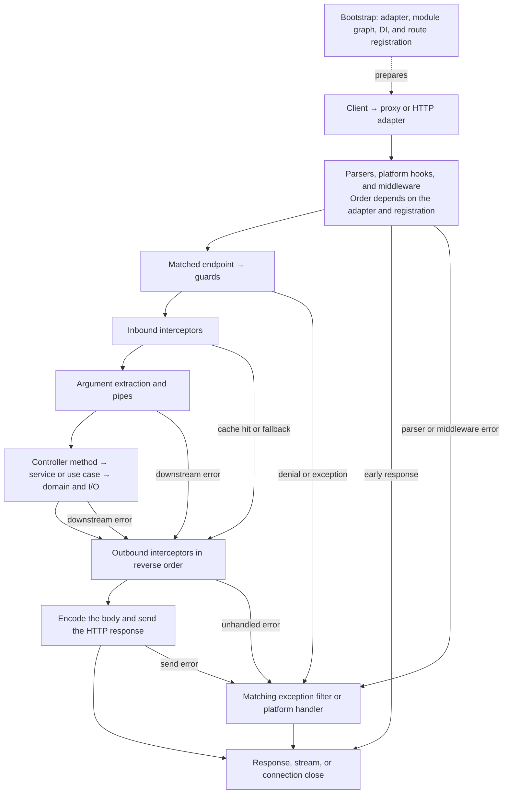

# NestJS Patterns and Concepts Registry

A practical map of NestJS capabilities in the order an application uses them. Each stage identifies extension points, built-in APIs, implementation choices, and ownership boundaries. The main path is an incoming HTTP request. GraphQL, WebSocket, RPC, queues, and other entry points use the same terminology so you can compare them with HTTP.

The APIs and implementation details were checked against NestJS **12.5.1**. Version- and adapter-specific behavior is marked where it matters. Integrations such as `@nestjs/graphql`, `@nestjs/cqrs`, and `@nestjs/schedule` are installed and versioned separately. [NestJS 12.5.1 release](https://github.com/nestjs/nest/releases/tag/v12.5.1) · [Documentation](https://docs.nestjs.com/) · [Migration guide](https://docs.nestjs.com/migration-guide)

Detailed pattern entries and examples follow the overview of each stage. The final section includes primary sources, architecture repository walkthroughs, and static analysis tools.

## Table of Contents

| Stage | What to look for |
| --- | --- |
| [HTTP Request Map](#http-request-map) | Success, early termination, exceptions, precedence, and scopes |
| [Application Design and Composition](#application-design-and-composition) | Modules, DI, providers, configuration, bootstrap, and hooks |
| [Ingress and Routing](#ingress-and-routing) | HTTP adapters, protocol, parsers, routing, versioning, and context |
| [Middleware](#middleware) | Early processing, registration, termination, and adapter integration |
| [Guards](#guards) | Authentication, authorization, throttling, and check order |
| [Interceptors](#interceptors) | Inbound and outbound processing, RxJS, caching, observability, and multipart |
| [Arguments and Pipes](#arguments-and-pipes) | Parameter decorators, all built-in pipes, DTOs, and schema validation |
| [Handler and Business Layer](#handler-and-business-layer) | Controllers, use cases, the domain, databases, transactions, and external effects |
| [Successful Response](#successful-response) | Automatic and manual replies, serialization, streaming, and SSE |
| [Errors and Exception Filters](#errors-and-exception-filters) | Error mapping, scopes, exception types, and failures by stage |
| [Transport Variants](#transport-variants) | GraphQL, WebSocket, microservices, queues, cron, events, CLI, and MCP |
| [Testing and Operations](#testing-and-operations) | Route verification, logs, metrics, readiness, and shutdown |
| [End-to-End Example](#end-to-end-example) | An endpoint with middleware, a guard, an interceptor, pipes, a service, and a filter |
| [Sources and Topical Index](#sources-and-topical-index) | Tagged source code, topical references, and the material catalog |

## HTTP Request Map



`AppModule` wires dependencies at startup. The **controller method** executes for the request and calls its providers. See [Errors and Exception Filters](#errors-and-exception-filters) for early denials and failures after headers have been sent. [Request lifecycle](https://docs.nestjs.com/faq/request-lifecycle) · [HTTP execution context source](https://github.com/nestjs/nest/blob/v12.5.1/packages/core/router/router-execution-context.ts)

### Scopes and Execution Order

| Mechanism | Where to register it | Order and termination |
| --- | --- | --- |
| Middleware | `app.use()`, `MiddlewareConsumer`, adapter API | Global middleware followed by applicable module middleware, subject to the actual registration order. A function calls `next()`, ends the response, or passes on an error. |
| Guards | `APP_GUARD`, `app.useGlobalGuards()`, `@UseGuards()` on the controller or method | Global → controller → method. The first denial stops the route. |
| Interceptors | `APP_INTERCEPTOR`, `app.useGlobalInterceptors()`, `@UseInterceptors()` | Inbound order is global → controller → method. Outbound results and downstream errors unwind through the nested interceptors in reverse order. |
| Pipes | `APP_PIPE`, `app.useGlobalPipes()`, `@UsePipes()`, decorator argument | For a given argument, global → controller → method → parameter pipes. [Parallel argument pipelines](#built-in-and-custom-pipes). |
| Exception filters | `APP_FILTER`, `app.useGlobalFilters()`, `@UseFilters()` | Method → controller → global → default handler if nothing matches. The selected filter handles the error. |
| Metadata | `@SetMetadata()`, `Reflector.createDecorator()`, `applyDecorators()` for decorator composition | Declares metadata. A guard, interceptor, adapter, or other consumer reads it to apply behavior. |

When order matters, list components at the same scope in a single decorator call. Register global `APP_*` providers to let Nest resolve their dependencies. `app.useGlobal*()` takes instances. You can retrieve a static provider instance using `app.get()`. See [Transport Variants](#transport-variants) for transport-specific global registration rules. [Execution context](https://docs.nestjs.com/fundamentals/execution-context) · [Request lifecycle](https://docs.nestjs.com/faq/request-lifecycle)

### Troubleshooting by Stage

| Symptom | What to check first |
| --- | --- |
| Handler never runs | Path, method, and version, an early proxy or middleware response, guard denial, cache hit, or pipe failure. |
| The guard sees `req.body`, but its values are still raw | [Parsing and validation order](#guards). Multipart files usually become available after the [upload interceptor](#file-uploads). |
| The interceptor has finished and the client is still receiving data | [Response lifecycle and transport hooks](#shaping-the-output-contract). |
| A method-level filter misses malformed JSON | [Parser errors and global filters](#failure-boundaries). |
| A value is available through `ExecutionContext` | Identify the transport and adapter. Use `switchToHttp()` for HTTP, `switchToRpc()` for RPC, `switchToWs()` for WebSocket, and `GqlExecutionContext.create()` for GraphQL. |

### Patterns Behind the Mechanisms

| Concept | How it appears in NestJS |
| --- | --- |
| Chain of Responsibility | Middleware passes the request through `next()`. Guards allow or stop it in sequence. Filters select a handler by error type. Each mechanism has its own handoff contract. |
| Interceptor, AOP, Decorator | An interceptor wraps execution and its result. A decorator records metadata used to attach the behavior. Cross-cutting concerns stay near the transport boundary. |
| Pipeline | Pipes apply a sequence of transformations and checks to an input argument. |
| Strategy, Factory, Adapter | DI selects an implementation behind a token, a factory builds it, and an adapter translates an external protocol into the application's contract. |
| Facade, Ports & Adapters, DDD | A feature module's public API hides its internal services. The use case calls ports, and the domain model owns the rules. |
| Repository, Unit of Work, CQRS | A repository manages access to state, a Unit of Work coordinates a transaction, and CQRS separates write and read responsibilities. |
| Observer, Pub/Sub, Saga | Subscribers react to events. A saga coordinates related asynchronous steps and compensation when needed. |

### Separation of Request Stages

**When to use.** Use middleware for early context, guards for access, pipes for argument parsing and validation, interceptors for wrapping execution, and filters for mapping unhandled errors. Keep business decisions in the use case.

**When it is overkill.** A single invariant check in a use case can stay there without a custom decorator or global wrapper.

**Good example.** A guard checks the principal, `ParseUUIDPipe` parses the incoming identifier, the use case checks access to the requested order, and an interceptor times the call.

**Bad example.** A guard assumes the global `ValidationPipe` has already transformed and cleaned `request.body`. An interceptor catches every error and returns a success status.

**What to verify.** Check ownership against the [registration order and scopes](#scopes-and-execution-order). Transport checks, business rules, and error mapping each have a clear owner. [Request lifecycle](https://docs.nestjs.com/faq/request-lifecycle) · [Guards](https://docs.nestjs.com/guards) · [Interceptors](https://docs.nestjs.com/interceptors)

## Application Design and Composition

### Modules and Providers

| Tool or concept | What it does and when to choose it |
| --- | --- |
| `@Module({ imports, controllers, providers, exports })` | Defines the component graph. A feature module owns a capability and exports public providers. Consumers import the module that owns the exported provider. |
| Root `AppModule` and feature/shared/core modules | The root module assembles the graph. A feature module groups a business capability. Shared and core modules are project conventions for common contracts and infrastructure. |
| `@Global()` and `global: true` | Make a module's exports globally available after registration. Use them for cross-cutting infrastructure with clear configuration. |
| `DynamicModule`, `ConfigurableModuleBuilder` | Conditional composition and named connections. The builder declares the options type and generates registration methods. Names such as `register`, `forRoot`, `forFeature`, and their `Async` variants are conventions of the particular API. |
| `@Injectable()`, constructor injection, `@Inject()`, `@Optional()` | Inject through a class token or explicit symbol/string token. Property injection is supported. Constructor injection makes dependencies visible. A TypeScript interface needs a runtime token. |
| `useClass` | Select an implementation class for a token. Separate registrations of the same class can create separate instances. |
| `useValue` | Provide an existing value, options object, test double, or external client with an established owner. |
| `useFactory`, `inject` | Create a provider from dependencies. A factory can return a Promise, and Nest waits for it before creating a dependent provider. |
| `useExisting` | Alias an existing token. Both tokens can refer to the same singleton object. |
| `Scope.DEFAULT`, `REQUEST`, `TRANSIENT` | [Provider lifetimes and scope propagation](#provider-lifetimes). |
| `REQUEST`, `INQUIRER`, `ContextIdFactory` | Retrieve the request, information about the injecting consumer, or the DI context ID. A manually created context supports `registerRequestByContextId()`. Durable providers and custom context-selection strategies cover specialized cases. |
| `ModuleRef.get()`, `resolve()`, `create()` | Retrieve a static provider, resolve a scoped provider in context, or instantiate a class through DI. Constructor injection is simpler for a permanent dependency. |
| `forwardRef()` | Defer a reference until the container resolves it. [When it helps and how to remove a cycle](#resolving-circular-dependencies). |
| `DiscoveryModule`/`DiscoveryService`, `Reflector`, `LazyModuleLoader` | Discover providers by metadata, read metadata, or load a module on demand. Lazy loading has limitations for routes, lifecycle hooks, and transport entry points. |

[NestJS Modules](https://docs.nestjs.com/modules) · [Custom providers](https://docs.nestjs.com/fundamentals/custom-providers) · [Dynamic modules](https://docs.nestjs.com/fundamentals/dynamic-modules) · [Async providers](https://docs.nestjs.com/fundamentals/async-providers) · [Injection scopes](https://docs.nestjs.com/fundamentals/injection-scopes) · [ModuleRef](https://docs.nestjs.com/fundamentals/module-ref) · [Circular dependency](https://docs.nestjs.com/fundamentals/circular-dependency) · [Discovery service](https://docs.nestjs.com/fundamentals/discovery-service) · [Lazy-loading modules](https://docs.nestjs.com/fundamentals/lazy-loading-modules)

### Bootstrap, Configuration, and Hooks

| Step | Options |
| --- | --- |
| Create the project | Nest CLI `nest new`, generators for modules/controllers/services/resources, standard or monorepo workspaces, and libraries. ESM/CJS and compiler choices affect runtime metadata. |
| Create the runtime | `NestFactory.create()` for HTTP, `createMicroservice()` for a specific transport, and `createApplicationContext()` for a DI context without a network listener. `connectMicroservice()` creates a hybrid application. |
| Read configuration | `@nestjs/config`, `ConfigModule.forRoot()`, `ConfigService`, `registerAs()`, `forFeature()`, a configuration factory, and `validate`/`validationSchema`. [Startup configuration checks](#startup-configuration). |
| Register the adapter and common policies | Parser limits, prefix, versioning, cookies/CORS/CSRF, logger, global guards/pipes/interceptors/filters, static assets, WebSocket adapter, and OpenAPI. Configure them before `app.init()` or `listen()` as required by the API. |
| Initialize | `app.init()` registers the application and router and runs initialization hooks. `listen()` initializes the HTTP application if needed and starts accepting connections. `startAllMicroservices()` starts the attached transports. |
| Prepare services | `OnModuleInit.onModuleInit()` runs after the module's dependencies have resolved. `OnApplicationBootstrap.onApplicationBootstrap()` runs after module initialization and before HTTP listen. Async hooks can delay readiness. |
| Release resources | [Shutdown hook order and process shutdown](#lifecycle-and-graceful-shutdown). |

[CLI](https://docs.nestjs.com/cli/overview) · [Configuration](https://docs.nestjs.com/application/configuration) · [Lifecycle events](https://docs.nestjs.com/fundamentals/lifecycle-events) · [Standalone applications](https://docs.nestjs.com/standalone-applications) · [Hybrid application](https://docs.nestjs.com/faq/hybrid-application)

**Patterns in this stage.** [Feature Module](#feature-module) · [Public Module API](#public-module-api) · [Modular Monolith](#modular-monolith) · [Provider Tokens and Bindings](#provider-tokens-and-bindings) · [Configurable Module](#configurable-module) · [Strategy and Factory](#strategy-and-factory) · [Provider Lifetimes](#provider-lifetimes) · [Resolving Circular Dependencies](#resolving-circular-dependencies) · [Reflection and Dynamic Discovery](#reflection-and-dynamic-discovery) · [Startup Configuration](#startup-configuration)

### Feature Module

**When to use.** Capabilities have different rules, data owners, or rates of change. Group code around Orders, Payments, and Shipping. Choose layers within each capability according to its complexity.

**When it is overkill.** A small capability may need only a controller, service, and model. Add packages or layers as distinct contracts emerge.

**Good example.** `orders/` contains `OrdersModule`, its controller, use cases, and data access. Adding order cancellation affects the Orders capability and its public contract.

**Bad example.** Controllers, DTOs, services, and ORM models for every feature live in shared root directories. Each change requires tracing imports to find the owner of the business rule.

**What to verify.** You can trace the request path and the capability's invariants from its module. The monorepo CLI builds multiple applications and libraries. Domains define their boundaries through their own APIs. [NestJS Modules](https://docs.nestjs.com/modules) · [NestJS CLI monorepo](https://docs.nestjs.com/cli/monorepo) · [Encore](https://encore.dev/articles/nestjs-project-structure-best-practices#which-folder-structures-work-in-nestjs)

### Public Module API

**When to use.** A consumer needs an operation owned by another module. Export a narrow application service, facade, or token. Add its owning module to `imports`.

**When it is overkill.** An isolated capability can leave `exports` empty. Truly shared bootstrap infrastructure can use deliberate global registration.

**Good example.**

```ts
@Module({
  providers: [OrdersFacade, OrdersStore],
  exports: [OrdersFacade],
})
class OrdersModule {}

@Module({
  imports: [OrdersModule],
  providers: [InvoicesService],
})
class InvoicesModule {}
```

**Bad example.** `InvoicesModule` registers `OrdersStore` again.

```ts
@Module({ providers: [OrdersStore, InvoicesService] })
class InvoicesModule {}
```

A common `SharedModule` that re-exports stores also obscures ownership and data dependencies.

**What to verify.** The owner controls changes to state. Registering a class in two modules can create separate instances. `@Global()` hides the dependency from the consumer's imports. Check TypeScript imports separately because Nest `exports` controls DI visibility. [NestJS Modules](https://docs.nestjs.com/modules) · [Common Errors](https://docs.nestjs.com/faq/common-errors) · [NestJS Doctor](https://www.nestjs.doctor/docs/rules/architecture#require-module-boundaries) · [Expona](https://expona.dev/blog/common-nestjs-anti-patterns#one-sharedmodule-importing-everything)

### Modular Monolith

**When to use.** You need independent business boundaries with one operational deployment. Each module owns its API, data, and dependency direction. Components can share a process and database under agreed access rules.

**When it is overkill.** A small application may need only a few feature modules and direct calls through their APIs. Distribution is justified by separate deployment, scaling, or failure isolation.

**Good example.** Payment and Order own their respective state transitions. An explicit coordinator or typed event handles the consequences of a completed payment. Use an [outbox](#transactional-outbox) when delivery must survive independent failures.

**Bad example.** Modules have separate folders and write directly to each other's tables. The team assumes its in-process bus guarantees delivery after restart.

**What to verify.** The code makes the commit boundary and side effects visible. Sebastian Iwanczyszyn's project illustrates the pattern as a teaching example. The index describes its specific limitations. [Modular Monolith README and source](#architecture-repositories) · [NestJS Modules](https://docs.nestjs.com/modules)

### Provider Tokens and Bindings

**When to use.** A dependency has multiple adapters, needs configuration at composition time, or must be replaceable at a test boundary.

**When it is overkill.** Use the class itself as a token for a single internal service. Introduce an interface and a runtime token where an independent boundary is useful.

**Good example.**

```ts
const ORDER_STORE = Symbol('ORDER_STORE');

@Injectable()
class OrdersService {
  constructor(@Inject(ORDER_STORE) private readonly store: OrderStore) {}
}

@Module({
  providers: [
    PgOrderStore,
    { provide: ORDER_STORE, useExisting: PgOrderStore },
    OrdersService,
  ],
})
class OrdersModule {}
```

**Bad example.** Nest tries to resolve a dependency without a runtime token for its TypeScript interface.

```ts
@Injectable()
class OrdersService {
  constructor(private readonly store: OrderStore) {}
}
```

Constructing the provider manually inside a use case also bypasses the Nest dependency graph.

**What to verify.** Import the same `Symbol` token from its declaration. Choose a binding from the [provider table](#modules-and-providers). [Custom providers](https://docs.nestjs.com/fundamentals/custom-providers) · [Common Errors](https://docs.nestjs.com/faq/common-errors) · [NestJS Doctor](https://www.nestjs.doctor/docs/rules/architecture#no-manual-instantiation)

### Configurable Module

**When to use.** A package needs different settings in different registrations, or its configuration depends on asynchronous infrastructure.

**When it is overkill.** A single local connection can use a static module with `useFactory` and the existing application configuration.

**Good example.**

```ts
imports: [
  SearchModule.registerAsync({
    imports: [ConfigModule],
    inject: [ConfigService],
    useFactory: (config: ConfigService) => ({
      url: config.getOrThrow<string>('SEARCH_URL'),
    }),
  }),
]
```

**Bad example.** A reusable client reads `process.env` at import time. Two differently named connections use the same token and share state.

**What to verify.** The dynamic module returns registration metadata. Use distinct tokens and clear resource ownership for multiple named clients. [Dynamic modules](https://docs.nestjs.com/fundamentals/dynamic-modules) · [Asynchronous providers](https://docs.nestjs.com/fundamentals/async-providers)

### Strategy and Factory

**When to use.** One operation has several implementations, such as delivery by email or push notification. Select the strategy at composition time or for each call.

**When it is overkill.** Use the existing function when there is a single implementation. A short local branch can use a direct conditional.

**Good example.** When the delivery provider is selected at startup, a DI factory returns an implementation behind one token. When the channel depends on input, the use case receives a strategy map and validates the key before calling it.

```ts
const sender = this.senders.get(command.channel);
if (!sender) throw new UnsupportedChannel(command.channel);
await sender.send(command.message);
```

**Bad example.** Every controller and worker checks the channel independently, creates its own SDK client, and duplicates inconsistent selection rules.

**What to verify.** One place owns strategy selection. Each implementation can be tested separately, and unsupported channels are handled before side effects occur. [NestJS Custom providers](https://docs.nestjs.com/fundamentals/custom-providers) · [Strategy pattern example](https://nestjs.io/tutorials/implementing-the-strategy-pattern-in-nestjs-d908a6b8)

### Provider Lifetimes

**When to use.** `DEFAULT` shares an instance within its registration. `TRANSIENT` suits dependencies that need one instance per injecting consumer. `REQUEST` suits dependencies whose instance and data belong to a request context.

**When it is overkill.** Pass a few fields as arguments. For log correlation, consider AsyncLocalStorage if the fields would otherwise pass through every intermediate call.

**Good example.** A stateless `OrdersService` takes `actorId` as an argument. A shared database client reuses its pool. Change the scope of a component when instance isolation has a concrete purpose.

**Bad example.** A singleton assigns `this.currentUser = request.user`. A second operation can replace the field while the first is awaiting a result. Another mistake is making a common dependency request-scoped throughout the application to carry one field.

**What to verify.** `REQUEST` scope propagates up to consumers. A consumer of a `TRANSIENT` provider keeps its own scope. Application lifecycle hooks are skipped for request-scoped classes. Check restrictions for gateways, schedulers, and other long-lived components. [Injection scopes](https://docs.nestjs.com/fundamentals/injection-scopes) · [Lifecycle events](https://docs.nestjs.com/fundamentals/lifecycle-events) · [Expona](https://expona.dev/blog/common-nestjs-anti-patterns#request-scoped-providers-everywhere)

### Resolving Circular Dependencies

**When to use.** Dependencies form a cycle in the module graph, constructor graph, or ordinary TypeScript imports. Identify which graph contains the cycle first.

**When it is overkill.** A direct import is enough when one `index.ts` creates the cycle. If two modules need a shared immutable type, move it to a location with the correct dependency direction.

**Good example.** A checkout coordinator calls the public operations of Orders and Payments. The corresponding owners still record payments and change order state.

**Bad example.** Orders imports Payments and Payments imports Orders. Both providers call each other from their constructors and depend on a particular creation order.

**What to verify.** `forwardRef()` helps the container resolve a known circular reference. Provider creation order in a cycle remains indeterminate. `ModuleRef.resolve()` and context IDs support targeted resolution of scoped providers. Register the `REQUEST` provider separately if your custom context needs it. Use a coordinator, a separate contract, or an event with explicit guarantees to change dependency direction durably. [Circular dependency](https://docs.nestjs.com/fundamentals/circular-dependency) · [Module reference](https://docs.nestjs.com/fundamentals/module-ref) · [Trilon](https://trilon.io/blog/avoiding-circular-dependencies-in-nestjs) · [NestJS Doctor](https://www.nestjs.doctor/docs/rules/architecture#no-circular-module-deps)

### Reflection and Dynamic Discovery

**When to use.** An infrastructure module registers an extensible set of handlers, subscribers, or adapters by metadata. A metadata decorator and `Reflector` fit route policies.

**When it is overkill.** Use an explicit list or a factory for a few known handlers. Measure startup before introducing lazy loading for infrequently used modules.

**Good example.** `DiscoveryService` finds marked providers. Bootstrap validates that keys are unique and builds the registry. An API policy guard resolves precedence between method and class metadata with `getAllAndOverride`.

**Bad example.** Every request scans every provider. A business service calls `ModuleRef.get(..., { strict: false })` for dependencies that could come from its constructor.

**What to verify.** The registry is built predictably. Lazy-loaded modules are cached. Their lifecycle hooks have restrictions, and routes and transport handlers typically need to be available when the transport is configured. [Discovery service](https://docs.nestjs.com/fundamentals/discovery-service) · [Execution context](https://docs.nestjs.com/fundamentals/execution-context) · [Trilon Metadata Deep Dive](https://trilon.io/blog/nestjs-metadata-deep-dive) · [Lazy-loading modules](https://docs.nestjs.com/fundamentals/lazy-loading-modules) · [NestJS Doctor](https://www.nestjs.doctor/docs/rules/architecture#no-service-locator)

### Startup Configuration

**When to use.** Correct operation depends on addresses, secrets, timeouts, and environment settings. Validate required values at startup and convert them to the expected types. Give feature flags an owner, a safe default, and a removal date.

**When it is overkill.** A simple object can hold a few static settings. A multilayer flag system makes sense when it actually controls rollout.

**Good example.** Bootstrap validates `DATABASE_URL` and a numeric request budget. The feature module receives typed configuration, and the logger redacts secrets. Tests cover both states of a dynamic flag.

**Bad example.** A driver discovers incomplete configuration only on the first request. Each service instance reads `process.env` and applies its own default.

**What to verify.** Incomplete configuration produces clear diagnostics before accepting traffic. Secrets and settings have a defined rotation process. [Configuration](https://docs.nestjs.com/application/configuration) · [Encore](https://encore.dev/articles/nestjs-project-structure-best-practices#how-should-you-handle-configuration) · [Wanago on configuration and deployment](#operations-and-performance)

## Ingress and Routing

| Layer | Tools and choices |
| --- | --- |
| External boundary | Reverse proxy, load balancer, API gateway, TLS termination, and request size and time limits. Configure proxy trust and sources of forwarded headers for the actual topology. |
| Express | `ExpressAdapter`, Express routes and middleware, `Request`/`Response`, and native Express capabilities. Express is the NestJS 12 default for a plain `NestFactory.create()` call. |
| Fastify | `FastifyAdapter`, Fastify `register()` and hooks, native request/reply objects, and plugins. `@RouteConfig()`, `@RouteConstraints()`, and `@RouteSchema()` pass options to the Fastify router. |
| Node | `NodeAdapter` from `@nestjs/platform-node` is available starting with 12.3. It runs on `node:http` and provides several Express-style methods. Check the adapter documentation for middleware, parsing, ETag, and file response support. |
| Custom adapter | Implement `HttpServer`/`AbstractHttpAdapter` if the built-in adapters are unsuitable. `app.getHttpAdapter()` and `HttpAdapterHost` provide access to the platform. `getHttpServer()` returns the Node server. |
| Body parsing | JSON and URL-encoded bodies use registered parsers. Use `useBodyParser()` for supported types and limits, or `bodyParser: false` to configure parsing yourself. `rawBody: true` retains the original bytes when the parser is enabled, for example for webhook signature verification. |
| Codecs and other input | For multipart, see [file uploads](#file-uploads). Configure an explicit content type, parser, and limit for text, binary, and custom content. Stream large files. |
| Path matching | `@Controller()` with `@RequestMapping()` or an HTTP method decorator. Static segments, parameters, wildcards, and host routing depend on adapter support. `RouterModule.register()` sets module prefixes. `setGlobalPrefix()` supports exclusions. |
| HTTP methods | `@Get`, `@Post`, `@Put`, `@Patch`, `@Delete`, `@Options`, `@Head`, and `@All`. The 12.5.1 API also includes `@Search`, `@QueryMethod`, `@Propfind`, `@Proppatch`, `@Mkcol`, `@Copy`, `@Move`, `@Lock`, and `@Unlock`. Check method support in the adapter and proxy. `@Query()` extracts query string values. |
| Versioning | `enableVersioning()` with `URI`, `HEADER`, `MEDIA_TYPE`, or `CUSTOM`. Configure `@Version()`, controller version, default version, or `VERSION_NEUTRAL`. Version participates in route selection. |
| Route conflicts | v12 supports `routeConflictPolicy` for duplicate or shadowed routes and `routeResolutionStrategy` for declaration order or specificity. Test a literal route alongside a dynamic `:id` on the actual adapter. |
| Request context | Use middleware or a hook for request IDs and `REQUEST` for DI. [Correlation and context propagation](#execution-context). |
| Contract and documentation | `@nestjs/swagger`, `SwaggerModule.createDocument()`, decorators for parameters, responses, and security, CLI plugin, OpenAPI schemas, and examples. `@ApiProperty()` describes the schema. Configure runtime validation separately. |

[HTTP adapters](https://docs.nestjs.com/http/performance) · [Controllers](https://docs.nestjs.com/controllers) · [Global prefix](https://docs.nestjs.com/faq/global-prefix) · [Router module](https://docs.nestjs.com/recipes/router-module) · [Versioning](https://docs.nestjs.com/http/versioning) · [Raw body](https://docs.nestjs.com/faq/raw-body) · [Async Local Storage](https://docs.nestjs.com/recipes/async-local-storage) · [OpenAPI](https://docs.nestjs.com/openapi/introduction) · [Application options v12.5.1](https://github.com/nestjs/nest/blob/v12.5.1/packages/common/interfaces/nest-application-options.interface.ts)

**Patterns in this stage.** [API Versioning and OpenAPI](#api-versioning-and-openapi) · [Execution Context](#execution-context)

### API Versioning and OpenAPI

**When to use.** The API has several independently released clients or needs a formal contract for SDK generation.

**When it is overkill.** A compatible optional field usually needs no new version. A TypeScript contract is enough for internal calls within one process.

**Good example.** `v1` and `v2` adapt different DTOs to one application use case. OpenAPI specifies precise error and response shapes, and integration tests exercise both versions. Choose mapped types from the API that supplies the relevant transport and runtime metadata.

**Bad example.** Add `@ApiProperty()` and assume the input field is validated. Duplicate business rules across versioned controllers and update only one implementation.

**What to verify.** Documentation, runtime behavior, and the generated contract agree. The older version has a defined support period. [Versioning](https://docs.nestjs.com/http/versioning) · [OpenAPI mapped types](https://docs.nestjs.com/openapi/mapped-types) · [Trilon Swagger](https://trilon.io/blog/nestjs-swagger-tips-tricks)

### Execution Context

**When to use.** A guard, interceptor, or decorator is used by multiple transports. Correlation context is needed deeper in the call stack, for example by a shared logger.

**When it is overkill.** A single HTTP handler can use the adapter API or an explicit argument. Keep the role, tenant, and transaction explicit wherever they affect business decisions.

**Good example.**

```ts
asyncLocalStorage.run({ requestId }, () => next());
```

Create a separate local context for each incoming worker message. In a Nest enhancer, `ExecutionContext` explicitly selects the HTTP, RPC, WebSocket, or GraphQL API.

**Bad example.** Store correlation data on a singleton or call `switchToHttp().getRequest()` across adapters, including RPC and GraphQL.

**What to verify.** Parallel operations receive independent identifiers. Propagate trace context across process boundaries using request or message headers. [Execution context](https://docs.nestjs.com/fundamentals/execution-context) · [AsyncLocalStorage](https://docs.nestjs.com/recipes/async-local-storage) · [GraphQL other features](https://docs.nestjs.com/graphql/other-features)

## Middleware

Middleware works with incoming request and response objects. It can call `next()`, send the response itself, or pass an error to the appropriate handler. `return next()` in middleware hands control to the network router. In an interceptor, `await next.handle()` gives you the Observable, so downstream execution still depends on subscription. [Middleware](https://docs.nestjs.com/middleware) · [Interceptors](https://docs.nestjs.com/interceptors)

| Form | How to use it |
| --- | --- |
| Function | `app.use(fn)` for a simple global policy or `consumer.apply(fn)` for selected routes. Fits lightweight logic that needs no DI. |
| Class | `@Injectable()` and `NestMiddleware.use(req, res, next)`. Register through `configure(consumer)` on a module that implements `NestModule`. Supports DI. |
| Group and scope | `consumer.apply(a, b).exclude(...).forRoutes(...)`. `forRoutes()` accepts controllers, paths, and `{ path, method }` objects. Determine precedence between global and module registrations from the actual bootstrap. |
| Platform hooks | Express middleware and four-argument error middleware, Fastify hooks such as `onRequest`, `preValidation`, `preHandler`, and `onResponse`, and NodeAdapter middleware. In Fastify, legacy middleware receives raw requests, while hooks receive Fastify request/reply objects. |
| HTTP security | `enableCors()`, `useSecurityHeaders()`, and `enableCsrfProtection()` in supported releases, or adapter-specific security plugins. CSRF protection depends on the credential type. CORS defines browser policy. Authentication and authorization have their own stages. |
| Cookies and sessions | The `cookies` option and `@Cookies()`/`@SignedCookies()` in v12. Choose session middleware or a plugin, a session store, and cookie options. Behind a load balancer, account for the shared session store and proxy. |
| HTTP infrastructure | Request IDs and ALS, client IP, access logs, early maintenance response, static files, and compression. Observe actual bytes, status, and disconnects at the transport level. |

**How to choose.** Use a guard or interceptor for logic that depends on controller metadata such as `@Roles()`. Use a pipe to normalize a specific argument. If middleware reads `body`, check parser registration. An early `app.use()` registration can run before the standard body parser. [Middleware](https://docs.nestjs.com/middleware) · [Security headers](https://docs.nestjs.com/security/helmet) · [CORS](https://docs.nestjs.com/security/cors) · [CSRF](https://docs.nestjs.com/security/csrf) · [Cookies](https://docs.nestjs.com/http/cookies) · [Session](https://docs.nestjs.com/http/session) · [HTTP compression](https://docs.nestjs.com/http/compression) · [Bootstrap source](https://github.com/nestjs/nest/blob/v12.5.1/packages/core/nest-application.ts)

### HTTP Boundary Security

**When to use.** For a browser API, define CORS and cookie policies, CSRF protection for credentials the browser sends automatically, and security headers. Set rate and request size limits for expensive or public operations.

**When it is overkill.** An API without browser clients may have no need for CORS. An existing gateway can own rate limiting if it receives a trusted limit key and covers the required routes.

**Good example.** Set `Secure`, `HttpOnly`, and `SameSite` deliberately on the session cookie. List allowed origins explicitly. Share rate-limit storage across replicas when the limit is service-wide. Trust forwarded data only from your proxy and test the resulting rate-limit key.

**Bad example.** Treat CORS as an authorization check. Each replica counts requests in local memory even though the API promises a single service-wide limit.

**What to verify.** Test on the deployed topology with a proxy, TLS, and multiple instances. Cookie policy matches the browser flow. [CORS](https://docs.nestjs.com/security/cors) · [CSRF](https://docs.nestjs.com/security/csrf) · [Helmet](https://docs.nestjs.com/security/helmet) · [Rate limiting](https://docs.nestjs.com/security/rate-limiting) · [Sessions](https://docs.nestjs.com/http/session)

## Guards

`CanActivate.canActivate(context)` returns `boolean`, `Promise<boolean>`, or `Observable<boolean>`. Nest checks guards in order and stops on denial. In HTTP, `false` yields `403 Forbidden`. A guard can throw `UnauthorizedException` when authentication is missing, or another suitable exception for its policy. [Guards](https://docs.nestjs.com/guards) · [GuardsConsumer](https://github.com/nestjs/nest/blob/v12.5.1/packages/core/guards/guards-consumer.ts)

| Purpose | Tools and options |
| --- | --- |
| Authentication | A custom `AuthGuard` backed by an authentication service, `@nestjs/passport` with `AuthGuard('jwt')` or another strategy, session validation, an API key, or identity from a trusted gateway. The authentication guard typically supplies the principal for later stages. |
| Protected by default | `APP_GUARD` and an explicit `@Public()` decorator based on `Reflector.createDecorator()` or `SetMetadata()`. The guard reads policy from the method or class. |
| Roles, permissions, claims, and attributes | `@Roles()`/`@Permissions()`, RBAC, claims-based access, or an attribute-based policy (ABAC). `Reflector.get()` reads one target, `getAllAndOverride()` selects the first defined value, and `getAllAndMerge()` combines values. |
| Resource checks | Ownership, tenant, and state. [Use-case checks and SQL predicates](#authentication-and-authorization). |
| Throttling | `ThrottlerModule`, `ThrottlerGuard`, `@Throttle()`, and `@SkipThrottle()` from `@nestjs/throttler`. Choose an IP, principal, or tenant key and storage that can enforce the limit across replicas. Gateway rate limiting protects an earlier boundary. |
| Precedence and composition | Establish context and authentication first, then run checks that require a principal. Use `applyDecorators()` and a mixin or factory for groups of routes while keeping guard order easy to follow. |
| Transport | `ExecutionContext.getHandler()`, `getClass()`, `getType()`, and transport switching. Sharing a policy across HTTP, GraphQL, and WebSocket requires a common principal format and transport-specific extraction. |

**Boundary case.** A guard can inspect parsed HTTP data before pipes have transformed or validated `@Param()` and `@Body()` values. Parse the identifier safely in the guard if needed, or enforce the access rule in the use case after the pipe. [Authentication](https://docs.nestjs.com/security/authentication) · [Passport](https://docs.nestjs.com/recipes/passport) · [Authorization](https://docs.nestjs.com/security/authorization) · [Rate limiting](https://docs.nestjs.com/security/rate-limiting) · [Execution context](https://docs.nestjs.com/fundamentals/execution-context)

### Authentication and Authorization

**When to use.** Authentication establishes identity. A guard can require a role or permission. For access to a specific object, verify the user's tenant membership and the object-level policy.

**When it is overkill.** A public route can omit access checks. A simple ownership rule can use a query predicate and a defined outcome when the row is missing.

**Good example.**

```ts
const order = await orders.findForTenant(orderId, principal.tenantId);
if (!order || !policy.canRead(principal, order)) throw new OrderUnavailable();
```

`principal` comes from a trusted authentication mechanism. Derive the tenant from that context. Define explicit expiration and revocation policies for user sessions, refresh tokens, and OAuth.

**Bad example.** A guard checks only for the presence of a token, and the service looks up the order by ID alone. An internal route uses the `tenantId` supplied directly by a form.

**What to verify.** Negative tests cover another tenant, another owner, and a missing role. Put checks shared by HTTP, RPC, and workers in the use case or a shared policy. When a check depends on row state, tie it to the SQL predicate or transaction. The public contract defines when to return `403` or `404`. [Authentication](https://docs.nestjs.com/security/authentication) · [Authorization](https://docs.nestjs.com/security/authorization) · [Passport](https://docs.nestjs.com/recipes/passport) · [Expona](https://expona.dev/blog/my-nestjs-code-review-checklist#authorization-guard-plus-permission-check-ownership-verified-for-resources)

## Interceptors

`NestInterceptor.intercept(context, next)` receives a `CallHandler`. `next.handle()` starts downstream processing through subsequent interceptors, argument processing, and the method. Interceptors can return an `Observable` or a Promise of one for asynchronous setup. Returning your own Observable without calling `next.handle()` skips downstream processing. [Interceptors](https://docs.nestjs.com/interceptors) · [InterceptorsConsumer](https://github.com/nestjs/nest/blob/v12.5.1/packages/core/interceptors/interceptors-consumer.ts)

| Task | Available tools |
| --- | --- |
| Wrap execution before and after | Run inbound work before `next.handle()`. `tap` observes values or errors, and `finalize` runs on completion, error, or unsubscribe. Measure HTTP response completion separately when timing full delivery. |
| Transform the result | Use `map` for a synchronous transformation and a suitable flattening operator for an asynchronous one. [Shaping the output contract](#shaping-the-output-contract). |
| Transform an error | `catchError` maps the error or supplies a safe fallback. To pass it on to a filter, rethrow with `throwError(() => error)`. Guard exceptions and send errors after the pipeline can fall outside this operator. |
| Return an early success | Use `of(value)` for a cache hit or fallback. `CacheInterceptor`, `@CacheKey()`, and `@CacheTTL()` come from `@nestjs/cache-manager`. [Keys, access, and invalidation](#cache-aside-and-conditional-requests). |
| Timeout and cancellation | Use RxJS `timeout()` or a policy from `@nestjs/resilience`. Unsubscribing and canceling an already-started Promise are separate operations. Propagate an `AbortSignal` to the driver when the I/O must stop. |
| Idempotency | Use `@nestjs/idempotency` or a [custom replay protocol](#idempotent-operations). For queues, see [event deduplication](#acknowledgments-and-retries). |
| Transaction | Usually belongs at the use-case or Unit of Work boundary. An interceptor fits when the entire wrapped operation is one transaction, the subscription finishes within it, and all repositories share its context. Long transactions around streams or network calls tie up resources. |
| Control downstream execution | Invoke downstream once per request unless the contract calls for a repeat. A blanket `retry()` around a mutation can resubscribe and repeat its side effect. |
| Multipart | The upload interceptor reads request parts before validation pipes. Then use `@UploadedFile()`/`@UploadedFiles()` and file validation. |

### File Uploads

| Variant | How to register it |
| --- | --- |
| One or more files | `FileInterceptor(field)` or `FilesInterceptor(field, maxCount)`. |
| Several named fields | `FileFieldsInterceptor([{ name, maxCount }])`. |
| Any file fields or text fields only | `AnyFilesInterceptor()` or `NoFilesInterceptor()`. Prefer an explicit form schema when allowed fields are known. |
| Express and NodeAdapter | `MulterModule.register()` or `registerAsync()` and the interceptors from the installed platform package. Configure storage, file limits, and cleanup rules. |
| Fastify | Use `MultipartModule` and the corresponding interceptors from `@nestjs/platform-fastify` in compatible releases, or the native `@fastify/multipart` plugin. The v12 documentation describes `FileStreamInterceptor` for streaming consumption. |
| Validate and process files | `ParseFilePipe`, `ParseFilePipeBuilder`, `MaxFileSizeValidator`, `FileTypeValidator`, or a custom `FileValidator`. Adapter limits restrict reading before the pipe runs. Verify missing files, limit violations, and interrupted transfers. |

[Caching](https://docs.nestjs.com/data/caching) · [Serialization](https://docs.nestjs.com/application/serialization) · [Idempotency keys](https://docs.nestjs.com/reliability/idempotency) · [Resilience](https://docs.nestjs.com/reliability/resilience) · [File upload and streaming](https://docs.nestjs.com/http/file-upload)

**Patterns in this stage.** [Files, Streams, and Webhooks](#files-streams-and-webhooks) · [Cache-Aside and Conditional Requests](#cache-aside-and-conditional-requests) · [Idempotent Operations](#idempotent-operations)

### Files, Streams, and Webhooks

**When to use.** File size calls for streaming, or an external system delivers signed events with retries.

**When it is overkill.** Small fixed payloads can use a normal response. A separate worker is useful for lengthy processing, traffic spikes, or retry requirements.

**Good example.** Limit upload size. Stream downloads with explicit cancellation and error handling. A webhook verifies the signature over the raw bytes, durably records the event with a unique source event ID, and acknowledges it after recording.

**Bad example.** Load each large file into memory. Verify a signature over reserialized JSON. Acknowledge a webhook before persisting it and rely on a background Promise in the same process.

**What to verify.** Test size limits, replay, disconnects, and different persistence outcomes. Multipart and raw body handling account for the actual Nest adapter. [File upload](https://docs.nestjs.com/http/file-upload) · [Streaming responses](https://docs.nestjs.com/http/streaming-responses) · [Raw body](https://docs.nestjs.com/faq/raw-body) · [Webhooks](https://docs.nestjs.com/http/webhooks)

### Cache-Aside and Conditional Requests

**When to use.** Measurements show repeated expensive reads. Acceptable staleness and key isolation are known. HTTP representations may benefit from an `ETag` and a conditional request.

**When it is overkill.** A cheap or rarely repeated request gains little from caching. For a hot SQL query, an index and a narrower result may be the first improvement.

**Good example.** `orders:tenantA:order42:v2` distinguishes the tenant and representation version. After commit, invalidation removes the key. The TTL bounds staleness if invalidation is missed. If a concurrent reader can repopulate the cache with an older value after deletion, use versioning or another explicit consistency strategy.

**Bad example.** Use one `/orders/42` key for different permissions and tenants. Invalidate before the transaction commits or rolls back and omit further coordination. Treat local caches on different replicas as consistent.

**What to verify.** Test misses, expiration, missed invalidation, and concurrent warm-up. The `ETag` identifies a specific representation, and the HTTP caching policy accounts for privacy. [NestJS Caching](https://docs.nestjs.com/data/caching) · [Wanago on caching and ETags](#http-and-public-contracts)

### Idempotent Operations

**When to use.** A client or broker retries an operation after an uncertain outcome. One logical request or event should change state only once.

**When it is overkill.** Naturally idempotent updates and simple reads often need no separate key. Check associated effects, including email and payment.

**Good example.** The store atomically reserves a key scoped to `(tenant, operation, key)` and saves a fingerprint of the significant fields and the result. A repeat with the same input returns the agreed result. A repeat with different input yields a conflict. When the effect is in one database, record the result and the business effect in one transaction. For an external payment, use the agreed provider idempotency key and reconcile uncertain outcomes.

**Bad example.** Two concurrent requests can both see a cache miss and proceed.

```ts
const cached = await cache.get(key);
if (cached !== undefined) return cached;

const receipt = await chargePayment();
await cache.set(key, receipt);
return receipt;
```

**What to verify.** Test concurrent replay, a mismatched payload, failure during processing, and behavior after TTL expiry. A Redis lock alone leaves the failure window after an external effect open without a recovery protocol. [NestJS Idempotency keys](https://docs.nestjs.com/reliability/idempotency) · [Interceptor example and its assumptions](https://nestjs.io/tutorials/implementing-idempotency-in-nestjs-with-an-interceptor-76f333c7)

## Arguments and Pipes

### Argument Extraction

| Decorator or API | Value source |
| --- | --- |
| `@Param()`, `@Param('id')` | URL parameters. Identifiers usually require parsing or validation. |
| `@Query()`, `@Query('limit')` | The query string after adapter parsing. Verify how arrays and nested keys are represented. |
| `@Body()`, `@Body('field')`, `@RawBody()` | The parsed body, one field, or the original bytes when raw body support is enabled. |
| `@Headers()`, `@Ip()`, `@HostParam()` | Headers, IP under the adapter's trust policy, and route host parameters. These argument types bypass built-in pipe application in HTTP v12.5.1. |
| `@Cookies()`, `@SignedCookies()`, `@Session()` | Cookies and the session. Configure signing for signed cookies and middleware or a plugin for sessions. `httpAdapter.setCookie()` and `clearCookie()` provide a common API for cookie writes in this release line. |
| `@UploadedFile()`, `@UploadedFiles()` | Files prepared by an upload interceptor or adapter plugin. |
| `@Req()`/`@Request()`, `@Res()`/`@Response()`, `@Next()` | Native request, response, and next objects. `@Res()`/`@Next()` changes response ownership. |
| `@SseSignal()` | An SSE client disconnect signal in current core, including during asynchronous handler setup. |
| `createParamDecorator()`, `@Bind()` | Define a custom extractor via `ExecutionContext` or bind parameter decorators. `@CurrentUser()` is one example. Configure `validateCustomDecorators` when a custom parameter needs class validation. |

[Controllers](https://docs.nestjs.com/controllers) · [Custom decorators](https://docs.nestjs.com/custom-decorators) · [HTTP parameter decorators](https://github.com/nestjs/nest/blob/v12.5.1/packages/common/decorators/http/route-params.decorator.ts) · [Pipe-eligible argument types](https://github.com/nestjs/nest/blob/v12.5.1/packages/core/router/router-execution-context.ts)

### Built-in and Custom Pipes

| Tool | Contract |
| --- | --- |
| `ParseIntPipe`, `ParseFloatPipe` | Parse numeric parameters. Check ranges, the safe integer limit, and business constraints separately. |
| `ParseBoolPipe` | Parses supported boolean input. [Example of choosing a conversion](#dtos-and-input-validation). |
| `ParseUUIDPipe` | Validates a UUID and can restrict its version. |
| `ParseEnumPipe` | Checks membership in an enum. |
| `ParseArrayPipe` | Parses or validates an array. With the relevant options it supports an element type and a string delimiter. |
| `ParseDatePipe` | Parses a date. For a strict format, such as an ISO timestamp with a timezone, use an explicit schema or a custom pipe. |
| `DefaultValuePipe` | Supplies a default before a required parse pipe. Individual parse pipes can have their own optional or default settings. Test missing input, the empty string, and `null` separately. |
| `ValidationPipe` | Class-based DTOs with `class-validator` and `class-transformer`. Options such as `transform`, `whitelist`, `forbidNonWhitelisted`, `exceptionFactory`, groups, `skipMissingProperties`, and conversion settings define the input contract. |
| `StandardSchemaValidationPipe` | In v12, accepts Standard Schema through metadata such as `@Body({ schema })`. Use a compatible schema from Zod, Valibot, or another provider. |
| `ParseFilePipe` | Validates a file or array of files. `ParseFilePipeBuilder` assembles size and type rules and error options. |
| `PipeTransform<T, R>` | Custom synchronous or asynchronous validation, normalization, or transformation. `ArgumentMetadata` contains the argument type, metatype, decorator data, and available schema. A pipe throws an exception when it rejects input. |
| Adapter validation | For example, Fastify AJV or `@RouteSchema()`. This can run before the Nest handler's guards and pipes. Coordinate error shape and ownership of the same contract. |
| Business-rule validation | The domain, a use case, or a database constraint. A pipe checks input. Enforce atomic and state-dependent rules inside the operation. |

Import decorated DTOs as runtime classes. Nested class-based DTOs generally use `@ValidateNested()` and `@Type()`. For arrays, account for validation of each element. Mapped types such as `PartialType`, `PickType`, `OmitType`, and `IntersectionType` express the shape. Use the OpenAPI or GraphQL package's variants so the respective metadata is included.

Each eligible argument runs through its own pipe chain. Asynchronous chains for separate arguments can overlap. Validate rules that depend on multiple fields against the full DTO or after argument extraction. Test missing fields, empty strings, unknown fields, and deeply nested values. [Pipes](https://docs.nestjs.com/pipes) · [Validation](https://docs.nestjs.com/application/validation) · [Built-in pipe exports](https://github.com/nestjs/nest/blob/v12.5.1/packages/common/pipes/index.ts) · [OpenAPI mapped types](https://docs.nestjs.com/openapi/mapped-types) · [GraphQL mapped types](https://docs.nestjs.com/graphql/mapped-types)

### DTOs and Input Validation

**When to use.** Validate data from HTTP, GraphQL, a queue, or another external entry point before using it.

**When it is overkill.** A built-in parse pipe can handle a single parameter. A typed internal call with an already validated argument can use that argument directly.

**Good example.**

```ts
class ListOrdersDto {
  @Type(() => Number)
  @IsInt()
  @Min(1)
  @Max(100)
  limit = 25;
}

app.useGlobalPipes(new ValidationPipe({
  transform: true,
  whitelist: true,
  forbidNonWhitelisted: true,
}));
```

Parse boolean input explicitly, for example with `ParseBoolPipe`. The string `'false'` is truthy when converted with `Boolean()`.

**Bad example.** Declare the input as a TypeScript interface and pass its entire value to the persistence layer.

```ts
@Post()
create(@Body() body: CreateOrderInput) {
  return this.orders.insert(body);
}
```

An interface is erased at runtime. Define the allowed input fields explicitly.

**What to verify.** A test observes the response to invalid input. `whitelist` uses validation metadata. Account for backward compatibility when setting global options. [NestJS Validation](https://docs.nestjs.com/application/validation) · [Wanago #4](https://wanago.io/2020/06/01/api-nestjs-error-handling-validation/) · [Expona](https://expona.dev/blog/my-nestjs-code-review-checklist)

## Handler and Business Layer

| Task | Options and trade-offs |
| --- | --- |
| Transport handler | The `@Controller()` route method receives prepared arguments, maps DTOs to commands, calls a service, and shapes the output. Reuse one use case across HTTP, GraphQL, workers, and RPC when they perform the same business operation. |
| Application logic | Use a service or a few domain-specific methods for CRUD. For complex orchestration, use an application use case, workflow, or command handler. `@Injectable()` connects the service to the DI graph. |
| Application logic | A service for CRUD. [A use case or command handler for orchestration](#domain-services-and-use-cases). |
| Business rules | A function, domain service, entity, value object, or [aggregate for a shared invariant](#aggregates-and-value-objects). |
| Architectural boundary | A feature module, [modular monolith](#modular-monolith), or [Ports and Adapters or Clean Architecture](#ports-and-adapters). |
| Transactions | Set the boundary at the use case and share a transactional manager or client. A Unit of Work coordinates multiple repositories. Include all atomic writes, such as an aggregate and outbox row, in that transaction. |
| Transactions | [Use-case boundary and Unit of Work](#use-case-transaction-boundaries). Use an [outbox](#transactional-outbox) to atomically persist the intent to publish. |
| Concurrency | [Database constraints, atomic SQL, and locks](#concurrent-updates-and-constraints). For schedulers, see [leases and fencing](#scheduling-and-distributed-locks). |
| Reads and caching | [Projections and pagination](#bounded-result-sets), [cache-aside](#cache-aside-and-conditional-requests), and [GraphQL DataLoader](#graphql-and-real-time-delivery). |
| External HTTP calls | Fetch, `@nestjs/http-client`, `@nestjs/axios`, or an SDK behind a port. Choose deadlines, cancellation, retries with backoff and jitter, circuit breakers, bulkheads, and fallbacks based on the outcome and whether repeating the operation is safe. |
| External HTTP calls | Fetch, `@nestjs/http-client`, `@nestjs/axios`, or an SDK behind a port. [Time budgets, retries, and failure isolation](#resilient-calls-to-external-services). |
| Long-running operation | A durable workflow, saga with compensation, or orchestrator. Recover steps, deadlines, retries, and state according to the chosen contract. A queue is usually enough for one step. |
| Long-running operation | A [durable workflow or saga](#sagas-and-durable-workflows) for recovering a multistep operation. A [queue](#queues-and-cpu-isolation) is usually enough for one step. |
[Providers](https://docs.nestjs.com/providers) · [Data overview](https://docs.nestjs.com/data/overview) · [CQRS](https://docs.nestjs.com/recipes/cqrs) · [HTTP client](https://docs.nestjs.com/application/http-client) · [Caching](https://docs.nestjs.com/data/caching) · [Outbox](https://docs.nestjs.com/reliability/outbox) · [Durable workflows](https://docs.nestjs.com/reliability/workflows) · [Distributed locks](https://docs.nestjs.com/reliability/locks)

**Patterns in this stage.** [Ports and Adapters](#ports-and-adapters) · [Aggregates and Value Objects](#aggregates-and-value-objects) · [Domain Services and Use Cases](#domain-services-and-use-cases) · [Introducing CQRS Incrementally](#introducing-cqrs-incrementally) · [Use-Case Transaction Boundaries](#use-case-transaction-boundaries) · [Concurrent Updates and Constraints](#concurrent-updates-and-constraints) · [Transactional outbox](#transactional-outbox) · [Bounded Result Sets](#bounded-result-sets) · [Data Modeling, Migrations, and Soft Deletes](#data-modeling-migrations-and-soft-deletes) · [Resilient Calls to External Services](#resilient-calls-to-external-services)

### Ports and Adapters

**When to use.** A use case with business rules must work through multiple entry points or depend on infrastructure that can change. The inner layer declares the operations it needs. Infrastructure implements them, and the Nest module wires the components together.

**When it is overkill.** Simple CRUD can call the built-in ORM service within the feature module. Extract a port around behavior you need to control or change.

**Good example.** `ConfirmOrder` depends on `OrderRepository` to load and save orders. A TypeORM adapter maps rows to the domain model. The controller calls the use case and maps the result to an HTTP DTO.

**Bad example.** A use case accepts `QueryBuilder`, `Request`, and `Response`, and the domain model creates an `HttpException` for a business error.

**What to verify.** The port's owner needs only domain types. The DTO, domain object, and ORM record can evolve independently. If their shapes coincide and the use case is simple, separate classes become useful once their contracts diverge. [DDD Cookbook, infrastructure](https://github.com/adrian-d-hidalgo/nestjs-ddd-cookbook/blob/c80422198451bde8f0392608e8d2a39fc875f1c0/05-infrastructure-layer.md) · [Clean Architecture Example](https://github.com/gbourgeat/nestjs-ddd-clean-architecture-example/blob/a108ade60b22abb4f7f553f875a3343dca956b00/docs/architecture/clean-architecture.md) · [Encore](https://encore.dev/articles/nestjs-project-structure-best-practices#how-should-you-separate-dtos-and-entities)

### Aggregates and Value Objects

**When to use.** Several changes must preserve a shared invariant. An aggregate defines a consistency boundary. A value object validates its contents and compares by value.

**When it is overkill.** Input checks and database constraints can cover a simple lookup table. Model behavior that recurs or has become more complex.

**Good example.**

```ts
order.cancel(clock.now());
await orders.save(order);
```

The `cancel` method checks the allowed transition and records a reason or event according to domain rules. When writes can race, the adapter uses a version check or lock.

**Bad example.** Transition rules diverge across controllers when each assigns the status directly.

```ts
order.status = 'cancelled';
await orders.save(order);
```

**What to verify.** Changes go through the aggregate root's behavior. Concurrent writes preserve the invariant at the selected transaction boundary. [DDD Cookbook, domain](https://github.com/adrian-d-hidalgo/nestjs-ddd-cookbook/blob/c80422198451bde8f0392608e8d2a39fc875f1c0/03-domain-layer.md) · [Modular Monolith, Order](https://github.com/Sebastian-Iwanczyszyn/modular-monolith-with-ddd-nestjs/tree/bd83b807071bee1ee2e7b963110fc2d9af8c09e8/src/modules/order/domain)

### Domain Services and Use Cases

**When to use.** A rule involves several domain objects or external effects need ordering. A domain service expresses the rule itself. An application use case coordinates loading, invoking the rule, saving, and calling ports.

**When it is overkill.** Put the rule in the object that owns it. A simple calculation can be a function with no DI.

**Good example.** A use case obtains a rate and an order through ports, calls a pricing function, and saves the result in a transaction. A regular unit test can exercise the function.

**Bad example.** `OrderDomainService` reads the HTTP session, manages the ORM transaction, and prepares JSON. A worker has to duplicate the same calculation.

**What to verify.** A transport or storage change stays around the use case. Business vocabulary and domain errors stay in the domain. [DDD Cookbook, application](https://github.com/adrian-d-hidalgo/nestjs-ddd-cookbook/blob/c80422198451bde8f0392608e8d2a39fc875f1c0/04-application-layer.md) · [DDD Cookbook, domain services and use cases](https://github.com/adrian-d-hidalgo/nestjs-ddd-cookbook/blob/c80422198451bde8f0392608e8d2a39fc875f1c0/13-domain-services-and-use-cases.md)

### Introducing CQRS Incrementally

**When to use.** Commands and reads differ in shape, load, or rules. Start with separate methods or classes, then introduce `@nestjs/cqrs` if command, query, event, or saga dispatch is useful.

**When it is overkill.** Direct service calls are easier to trace for straightforward CRUD. Separate read and write classes can use the same database.

**Good example.** `CancelOrderCommand` invokes a handler that checks rules and saves the aggregate. `ListOrdersQuery` reads a paginated projection with its own authorization contract. If the projection updates asynchronously, the API specifies the acceptable delay.

**Bad example.** Every getter becomes a message. The API promises a current projection immediately after the command commits while updating that projection asynchronously.

**What to verify.** Separating the models reduces coupling. Design transactions and projection consistency explicitly. Event sourcing requires its own decision about storing events and rebuilding state. [NestJS CQRS](https://docs.nestjs.com/recipes/cqrs) · [DDD Cookbook, decision matrices](https://github.com/adrian-d-hidalgo/nestjs-ddd-cookbook/blob/c80422198451bde8f0392608e8d2a39fc875f1c0/10-decision-matrices.md)

### Use-Case Transaction Boundaries

**When to use.** Changes to several rows or tables form one atomic transition. The use case defines the boundary, and the adapter provides one transaction context.

**When it is overkill.** A single atomic `UPDATE` may need no additional wrapper. A Unit of Work port is useful when it actually coordinates multiple operations.

**Good example.**

```ts
await dataSource.transaction(async (manager) => {
  await manager.getRepository(OrderRow).insert(orderRow);
  await manager.getRepository(OutboxRow).insert(eventRow);
});
```

For Prisma, use the `tx` client inside the interactive transaction. For Drizzle and Kysely, use the transaction object. With raw PostgreSQL, use the same connection client between `BEGIN` and `COMMIT` or `ROLLBACK`.

**Bad example.** The repository for the first write comes from the global DataSource.

```ts
await dataSource.transaction(async (manager) => {
  await globalOrdersRepository.insert(orderRow);
  await manager.getRepository(OutboxRow).insert(eventRow);
});
```

The first write can commit outside the transaction. A long network call inside the callback holds database resources and complicates failure handling.

**What to verify.** Forcing an error after the first write shows a full rollback. Handle errors at the required isolation level according to the database contract. Coordinate network effects after commit or through an outbox. [NestJS TypeORM](https://docs.nestjs.com/data/typeorm) · [Wanago transactions by stack](#postgresql-and-storage)

### Concurrent Updates and Constraints

**When to use.** Overlapping requests can update the same state. Choose atomic SQL, a unique constraint, an optimistic version check, or a pessimistic lock according to the invariant.

**When it is overkill.** A local transformation of a validated copy needs no database lock. For a simple single-row update, a predicate in one statement is usually enough.

**Good example.**

```sql
UPDATE inventory
SET available = available - $2
WHERE sku = $1 AND $2 > 0 AND available >= $2
RETURNING available;
```

The use case checks whether a row was returned and maps a missing row to the agreed rejection. A unique key prevents duplicate records across any number of replicas.

**Bad example.** Read and write in separate operations without a version check or lock.

```ts
const item = await inventory.findBySku(sku);
if (item.available >= quantity) {
  await inventory.setAvailable(sku, item.available - quantity);
}
```

**What to verify.** The invariant holds across two concurrent connections. On a deadlock or serialization failure, retry the whole transaction if it is safe to repeat and limit the number of attempts. Treat HTTP idempotency as a separate concern. [PostgreSQL Transaction Isolation](https://www.postgresql.org/docs/current/transaction-iso.html)

### Transactional outbox

**When to use.** A business write and its intent to publish an event must survive a process or broker failure.

**When it is overkill.** A local call after commit can handle a side effect whose loss is acceptable. Use an ordinary transaction for an atomic change within one database.

**Good example.**

```text
Database transaction   Save the order and add eventId and payload to the outbox
Publisher              Claim the entry → publish → receive confirmation → mark it published
Consumer               Deduplicate by eventId and apply the local effect in one transaction
```

Multiple publishers need concurrency-safe claiming and recovery of stuck attempts. Define ordering, retries, backlog monitoring, and retention of published entries separately. When per-aggregate order matters, enforce it through routing, an aggregate sequence, or both.

**Bad example.** Call the broker inside a SQL transaction and expect rollback to retract the publication. If the process fails after publishing but before marking the entry, an outbox publisher that recovers pending entries will send it again.

**What to verify.** Commit persists both the order and its publication intent. The intent survives a broker failure, and duplicate delivery is safe. Exactly-once business effects depend on the recipient's implementation and external systems. [NestJS Outbox](https://docs.nestjs.com/reliability/outbox) · [DDD Cookbook, advanced patterns](https://github.com/adrian-d-hidalgo/nestjs-ddd-cookbook/blob/c80422198451bde8f0392608e8d2a39fc875f1c0/14-advanced-patterns.md)

### Bounded Result Sets

**When to use.** Lists grow, results are sorted, and loading related data can create N+1 queries. Define the filter, stable ordering, and size limit first.

**When it is overkill.** Simple offset pagination can serve a small bounded lookup table or a result that must support jumping to an arbitrary page.

**Good example.**

```sql
SELECT id, created_at, status
FROM orders
WHERE tenant_id = $1 AND (created_at, id) < ($2, $3)
ORDER BY created_at DESC, id DESC
LIMIT $4;
```

The example retrieves the next page using immutable, non-null sort keys. Omit the cursor predicate for the first page. Check a composite index and query plan for the actual query. Load related data as a batch or with a suitable join.

**Bad example.** Paginate on a timestamp alone when values can tie. Query related data separately for every list item. Return every model field by default.

**What to verify.** Tests cover tied sort keys and page boundaries. Define behavior when rows are inserted or sort keys change. Use `EXPLAIN` and measurements to check the cost of the actual query. [Wanago examples across ORMs and SQL](#postgresql-and-storage)

### Data Modeling, Migrations, and Soft Deletes

**When to use.** Relational constraints and storage shape express important invariants. Application versions may coexist during a migration. Soft deletion fits an explicit restoration, history, or retention requirement.

**When it is overkill.** Ordinary deletion plus an audit trail may be enough. Views, JSONB, multiple schemas, and PostGIS should answer concrete query or data requirements.

**Good example.** Add a backward-compatible change, deploy the application, backfill existing rows, then strengthen the constraint or remove the old column. For soft deletion define active-row uniqueness, relationships, restoration, and default queries up front.

**Bad example.** Rename a column that is still in use during a rolling deployment. Mark a row as deleted and overlook raw SQL and aggregates that bypass filters.

**What to verify.** The schema expresses key constraints. Test migrations on existing data and under expected concurrent load. Identify required SQL and transaction capabilities before selecting an ORM. [Data overview](https://docs.nestjs.com/data/overview) · [TypeORM, Prisma, Drizzle, Kysely, and raw SQL examples](#postgresql-and-storage)

### Resilient Calls to External Services

**When to use.** A dependency limits service availability or latency. Deadlines, cancellation, retries, circuit breakers, and bulkheads address different failure modes. Choose them according to the measured problem.

**When it is overkill.** A timeout may be enough for a short safe read. Automatic retry of a non-idempotent call with an unknown outcome can duplicate its effect.

**Good example.** Share one request budget across attempts, propagate cancellation to the client, and retry only eligible transient failures with a bounded attempt count and jitter. A bulkhead caps concurrency for a costly client. A breaker fails quickly with the agreed error or acceptable fallback while the dependency recovers.

**Bad example.** Retry arbitrarily at every layer. A timeout limits how long the caller waits while downstream work continues consuming resources.

**What to verify.** The call has a time budget, an error classification, and a defined outcome after attempts are exhausted. Test pool size, cancellation, and concurrent load. Check the actual `@nestjs/axios` or newer HTTP client integration and the package capabilities available in the stack. [Resilience](https://docs.nestjs.com/reliability/resilience) · [Trilon @nestjs/resilience](https://trilon.io/blog/introducing-nestjs-resilience) · [HTTP client](https://docs.nestjs.com/application/http-client)

## Successful Response

### Response Ownership

| Method | What happens |
| --- | --- |
| `return value` or `Promise<value>` | Nest waits for the result and passes it to the adapter. Objects and arrays usually become JSON. The adapter handles primitive values. By default, `POST` returns `201` and other methods return `200`. |
| `return Observable<T>` in ordinary HTTP | Nest waits for completion and uses the last value. An infinite Observable leaves the response pending. Use SSE or a supported streaming body to send items as they arrive. |
| `@HttpCode()`, `@Header()`, `HttpStatus` | Declarative status and headers. In the current HTTP runtime, initial values are set after guards and before interceptors. They can change until the headers are sent. |
| `@Res({ passthrough: true })` | The handler sets cookies, headers, or status through the adapter and returns a value. Nest still sends the returned body. |
| `@Res()`/`@Response()` or `@Next()` | Adapter-specific handling. The handler sends the response or delegates. Guards, interceptors, and pipes still run. For an ordinary response, Nest skips its automatic response writer. |
| `@Redirect()` | Redirect with a default URL and status. The handler can return `{ url, statusCode }` to override them. |
| `@Render()` and a view engine | An HTML template with the model returned by the controller handler. `useStaticAssets()` separately provides platform-level static file serving. |
| File | `StreamableFile` from a `Buffer` or Node `Readable` with type, disposition, and length options. Sending and compression behavior depend on the platform. |
| HTTP stream | In v12.5.1 a handler can return a Node `Readable`, Web `ReadableStream`, `AsyncIterable` such as an async generator, or standard Web `Response`. Handle disconnects and release the source. For multiple logical records, select NDJSON, SSE, or the client's protocol and define backpressure, limits, and data type. |
| SSE | `@Sse()` and an Observable of `MessageEvent` for one-way server-to-client delivery. Account for `@SseSignal()`, unsubscribe, `finalize`, heartbeats, and proxy buffering. |
| Cache validators | Use `ETag`/`If-None-Match`, `Last-Modified`, and `Cache-Control` according to resource semantics. ETag generation and automatic `304` responses vary by adapter. |

[Controllers](https://docs.nestjs.com/controllers) · [MVC](https://docs.nestjs.com/http/mvc) · [Streaming responses](https://docs.nestjs.com/http/streaming-responses) · [Server-Sent Events](https://docs.nestjs.com/http/server-sent-events) · [HTTP adapters](https://docs.nestjs.com/http/performance) · [RouterResponseController](https://github.com/nestjs/nest/blob/v12.5.1/packages/core/router/router-response-controller.ts)

### Shaping the Output Contract

| Option | When to choose it |
| --- | --- |
| `ClassSerializerInterceptor` and `@SerializeOptions()` | A class-based model with `@Exclude()`, `@Expose()`, groups, and transformation. [Verifying the output shape](#serialization-and-response-contracts). |
| `ClassSerializerInterceptor` and `@SerializeOptions()` | A class-based model with `@Exclude()`, `@Expose()`, groups, and transformation. Check plain objects, class instances, and nesting. |
| `StandardSchemaSerializerInterceptor` and `@SerializeOptions({ schema })` | A Standard Schema output contract in v12. Useful for validating and transforming data before sending it. |
| Fastify response schema | Native Fastify serialization when a route schema is configured. Check status codes, fields, and interaction with Nest interceptors. |
| Envelope and headers | An interceptor can add fields to a JSON response. Preserve the format contract for files, streams, SSE, redirects, and `204`. Use dedicated APIs for cookies and headers. |
| Transport completion | Observe `finish`, `close`, or an adapter hook. Clean up the source and abort external work where supported. The handler returns when the result is ready. Delivery can still fail while sending it. |

[Serialization](https://docs.nestjs.com/application/serialization) · [Interceptors](https://docs.nestjs.com/interceptors) · [Fastify integration](https://docs.nestjs.com/http/performance)

### Serialization and Response Contracts

**When to use.** A response must hide internal fields, stabilize its shape, or offer different representations of an entity.

**When it is overkill.** A few fields can be mapped explicitly at the boundary. Shared contracts can justify reusable DTOs and global interceptors.

**Good example.**

```ts
return { id: user.id, name: user.displayName };
```

The ORM query also selects only the fields in the projection. If using `class-transformer` decorators, check their effect on the actual result shape with class instances, plain objects, and interceptor options.

**Bad example.** Return `{ ...user }` from the ORM and rely on the TypeScript return type. Adding a field to the schema changes the public API response.

**What to verify.** A contract test observes the actual JSON, including nesting and the exact fields. Required fields are documented. [NestJS Serialization](https://docs.nestjs.com/application/serialization) · [NestJS OpenAPI](https://docs.nestjs.com/openapi/types-and-parameters) · [Encore](https://encore.dev/articles/nestjs-project-structure-best-practices#how-should-you-separate-dtos-and-entities)

## Errors and Exception Filters

### Failure Boundaries

| Error source | Where it is handled |
| --- | --- |
| Disconnect, proxy rejection, or TLS failure | The network layer or external gateway. The HTTP handler may be unavailable at that point. |
| HTTP parser error, unknown route, or early middleware | The platform or Nest exception layer, depending on the entry point. Controller- and method-level filters are unavailable. In v12.5.1, use a global singleton filter when these paths need shared Nest handling. |
| A guard returns `false` or throws | HTTP returns the default `403` or the status associated with the exception. A matching filter can handle it. The denial occurs before the route interceptors run. |
| Pipe, handler, repository, or downstream I/O | The error can reach interceptor `catchError` operators. An unhandled error then reaches a matching Nest exception filter. |
| An interceptor throws | An already active outer interceptor can handle the error. Any unhandled error reaches a filter. |
| Serialization or start of sending | A serializer interceptor's failure occurs in its outbound pipeline. A later send failure goes through the HTTP router or adapter exception boundary. |
| Error after streaming or a manual response starts | The status has already been sent. Recover according to the protocol, clean up, report the error, or close the stream. |
| Detached Promise, timer, or missing `await` | The error occurs outside the controller invocation. The background process owner or queue should catch it and retry or mark the operation failed. |

### Filter APIs

| Tool | Use |
| --- | --- |
| `HttpException` | An explicit transport error with an HTTP status and public body. Current API options include `cause` and `errorCode`. Expose a stable code and safe message. |
| Domain or application error | Express an expected rejection independently of transport. A filter or transport handler maps it to an HTTP status, GraphQL error, or RPC failure. |
| Local `try/catch` or explicit `Result` | Recover, add context, or handle an expected domain rejection where the decision can be made. When returning a `Result`, explicitly map failure to the endpoint's protocol. |
| `ExceptionFilter.catch(exception, host)` | Define your error contract. `@Catch(SomeError)` restricts a filter by type. `@Catch()` catches every exception in scope. Use `ArgumentsHost` to switch to the transport. |
| `@UseFilters()` and `APP_FILTER` | Local or global scope. The nearest matching filter handles the error. HTTP v12.5.1 reverses the candidate list, giving the last matching filter in a registration first priority. |
| `BaseExceptionFilter`, `HttpAdapterHost` | Extend standard HTTP handling with `super.catch()` or reply through the common adapter API. Check `isHeadersSent()` in a general-purpose filter. |
| Default handler | Builds the status and body for `HttpException`. Unknown errors usually produce `500` and a generic message. Some HTTP-shaped adapter errors are recognized separately. Keep technical details in logs. |
| `RpcException`, `BaseRpcExceptionFilter`, `WsException`, `BaseWsExceptionFilter` | Message, RPC, and WebSocket errors follow their own protocols. GraphQL returns an execution result with `errors` and optional `extensions`. |

### Built-in HTTP Exceptions

| Status codes | Classes in `@nestjs/common` v12.5.1 |
| --- | --- |
| `400`, `401`, `403`, `404` | `BadRequestException`, `UnauthorizedException`, `ForbiddenException`, `NotFoundException` |
| `405`, `406`, `408`, `409`, `410`, `412` | `MethodNotAllowedException`, `NotAcceptableException`, `RequestTimeoutException`, `ConflictException`, `GoneException`, `PreconditionFailedException` |
| `413`, `415`, `418`, `421`, `422` | `PayloadTooLargeException`, `UnsupportedMediaTypeException`, `ImATeapotException`, `MisdirectedException`, `UnprocessableEntityException` |
| `500`, `501`, `502`, `503`, `504`, `505` | `InternalServerErrorException`, `NotImplementedException`, `BadGatewayException`, `ServiceUnavailableException`, `GatewayTimeoutException`, `HttpVersionNotSupportedException` |

For other statuses, use `HttpException` with `HttpStatus` or an integration-specific class such as a throttler exception. `IntrinsicException` is a base class for built-in errors. [Exception filters](https://docs.nestjs.com/exception-filters) · [Exception class exports](https://github.com/nestjs/nest/blob/v12.5.1/packages/common/exceptions/index.ts) · [HTTP filter selection](https://github.com/nestjs/nest/blob/v12.5.1/packages/core/router/router-exception-filters.ts) · [BaseExceptionFilter](https://github.com/nestjs/nest/blob/v12.5.1/packages/core/exceptions/base-exception-filter.ts)

### Error Mapping at the Boundary

**When to use.** Multiple transports call the use case, or the API must distinguish expected rejections, transient failures, and unexpected exceptions.

**When it is overkill.** A simple HTTP-only controller can use the built-in `NotFoundException` at the transport layer. A shared error hierarchy makes sense when it serves a shared protocol.

**Good example.** Map `OrderAlreadyClosed` to HTTP `409`, an agreed GraphQL error code, and an expected command outcome for a worker. An unexpected error produces a generic client response and keeps diagnostics in protected logs.

**Bad example.** Convert every failure to `400` and return the driver message and stack to the client. Have the domain object use `HttpException` for every invariant.

**What to verify.** Clients get a stable code and status for decision-making. Logs retain cause and correlation. Whether an operation is safe to repeat depends on its semantics, independently of its HTTP status. [Exception filters](https://docs.nestjs.com/exception-filters) · [Microservice exception filters](https://docs.nestjs.com/microservices/exception-filters) · [Expona](https://expona.dev/blog/my-nestjs-code-review-checklist#errors-domain-errors-mapped-no-stack-traces-leaked)

## Transport Variants

Nest enhancers run at supported entry points. Custom decorators, guards, interceptors, and filters must extract data from the appropriate context. The transport defines output formats and delivery guarantees. [Platform agnosticism](https://docs.nestjs.com/fundamentals/platform-agnosticism) · [Execution context](https://docs.nestjs.com/fundamentals/execution-context)

### GraphQL

- The request arrives through HTTP or a subscription transport. The GraphQL driver processes the document against the schema, then invokes root resolvers. Choose code-first or schema-first, a supported driver, and an explicit context shape. `@Resolver()`, `@Query()`, `@Mutation()`, `@Subscription()`, `@ResolveField()`, `@Args()`, `@Parent()`, `@Context()`, and `@Info()` describe handlers and arguments.
- Enable guards, interceptors, and filters on field resolvers through the relevant `fieldResolverEnhancers` options. This adds work to each field invocation. Verify subscription connection handling separately. See [GraphQL and Real-Time Delivery](#graphql-and-real-time-delivery) for batching and DataLoader, query complexity, and the subscription lifecycle.
- `GqlExecutionContext.create(context)` exposes root, args, context, and info. An exception filter can use `GqlArgumentsHost` to access the GraphQL context. Errors are mapped into the GraphQL execution result. [Quick start](https://docs.nestjs.com/graphql/quick-start) · [Resolvers](https://docs.nestjs.com/graphql/resolvers) · [Other features](https://docs.nestjs.com/graphql/other-features) · [Complexity](https://docs.nestjs.com/graphql/complexity) · [Subscriptions](https://docs.nestjs.com/graphql/subscriptions) · [Federation](https://docs.nestjs.com/graphql/federation)

### WebSocket

- `@WebSocketGateway()`, `@WebSocketServer()`, `OnGatewayInit`, `OnGatewayConnection`, and `OnGatewayDisconnect` describe the gateway and connection lifecycle. The adapter handles handshake, upgrade, and transport authentication. The gateway or a guard checks access to individual events.
- `@SubscribeMessage()` invokes the message handler. `@MessageBody()`, `@ConnectedSocket()`, and adapter-supported `@Ack()` extract arguments. Access the context with `switchToWs()`. Return an application result or acknowledgment, an agreed named event, or an Observable where multiple responses are supported. Nest enhancers apply to message handlers. Attach equivalent rules separately to connection and disconnection handlers when needed.
- Socket.IO, `WsAdapter`, and custom adapters differ in protocol, acknowledgments, rooms, scaling, and reconnect behavior. Use `WsException` and a WebSocket filter for transport errors. [Gateways](https://docs.nestjs.com/websockets/gateways) · [Adapter](https://docs.nestjs.com/websockets/adapter) · [WS guards](https://docs.nestjs.com/websockets/guards) · [WS filters](https://docs.nestjs.com/websockets/exception-filters)

### RPC and Nest Microservices Messaging

- Ingress includes deserialization, pattern matching, and transport context. In v12, `registerPreRequestHook()` wraps execution before guards. Guards, interceptors, pipes, the controller method, and the applicable RPC exception filter follow.
- `@MessagePattern()` and `ClientProxy.send()` implement request/reply. `send()` returns a cold Observable that needs a subscription to dispatch. `@EventPattern()` and `ClientProxy.emit()` deliver events, and `emit()` initiates delivery immediately. Transport acknowledgment and the business effect have separate contracts. `@Payload()` and `@Ctx()` extract the payload and carrier context. `ClientsModule` and `ClientProxyFactory` register clients.
- Built-in transports include TCP, Redis, MQTT, NATS, RabbitMQ, Kafka, and gRPC. Custom transport strategies, serializers and deserializers, and broker configuration are available. gRPC uses protobuf contracts and provides `@GrpcService()`, `@GrpcMethod()`, `@GrpcStreamMethod()`, and `@GrpcStreamCall()`. For brokers, verify acknowledgments or offsets, redelivery, ordering, and dead-letter behavior.
- `connectMicroservice(..., { inheritAppConfig: true })` can inherit HTTP global enhancers. Apply a component to both transports only if it reads the right context and returns a suitable result. [Basics](https://docs.nestjs.com/microservices/basics) · [Pre-request hooks](https://docs.nestjs.com/microservices/pre-request-hooks) · [gRPC](https://docs.nestjs.com/microservices/grpc) · [RabbitMQ](https://docs.nestjs.com/microservices/rabbitmq) · [Kafka](https://docs.nestjs.com/microservices/kafka) · [Custom transport](https://docs.nestjs.com/microservices/custom-transport) · [Hybrid app](https://docs.nestjs.com/faq/hybrid-application)

### Other Entry Points

| Entry point | Flow and tools |
| --- | --- |
| Webhook | [Raw body, signature verification, and durable acknowledgment](#files-streams-and-webhooks). Match validation, queuing, event ordering, and acknowledgment timing to the provider protocol. [Webhooks](https://docs.nestjs.com/http/webhooks) |
| BullMQ/Bull | `BullModule`, `@InjectQueue()`, `@Processor()`, and `WorkerHost.process()` in BullMQ, or `@Process()` in Bull. Validate job data at entry. Worker processing bypasses HTTP enhancers. [Job lifecycle and CPU isolation](#queues-and-cpu-isolation) · [Queues](https://docs.nestjs.com/application/queues) |
| Cron, interval, timeout | `@nestjs/schedule`, `ScheduleModule.forRoot()`, `@Cron()`, `@Interval()`, `@Timeout()`, and `SchedulerRegistry`. The method invokes the use case and records the outcome. [Repeated runs and replica contention](#scheduling-and-distributed-locks) · [Task scheduling](https://docs.nestjs.com/application/task-scheduling) |
| In-process event | `@nestjs/event-emitter`, `EventEmitterModule.forRoot()`, `EventEmitter2.emit()`/`emitAsync()`, and `@OnEvent()`. For CQRS, consider `EventBus` and `@EventsHandler()`. Durable delivery across processes requires a broker, persistent storage, or an outbox. [Events](https://docs.nestjs.com/application/events) · [CQRS](https://docs.nestjs.com/recipes/cqrs) |
| CLI/standalone | `createApplicationContext()` → parse arguments, optionally with Nest Commander → provider or use case → exit status or output → `app.close()`. This path bypasses the HTTP pipeline. [Standalone applications](https://docs.nestjs.com/standalone-applications) · [Nest Commander](https://docs.nestjs.com/recipes/nest-commander) |
| MCP | MCP transport → protocol request → registered tool, resource, or prompt → validation and use case → MCP result. Streamable HTTP and stdio differ in ingress, authentication, and error semantics. Protect the transport boundary and authorize the operation separately. [MCP overview](https://docs.nestjs.com/mcp/overview) · [Primitives](https://docs.nestjs.com/mcp/primitives) · [Transports](https://docs.nestjs.com/mcp/transports) · [Testing](https://docs.nestjs.com/mcp/testing) |

**Patterns in this stage.** [GraphQL and Real-Time Delivery](#graphql-and-real-time-delivery) · [Commands, Events, and Transports](#commands-events-and-transports) · [Acknowledgments and Retries](#acknowledgments-and-retries) · [Queues and CPU Isolation](#queues-and-cpu-isolation) · [Scheduling and Distributed Locks](#scheduling-and-distributed-locks) · [Sagas and Durable Workflows](#sagas-and-durable-workflows)

### GraphQL and Real-Time Delivery

**When to use.** Multiple clients need selective fields or updates. Choose GraphQL for selective reads, SSE for one-way updates from the server, and WebSocket for two-way communication.

**When it is overkill.** A stable resource with a simple shape and infrequent updates can use REST and a normal refresh request.

**Good example.** A GraphQL DataLoader batches related entity reads by key within one operation. Its context accounts for the caller. Define access policy, disconnect cleanup, and horizontal scaling for subscriptions. Set query complexity and result size limits on costly reads.

**Bad example.** A field resolver runs a separate SQL query for every item. A global DataLoader shares cached rows across users. Replicas treat a local pub/sub instance as a shared bus.

**What to verify.** Test query count, access isolation, and connection cleanup. [Field resolver enhancer settings](#graphql) · [GraphQL Other features](https://docs.nestjs.com/graphql/other-features) · [Complexity](https://docs.nestjs.com/graphql/complexity) · [Subscriptions](https://docs.nestjs.com/graphql/subscriptions) · [SSE](https://docs.nestjs.com/http/server-sent-events) · [WebSocket gateways](https://docs.nestjs.com/websockets/gateways)

### Commands, Events, and Transports

**When to use.** A command asks a specific owner to act. An event states a fact that has occurred. Use request/reply when a consumer needs the result before continuing. Define the contract, version, and delivery guarantees of each integration event.

**When it is overkill.** A typed module call is simpler than a separate bus and queue when components share a process and the caller needs a result immediately.

**Good example.** Send `ConfirmPayment` to the payment owner. Publish `PaymentConfirmed` after persisting the result. A local handler consumes a domain event in its own context. An external consumer receives an explicit integration DTO with `eventId`, timestamp, event name, and version.

**Bad example.** Publish `PaymentConfirmed` before the payment commits. Serialize the entire ORM object so consumers come to depend on fields used only by internal use cases.

**What to verify.** The contract identifies who performs the work, who waits, and where the delivery boundary lies. [Send and emit contracts](#rpc-and-nest-microservices-messaging) · [Microservices basics](https://docs.nestjs.com/microservices/basics) · [Application events](https://docs.nestjs.com/application/events) · [Modular Monolith](#architecture-repositories)

### Acknowledgments and Retries

**When to use.** A broker can redeliver after a consumer or acknowledgment is lost. The operation has a stable identity and a defined error classification.

**When it is overkill.** A synchronous call or local EventEmitter can be enough for a noncritical in-process reaction. For a critical effect, define what must survive a process failure.

**Good example.** A RabbitMQ consumer using manual acknowledgments commits its inbox entry and local effect in one transaction before acknowledging. Retry transient failures with a delay. Route messages with permanent failures to the configured dead-letter destination for inspection.

**Bad example.** Send `ack` before commit, or immediately return a permanently failing message to the same queue in an endless loop.

**What to verify.** Test a failure between commit and acknowledgment, a transient failure, and exhausted retries. RabbitMQ, Kafka, NATS, Redis transport, and BullMQ differ. Verify acknowledgment, replay, and durability for the chosen system. [RabbitMQ](https://docs.nestjs.com/microservices/rabbitmq) · [Kafka](https://docs.nestjs.com/microservices/kafka) · [Queues](https://docs.nestjs.com/application/queues)

### Queues and CPU Isolation

**When to use.** Jobs outlast the HTTP deadline, arrive in bursts, require retries, or consume substantial CPU. A queue manages delivery and load. Run heavy computation outside the HTTP event loop.

**When it is overkill.** Fast I/O can use an asynchronous call with a deadline. A separate queue is useful when there is an explicit contract for asynchronous work.

**Good example.** The API persists a job and returns its ID. A worker uses bounded concurrency, can safely repeat result persistence, and monitors queue delay. A CPU-bound step runs in a separate process or worker thread with bounded parallelism.

**Bad example.** Run heavy synchronous computation in the HTTP handler or a BullMQ processor on the same event loop, then increase concurrency and worsen latency.

**What to verify.** Test a traffic spike, a stuck or repeated job, memory limits, job status, and worker shutdown. Bull and BullMQ have different Nest APIs. Check the chosen package's decorators and handlers. [NestJS Queues](https://docs.nestjs.com/application/queues) · [Wanago on queues and background jobs](#transports-and-background-jobs)

### Scheduling and Distributed Locks

**When to use.** Cron starts on each replica, a resource needs a single active worker, or jobs must run without overlap.

**When it is overkill.** A single managed scheduler can use a unique run ID and an idempotent command. A single local process may only need a local overlap check.

**Good example.** A global cron schedule creates a job with a unique period key. For a long-lived lease, the protected store checks a fencing token and rejects writes from the previous holder after handover.

**Bad example.** Rely on a local flag to prevent duplicate work across replicas. A worker treats an expired lease as continued permission to write.

**What to verify.** Test simultaneous starts, lease expiry, a delayed former holder, and recovery. The mechanism depends on the store's guarantees and enforcement by the protected resource. [Task scheduling](https://docs.nestjs.com/application/task-scheduling) · [Distributed locks](https://docs.nestjs.com/reliability/locks) · [Trilon](https://trilon.io/blog/distributed-locks-with-nestjs-locks)

### Sagas and Durable Workflows

**When to use.** A use case spans systems that commit independently and must survive restart, wait for signals, or perform compensation.

**When it is overkill.** A transaction usually covers changes within one database. A durable single-step job may need only a queue.

**Good example.** Checkout state records reservation, payment, and shipping steps. A repeated step uses the same key. After payment fails permanently, the orchestrator requests release of the reservation. Track transitions, timers, retries, and manual intervention.

**Bad example.** Keep the entire long-running scenario in one RxJS stream or in-memory Promise. After restart, the service has no record of whether the external step ran.

**What to verify.** Steps can be repeated safely after restart. Compensation is a business operation with its own failure contract. CQRS `@Saga()` maps an event stream to commands. `UnhandledExceptionBus` can surface event processing errors. Durability requires separate choices about storage, runtime, versioning, and retry rules. [NestJS CQRS](https://docs.nestjs.com/recipes/cqrs) · [Durable workflows](https://docs.nestjs.com/reliability/workflows) · [DDD Cookbook, Sagas](https://github.com/adrian-d-hidalgo/nestjs-ddd-cookbook/blob/c80422198451bde8f0392608e8d2a39fc875f1c0/14-advanced-patterns.md#sagas-orchestrated-cross-bc-transactions)

## Testing and Operations

| Task | Tools and verification |
| --- | --- |
| Domain unit test | Call the function or class directly with a fake clock or repository. [Unit test boundaries](#testing). |
| DI and wiring | `Test.createTestingModule()`, `compile()`, `get()`/`resolve()`, `overrideProvider()`, `overrideGuard()`, `overrideInterceptor()`, `overridePipe()`, `overrideFilter()`, and `overrideModule()`. |
| HTTP contract | `createNestApplication()` with the real adapter, Supertest, an HTTP client against a test port, or Fastify `inject()`. Check body, status, headers, scopes, guard denial, pipe errors, filters, 404, and parser failure. |
| Infrastructure integration | [A real database for migration, rollback, and race tests](#testing). Use a separate test queue to verify worker recovery and ensure a replay produces no duplicate effect. |
| Logs and context | `Logger`/`ConsoleLogger`, `LoggerService`, and `app.useLogger()`. [Log fields and correlation](#logs-metrics-and-tracing). |
| Tracing and metrics | OpenTelemetry, Observe, and instrumentation for the adapter, handler, database, and consumer. Measure handler time and response writes separately. [Cardinality and trace propagation](#logs-metrics-and-tracing). |
| Readiness | `@nestjs/terminus`, `TerminusModule`, and `HealthCheckService`. [Liveness, readiness, and migrations](#liveness-readiness-and-deployment). |
| Shutdown | `return503OnClosing` and `forceCloseConnections` in the current HTTP release line. [Shutdown order and load verification](#lifecycle-and-graceful-shutdown). |
| Review and diagnostics | Request lifecycle tracing, Nest Devtools, Common Errors, module graph analysis, ESLint, and NestJS Doctor. Evaluate analyzer rules against the actual application's behavior and architecture. |

[Testing](https://docs.nestjs.com/fundamentals/testing) · [Logger](https://docs.nestjs.com/application/logger) · [OpenTelemetry](https://docs.nestjs.com/observability/opentelemetry) · [Health checks](https://docs.nestjs.com/reliability/terminus) · [Deployment](https://docs.nestjs.com/deployment) · [Lifecycle](https://docs.nestjs.com/fundamentals/lifecycle-events) · [Common Errors](https://docs.nestjs.com/faq/common-errors) · [Devtools](https://docs.nestjs.com/devtools/overview)

**Patterns in this stage.** [Testing](#testing) · [Logs, Metrics, and Tracing](#logs-metrics-and-tracing) · [Performance Measurement](#performance-measurement) · [Liveness, Readiness, and Deployment](#liveness-readiness-and-deployment) · [Lifecycle and Graceful Shutdown](#lifecycle-and-graceful-shutdown)

### Testing

**When to use.** Different levels verify different guarantees. Unit tests cover local rules. Integration tests cover the real adapter, DI, migrations, and transactions. E2E tests verify the external transport contract.

**When it is overkill.** Call a domain function directly. Use Nest TestingModule to verify provider composition, global policies, or a public contract.

**Good example.**

```ts
const moduleRef = await Test.createTestingModule({
  imports: [OrdersModule],
})
  .overrideProvider(ORDER_STORE)
  .useValue(fakeOrderStore)
  .compile();

try {
  const orders = moduleRef.get(OrdersService);
  // Verify the use case with the substituted dependency.
} finally {
  await moduleRef.close();
}
```

HTTP tests initialize the application with the relevant production bootstrap configuration, including pipes, guards, and filters, and close it afterward. Test rollbacks and races against a real database with independent connections.

**Bad example.** A mock confirms an ORM call and the test claims atomicity. An E2E test omits the application's `ValidationPipe` and accepts a request that production rejects.

**What to verify.** Tests cover observable effects and predictable failures. Each open module, application, and consumer is closed. A test override targets the Nest runtime token actually used by the consumer. [NestJS Testing](https://docs.nestjs.com/fundamentals/testing) · [Trilon TDD](https://trilon.io/blog/tdd-with-nestjs-integration-tests) · [Trilon ESLint](https://github.com/TrilonIO/eslint-plugin)

### Logs, Metrics, and Tracing

**When to use.** Diagnose at three levels. Structured events explain a specific outcome, metrics expose degradation, and traces connect multiple services and transports.

**When it is overkill.** Start with JSON logs, basic latency and error metrics, and a request ID for a small service. Add tracing when diagnosing a request path by hand takes significant time.

**Good example.** Logs include `requestId` or `traceId`, operation, outcome, and duration. Redact sensitive fields before logging. Aggregate metrics by route template and propagate trace context through queues. Configure an appropriate sampling policy for APM.

**Bad example.** Log tokens and raw request bodies. Label every metric with a client ID, creating high cardinality. Queue records lose correlation with the incoming request.

**What to verify.** A failure can be traced across HTTP, the database, and the consumer, and its frequency and latency are observable. Keep credentials and unnecessary personal data out of telemetry. [Logger](https://docs.nestjs.com/application/logger) · [Distributed tracing](https://docs.nestjs.com/observability/distributed-tracing) · [OpenTelemetry](https://docs.nestjs.com/observability/opentelemetry)

### Performance Measurement

**When to use.** You have a target metric and an observed problem. First break down latency across the event loop, CPU, database, network, queues, and serialization.

**When it is overkill.** Switching adapters, changing request scope, or splitting services without profiling can add cost without solving the problem.

**Good example.** Compare Express and Fastify with identical traffic, serialization, TLS, proxy, and database configuration. Check multipart and middleware compatibility. For keep-alive, account for the actual SDK, Node.js agent, pool sizes, and proxy timeouts.

**Bad example.** Apply an empty endpoint benchmark to a route that uses SQL. Assume a newer Node.js agent has the same behavior as the one in an older example.

**What to verify.** Record throughput, p95 and p99 latency, errors, and memory use on a representative request. [HTTP adapters](https://docs.nestjs.com/http/performance) · [Keep-alive](https://docs.nestjs.com/faq/keep-alive-connections) · [Fastify migration](https://docs.nestjs.com/recipes/fastify-migration)

### Liveness, Readiness, and Deployment

**When to use.** An orchestrator routes traffic and restarts processes. Use separate checks for readiness to serve and process health.

**When it is overkill.** A simple local CLI can omit health endpoints. For one service, use lightweight probes with a bounded deadline and check only the dependencies each probe needs.

**Good example.** Readiness checks the minimum required dependencies and changes state when the instance stops accepting traffic. Liveness reports that the process can run. Build the image reproducibly, document TLS and proxy configuration, and coordinate migrations separately.

**Bad example.** A brief external API outage fails liveness on all replicas. Each new replica starts the same conflicting migration concurrently.

**What to verify.** Remove the replica from load balancing before shutdown. Test startup, a dependency outage, and a rolling deployment. [NestJS Health checks](https://docs.nestjs.com/reliability/terminus) · [Deployment](https://docs.nestjs.com/deployment) · [Wanago on Docker and ECS](#operations-and-performance)

### Lifecycle and Graceful Shutdown

**When to use.** A process owns HTTP connections, queues, timers, or pools. Start shutdown with `app.close()` or an operating system signal when `enableShutdownHooks()` is configured.

The shutdown sequence is `OnModuleDestroy.onModuleDestroy()` → `BeforeApplicationShutdown.beforeApplicationShutdown()` → disposal of application infrastructure → `OnApplicationShutdown.onApplicationShutdown()`. These hooks belong to the application lifecycle. See the [provider scope limitations](#provider-lifetimes) for request-scoped instances.
**When it is overkill.** A stateless provider without resources can omit the hook. Reuse library lifecycle hooks that already release the resource.

**Good example.**

```ts
const app = await NestFactory.create(AppModule);
app.enableShutdownHooks(['SIGTERM', 'SIGINT']);
await app.listen(port);
```

Components stop accepting new work, finish or safely return in-flight work, and release connections. Coordinate the order and deadline with the orchestrator. For a standalone CLI, call `app.close()` after the command.

**Bad example.** SIGTERM calls `process.exit()` immediately. Two independent signal handlers try to close the same resource while a worker is still processing a job.

**What to verify.** A smoke test sends a signal during a request or job and checks that shutdown stays within budget. Readiness goes false before shutdown, and unfinished jobs follow the queue's contract. Test how HTTP shutdown options affect new and in-flight requests under load. Process exit depends on open handles. Check hook order for the installed Nest major. [Lifecycle events](https://docs.nestjs.com/fundamentals/lifecycle-events) · [Standalone applications](https://docs.nestjs.com/standalone-applications) · [Trilon NestJS 11](https://trilon.io/blog/announcing-nestjs-11-whats-new)

## End-to-End Example

In this example GET endpoint, middleware sets a header, a guard checks the supported client version, an interceptor wraps the response, pipes parse an ID and a boolean, and a filter maps a domain error to `404`. The example uses a simple header-based version policy. For standard version-based routing, use `enableVersioning()` from [Ingress and Routing](#ingress-and-routing).

```ts
import 'reflect-metadata';
import {
  ArgumentsHost, CallHandler, CanActivate, Catch, Controller,
  DefaultValuePipe, ExceptionFilter, ExecutionContext, Get,
  HttpStatus, Injectable, MiddlewareConsumer, Module, NestInterceptor,
  NestMiddleware, NestModule, Param, ParseBoolPipe, ParseIntPipe, Query,
  UseGuards, UseInterceptors,
} from '@nestjs/common';
import { APP_FILTER, HttpAdapterHost } from '@nestjs/core';
import { map } from 'rxjs';

@Injectable()
export class TraceHeaderMiddleware implements NestMiddleware {
  use(_request: unknown, response: { setHeader(name: string, value: string): unknown }, next: () => void) {
    response.setHeader('x-example-stage', 'middleware');
    next();
  }
}

@Injectable()
export class ClientVersionGuard implements CanActivate {
  canActivate(context: ExecutionContext): boolean {
    const request = context.switchToHttp().getRequest<{
      headers: Record<string, string | string[] | undefined>;
    }>();
    return request.headers['x-client-version'] === '1';
  }
}

@Injectable()
export class EnvelopeInterceptor implements NestInterceptor {
  intercept(_context: ExecutionContext, next: CallHandler) {
    return next.handle().pipe(map((data) => ({ data })));
  }
}

export class OrderNotFound extends Error {}

@Injectable()
export class OrdersService {
  get(id: number, includeItems: boolean) {
    if (id !== 1) throw new OrderNotFound();
    return includeItems ? { id, items: [] } : { id };
  }
}

@Catch(OrderNotFound)
export class OrderNotFoundFilter implements ExceptionFilter<OrderNotFound> {
  constructor(private readonly adapterHost: HttpAdapterHost) {}

  catch(_error: OrderNotFound, host: ArgumentsHost) {
    const response = host.switchToHttp().getResponse();
    this.adapterHost.httpAdapter.reply(
      response,
      { code: 'ORDER_NOT_FOUND' },
      HttpStatus.NOT_FOUND,
    );
  }
}

@Controller('orders')
@UseGuards(ClientVersionGuard)
@UseInterceptors(EnvelopeInterceptor)
class OrdersController {
  constructor(private readonly orders: OrdersService) {}

  @Get(':id')
  get(
    @Param('id', ParseIntPipe) id: number,
    @Query('includeItems', new DefaultValuePipe(false), ParseBoolPipe)
    includeItems: boolean,
  ) {
    return this.orders.get(id, includeItems);
  }
}

@Module({
  controllers: [OrdersController],
  providers: [
    OrdersService,
    { provide: APP_FILTER, useClass: OrderNotFoundFilter },
  ],
})
export class AppModule implements NestModule {
  configure(consumer: MiddlewareConsumer) {
    consumer.apply(TraceHeaderMiddleware).forRoutes(OrdersController);
  }
}
```

Save the module as `sample.ts`. Use the following `main.ts` with ESM and NodeNext.

```ts
import { NestFactory } from '@nestjs/core';
import { AppModule } from './sample.js';

const app = await NestFactory.create(AppModule);
app.enableShutdownHooks();
await app.listen(3000);
```

| Request | Result | Where the flow stopped |
| --- | --- | --- |
| `GET /orders/1` with `x-client-version: 1` | `200`, `{"data":{"id":1}}` | The service returned a result and the interceptor wrapped it. |
| `GET /orders/1?includeItems=true` with the same header | `200`, `{"data":{"id":1,"items":[]}}` | The query pipe converted the string to a boolean. |
| `GET /orders/abc` with the same header | `400` | A pipe rejected the ID inside the interceptor chain before the service ran. |
| `GET /orders/1?includeItems=maybe` with the same header | `400` | A pipe rejected the boolean before the service ran. |
| `GET /orders/1` without the version header | `403` | The guard stopped the request before the interceptor and pipes. |
| `GET /orders/2` with the version header | `404`, `{"code":"ORDER_NOT_FOUND"}` | The filter mapped the domain error directly to the error response. |

## Sources and Topical Index

[Back to the table of contents](#table-of-contents)

Public indexes and pages were checked on November 18, 2026. The NestJS documentation describes the contract of the current version. Read historical articles, architecture examples, and analyzer rules in light of their stack and assumptions.

- [Coverage](#coverage)
- [Static Analysis](#static-analysis)
- [Architecture Repositories](#architecture-repositories)
- [Official Documentation](#official-documentation)
- [Wanago by Topic](#wanago-by-topic)
- [NestJS.io by Topic](#nestjsio-by-topic)
- [Trilon by Topic](#trilon-by-topic)
- [Awesome NestJS by Topic](#awesome-nestjs-by-topic)
- [NestJS Doctor Documentation](#nestjs-doctor-documentation)

### Coverage

| Source | Material reviewed |
| --- | --- |
| [NestJS Documentation](https://docs.nestjs.com/) and [Common Errors](https://docs.nestjs.com/faq/common-errors) | 170 public documentation pages in the sitemap. The index covers Overview, Fundamentals, Application, Data, HTTP, Security, Recipes, FAQ, and specialized topics. [Sitemap](https://docs.nestjs.com/sitemap.xml) |
| [Wanago · API with NestJS](https://wanago.io/courses/api-with-nestjs/) | All 187 installments across 19 archive pages, each grouped by topic and linked to its original article. |
| [Trilon Blog](https://trilon.io/blog) | 44 articles from the index and sitemap. The index distinguishes NestJS guidance, release history, and related topics. |
| [NestJS Doctor · Architecture Rules](https://www.nestjs.doctor/docs/rules/architecture) | 37 documentation pages covering major rule categories, configuration, reports, CI, and analyzer internals. [Sitemap](https://www.nestjs.doctor/sitemap.xml) |
| [NestJS.io](https://nestjs.io/tutorials) | 198 items across 12 categories. Matched 187 republished pieces to Wanago originals by title and author. |
| [Awesome NestJS](https://github.com/nestjs/awesome-nestjs) | The complete README table of contents and topic sections. The index links every catalog group and highlights selection criteria. |
| [Expona · Anti-patterns](https://expona.dev/blog/common-nestjs-anti-patterns) and [Code Review Checklist](https://expona.dev/blog/my-nestjs-code-review-checklist) | Both articles are organized by theme and mapped to NestJS rules and behavior tests. |
| [Encore · Project Structure](https://encore.dev/articles/nestjs-project-structure-best-practices) | The article covers feature modules, DTOs, errors, configuration, testing, logging, and monorepos. |
| [Trilon ESLint Plugin](https://github.com/TrilonIO/eslint-plugin) | README, four rules, configurations, and rule specifications at a pinned revision. |
| [DDD Cookbook](https://github.com/adrian-d-hidalgo/nestjs-ddd-cookbook), [Modular Monolith](https://github.com/Sebastian-Iwanczyszyn/modular-monolith-with-ddd-nestjs), [Clean Architecture Example](https://github.com/gbourgeat/nestjs-ddd-clean-architecture-example) | Documentation from three repositories and key execution paths from two applications. Detailed links are pinned to the revisions reviewed. |

For curated lists and articles, coverage follows the published indexes and explicitly named materials. Linked recommendations, third-party Awesome NestJS projects, videos, and paid courses are covered at the catalog level. Repository examples were reviewed from source.

### Static Analysis

#### Manual Review Checklist

| Check | What to inspect | Material |
| --- | --- | --- |
| Controller as an adapter | Ownership of the business rule, reuse across HTTP and queue entry points, and return shape | [Expona on controller logic](https://expona.dev/blog/common-nestjs-anti-patterns#business-logic-in-controllers) |
| Module coupling | Nest imports, file imports, runtime tokens, and narrow exports | [Encore on module design](https://encore.dev/articles/nestjs-project-structure-best-practices#how-should-you-design-nestjs-modules) |
| DTOs and security | Runtime validation, access to individual objects, and exposure of extra fields or internal error details | [Expona Code Review Checklist](https://expona.dev/blog/my-nestjs-code-review-checklist) |
| Dependency lifetime | Upward request-scope propagation and operation state isolation | [Expona on request scope](https://expona.dev/blog/common-nestjs-anti-patterns#request-scoped-providers-everywhere) |
| Database and tests | Tenant predicates, N+1 queries, result bounds, transaction boundaries, and real constraints | [Expona Code Review Checklist](https://expona.dev/blog/my-nestjs-code-review-checklist) |

#### NestJS Doctor

[Architecture Rules](https://www.nestjs.doctor/docs/rules/architecture) describes ten checks. Business logic boundaries use `no-business-logic-in-controllers`, `no-repository-in-controllers`, `no-orm-in-controllers`, and `no-orm-in-services`. Graph and export checks are `no-circular-module-deps`, `require-module-boundaries`, and `no-barrel-export-internals`. DI checks include `no-manual-instantiation`, `no-service-locator`, and `prefer-constructor-injection`.

Results come from code structure. Several controller branches may belong to transport logic. `ModuleRef` may be an intentional infrastructure dependency. Direct ORM access in a CRUD service can suit the project's boundaries. For an ambiguous finding, check the reported code and project settings. [Architecture Rules](https://www.nestjs.doctor/docs/rules/architecture) · [Rule scopes](https://www.nestjs.doctor/docs/rules#rule-scopes) · [Configuration](https://www.nestjs.doctor/docs/configuration)

The analyzer covers architecture plus [Security](https://www.nestjs.doctor/docs/rules/security), [Correctness](https://www.nestjs.doctor/docs/rules/correctness), [Performance](https://www.nestjs.doctor/docs/rules/performance), and [Schema](https://www.nestjs.doctor/docs/rules/schema). The [module graph report](https://www.nestjs.doctor/docs/report/module-graph) shows dependencies, and [boot trace](https://www.nestjs.doctor/docs/report/boot-trace) shows startup chains. CI supports thresholds and filtering. The final score depends on the rule set and weights. [CI gates](https://www.nestjs.doctor/docs/ci/gates) · [Scoring](https://www.nestjs.doctor/docs/pipeline/scoring)

#### Trilon ESLint Plugin

| Rule | What it automates |
| --- | --- |
| [`check-inject-decorator`](https://github.com/TrilonIO/eslint-plugin/blob/07eb3177343683accfadf9492f2dd17da02355b8/docs/rules/check-inject-decorator.md) | Checks recognizable uses of `@Inject()` and token declarations. |
| [`detect-circular-reference`](https://github.com/TrilonIO/eslint-plugin/blob/07eb3177343683accfadf9492f2dd17da02355b8/docs/rules/detect-circular-reference.md) | Flags `forwardRef()`. File import cycles and the module graph require separate checks. |
| [`enforce-close-testing-module`](https://github.com/TrilonIO/eslint-plugin/blob/07eb3177343683accfadf9492f2dd17da02355b8/docs/rules/enforce-close-testing-module.md) | Checks whether recognized teardown code closes a Nest testing module. |
| [`enforce-custom-provider-type`](https://github.com/TrilonIO/eslint-plugin/blob/07eb3177343683accfadf9492f2dd17da02355b8/docs/rules/enforce-custom-provider-type.md) | Enforces an explicit type for custom provider declarations. Included in the strict configuration. |

### Architecture Repositories

#### NestJS DDD Cookbook

A teaching guide with examples, decision criteria, and a path from simple designs to more elaborate ones. It connects a business rule, an application use case, an ORM adapter, and a wire DTO. Start with the decision matrix when deciding how many layers a capability needs. [README](https://github.com/adrian-d-hidalgo/nestjs-ddd-cookbook/blob/c80422198451bde8f0392608e8d2a39fc875f1c0/README.md) · [Table of Contents](https://github.com/adrian-d-hidalgo/nestjs-ddd-cookbook/blob/c80422198451bde8f0392608e8d2a39fc875f1c0/SUMMARY.md)

- **Architecture choices and boundaries.** [01 · Getting Started](https://github.com/adrian-d-hidalgo/nestjs-ddd-cookbook/blob/c80422198451bde8f0392608e8d2a39fc875f1c0/01-getting-started.md) · [02 · Project Structure](https://github.com/adrian-d-hidalgo/nestjs-ddd-cookbook/blob/c80422198451bde8f0392608e8d2a39fc875f1c0/02-project-structure.md) · [07 · Shared Kernel](https://github.com/adrian-d-hidalgo/nestjs-ddd-cookbook/blob/c80422198451bde8f0392608e8d2a39fc875f1c0/07-shared-kernel.md) · [10 · Decision Matrices](https://github.com/adrian-d-hidalgo/nestjs-ddd-cookbook/blob/c80422198451bde8f0392608e8d2a39fc875f1c0/10-decision-matrices.md)
- **Layers and contracts.** [03 · Domain](https://github.com/adrian-d-hidalgo/nestjs-ddd-cookbook/blob/c80422198451bde8f0392608e8d2a39fc875f1c0/03-domain-layer.md) · [04 · Application](https://github.com/adrian-d-hidalgo/nestjs-ddd-cookbook/blob/c80422198451bde8f0392608e8d2a39fc875f1c0/04-application-layer.md) · [05 · Infrastructure](https://github.com/adrian-d-hidalgo/nestjs-ddd-cookbook/blob/c80422198451bde8f0392608e8d2a39fc875f1c0/05-infrastructure-layer.md) · [06 · Presentation](https://github.com/adrian-d-hidalgo/nestjs-ddd-cookbook/blob/c80422198451bde8f0392608e8d2a39fc875f1c0/06-presentation-layer.md) · [13 · Domain Services and Use Cases](https://github.com/adrian-d-hidalgo/nestjs-ddd-cookbook/blob/c80422198451bde8f0392608e8d2a39fc875f1c0/13-domain-services-and-use-cases.md)
- **Implementation and verification.** [08 · Testing](https://github.com/adrian-d-hidalgo/nestjs-ddd-cookbook/blob/c80422198451bde8f0392608e8d2a39fc875f1c0/08-testing.md) · [09 · Recipes](https://github.com/adrian-d-hidalgo/nestjs-ddd-cookbook/blob/c80422198451bde8f0392608e8d2a39fc875f1c0/09-recipes.md) · [11 · Pitfalls](https://github.com/adrian-d-hidalgo/nestjs-ddd-cookbook/blob/c80422198451bde8f0392608e8d2a39fc875f1c0/11-common-pitfalls.md) · [12 · Execution Flows](https://github.com/adrian-d-hidalgo/nestjs-ddd-cookbook/blob/c80422198451bde8f0392608e8d2a39fc875f1c0/12-execution-flows.md) · [15 · Implementation Checklist](https://github.com/adrian-d-hidalgo/nestjs-ddd-cookbook/blob/c80422198451bde8f0392608e8d2a39fc875f1c0/15-implementation-checklist.md)
- **Durable delivery and orchestration.** [14 · Outbox, Inbox, Sagas](https://github.com/adrian-d-hidalgo/nestjs-ddd-cookbook/blob/c80422198451bde8f0392608e8d2a39fc875f1c0/14-advanced-patterns.md)

#### Modular Monolith with DDD in NestJS

Demonstrates Order, Payment, Shipment, and Notification with command handlers, domain events, and integration events. It uses `@nestjstools/messaging`. The wrapper configures local and RabbitMQ channels. Test mode switches the integration-event channel to in-memory delivery. [README](https://github.com/Sebastian-Iwanczyszyn/modular-monolith-with-ddd-nestjs/blob/bd83b807071bee1ee2e7b963110fc2d9af8c09e8/README.md) · [Messaging wrapper](https://github.com/Sebastian-Iwanczyszyn/modular-monolith-with-ddd-nestjs/blob/bd83b807071bee1ee2e7b963110fc2d9af8c09e8/src/common/messaging/messaging-wrapper.module.ts) · [Modules](https://github.com/Sebastian-Iwanczyszyn/modular-monolith-with-ddd-nestjs/tree/bd83b807071bee1ee2e7b963110fc2d9af8c09e8/src/modules)

`CreateOrderHandler` saves the order, then publishes an integration event. A failure between those operations can leave the record and event out of sync. The README states the example's limits for transactions, outbox and inbox, authentication, and separate worker processes. [CreateOrderHandler](https://github.com/Sebastian-Iwanczyszyn/modular-monolith-with-ddd-nestjs/blob/bd83b807071bee1ee2e7b963110fc2d9af8c09e8/src/modules/order/application/command/handler/create-order.handler.ts) · [Example limitations](https://github.com/Sebastian-Iwanczyszyn/modular-monolith-with-ddd-nestjs/blob/bd83b807071bee1ee2e7b963110fc2d9af8c09e8/README.md#repository-does-not-include)

#### Clean Architecture Example · Route Solver

`RestApiModule` wires external entry points to application use cases through factories. `DatabaseModule` binds the TypeORM adapter to `RoadSegmentRepository`. The project has separate weather and route-finding adapters, tests with an in-memory repository, real database integration tests, and import-rule validation with dependency-cruiser. [README](https://github.com/gbourgeat/nestjs-ddd-clean-architecture-example/blob/a108ade60b22abb4f7f553f875a3343dca956b00/README.md) · [RestApiModule](https://github.com/gbourgeat/nestjs-ddd-clean-architecture-example/blob/a108ade60b22abb4f7f553f875a3343dca956b00/src/presentation/rest-api/rest-api.module.ts) · [DatabaseModule](https://github.com/gbourgeat/nestjs-ddd-clean-architecture-example/blob/a108ade60b22abb4f7f553f875a3343dca956b00/src/infrastructure/database/database.module.ts) · [Tests](https://github.com/gbourgeat/nestjs-ddd-clean-architecture-example/tree/a108ade60b22abb4f7f553f875a3343dca956b00/test)

- **Model and use cases.** [Clean Architecture and dependency rules](https://github.com/gbourgeat/nestjs-ddd-clean-architecture-example/blob/a108ade60b22abb4f7f553f875a3343dca956b00/docs/architecture/clean-architecture.md) · [Domain Patterns](https://github.com/gbourgeat/nestjs-ddd-clean-architecture-example/blob/a108ade60b22abb4f7f553f875a3343dca956b00/docs/architecture/domain-patterns.md) · [Ubiquitous Language](https://github.com/gbourgeat/nestjs-ddd-clean-architecture-example/blob/a108ade60b22abb4f7f553f875a3343dca956b00/docs/domain/ubiquitous-language.md) · [Create Road Segment](https://github.com/gbourgeat/nestjs-ddd-clean-architecture-example/blob/a108ade60b22abb4f7f553f875a3343dca956b00/docs/features/create-road-segment.md)
- **Infrastructure and verification.** [Docker](https://github.com/gbourgeat/nestjs-ddd-clean-architecture-example/blob/a108ade60b22abb4f7f553f875a3343dca956b00/docs/infrastructure/docker.md) · [CI/CD](https://github.com/gbourgeat/nestjs-ddd-clean-architecture-example/blob/a108ade60b22abb4f7f553f875a3343dca956b00/docs/infrastructure/ci-cd.md) · [Git](https://github.com/gbourgeat/nestjs-ddd-clean-architecture-example/blob/a108ade60b22abb4f7f553f875a3343dca956b00/docs/workflows/git.md) · [Pre-commit](https://github.com/gbourgeat/nestjs-ddd-clean-architecture-example/blob/a108ade60b22abb4f7f553f875a3343dca956b00/docs/workflows/pre-commit-hooks.md) · [Task runner](https://github.com/gbourgeat/nestjs-ddd-clean-architecture-example/blob/a108ade60b22abb4f7f553f875a3343dca956b00/docs/tools/task-runner.md)


### Official Documentation

Internal links lead to the registry's discussion and sources for each topic. Direct links lead to additional documentation. Check routes and package availability against your NestJS version. [Documentation source](https://github.com/nestjs/docs.nestjs.com/tree/7b56f809ec0295b8e4b8424192c923fc341b2a91)

- **Documentation entry points and core concepts.** [Introduction](#nestjs-patterns-and-concepts-registry) · [Ingress and Routing](#ingress-and-routing) · [Handler and Business Layer](#handler-and-business-layer) · [Application Design and Composition](#application-design-and-composition) · [Middleware](#middleware) · [Errors and Exception Filters](#errors-and-exception-filters) · [Arguments and Pipes](#arguments-and-pipes) · [HTTP Request Map](#http-request-map) · [Testing and Operations](#testing-and-operations) · [First steps](https://docs.nestjs.com/first-steps) · [Support](https://docs.nestjs.com/support)
- **Container, lifecycle, and testing.** [Application Design and Composition](#application-design-and-composition) · [HTTP Request Map](#http-request-map) · [Transport Variants](#transport-variants) · [Testing and Operations](#testing-and-operations)
- **Application subsystems.** [Application Design and Composition](#application-design-and-composition) · [Arguments and Pipes](#arguments-and-pipes) · [Interceptors](#interceptors) · [Testing and Operations](#testing-and-operations) · [Transport Variants](#transport-variants) · [Handler and Business Layer](#handler-and-business-layer) · [Internationalization](https://docs.nestjs.com/application/i18n) · [Mail](https://docs.nestjs.com/application/mail) · [File storage](https://docs.nestjs.com/application/file-storage)
- **Data and caching.** [Handler and Business Layer](#handler-and-business-layer) · [Interceptors](#interceptors)
  - [Drizzle](https://docs.nestjs.com/data/drizzle)
  - [MongoDB](https://docs.nestjs.com/data/mongodb)
  - [Prisma](https://docs.nestjs.com/data/prisma)
  - [MikroORM](https://docs.nestjs.com/data/mikroorm)
  - [Sequelize](https://docs.nestjs.com/data/sequelize)
- **Security.** [Guards](#guards) · [Middleware](#middleware) · [Encryption and Hashing](https://docs.nestjs.com/security/encryption-and-hashing)
- **HTTP and adapters.** [Ingress and Routing](#ingress-and-routing) · [Middleware](#middleware) · [Interceptors](#interceptors) · [Successful Response](#successful-response)
- **Observability.** [Testing and Operations](#testing-and-operations)
  - [Observability - Overview](https://docs.nestjs.com/observability/overview)
  - [Observability - SDK](https://docs.nestjs.com/observability/sdk)
  - [Observability - Manual instrumentation](https://docs.nestjs.com/observability/manual-instrumentation)
  - [Observability - Error monitoring](https://docs.nestjs.com/observability/error-monitoring)
  - [Observability - Dashboard](https://docs.nestjs.com/observability/dashboard)
  - [Observability - Production rules](https://docs.nestjs.com/observability/production-rules)
  - [Observability - MCP server](https://docs.nestjs.com/observability/mcp-server)
  - [Observability - Choosing an APM for NestJS](https://docs.nestjs.com/observability/choosing-an-apm)
- **Reliability.** [Interceptors](#interceptors) · [Handler and Business Layer](#handler-and-business-layer) · [Testing and Operations](#testing-and-operations)
- **GraphQL.** [Transport Variants](#transport-variants) · [Arguments and Pipes](#arguments-and-pipes) · [Ingress and Routing](#ingress-and-routing)
  - [GraphQL + TypeScript - Mutations](https://docs.nestjs.com/graphql/mutations)
  - [GraphQL + TypeScript - Scalars](https://docs.nestjs.com/graphql/scalars)
  - [GraphQL + TypeScript - Directives](https://docs.nestjs.com/graphql/directives)
  - [GraphQL + TypeScript - Interfaces](https://docs.nestjs.com/graphql/interfaces)
  - [GraphQL + TypeScript - Unions and Enums](https://docs.nestjs.com/graphql/unions-and-enums)
  - [GraphQL + TypeScript - Field middleware](https://docs.nestjs.com/graphql/field-middleware)
  - [GraphQL + TypeScript - Plugins](https://docs.nestjs.com/graphql/plugins)
  - [GraphQL + TypeScript - Extensions](https://docs.nestjs.com/graphql/extensions)
  - [GraphQL + TypeScript - CLI Plugin](https://docs.nestjs.com/graphql/cli-plugin)
  - [GraphQL + TypeScript - Generating SDL](https://docs.nestjs.com/graphql/generating-sdl)
  - [GraphQL + TypeScript - Sharing models](https://docs.nestjs.com/graphql/sharing-models)
- **WebSocket.** [Transport Variants](#transport-variants) · [Pipes - Gateways](https://docs.nestjs.com/websockets/pipes) · [Interceptors - Gateways](https://docs.nestjs.com/websockets/interceptors)
- **MCP.** [Transport Variants](#transport-variants) · [MCP - Migration](https://docs.nestjs.com/mcp/migration)
- **AI integrations.**
  - [AI - Overview](https://docs.nestjs.com/ai/overview)
  - [AI - Models](https://docs.nestjs.com/ai/models)
  - [AI - Tools](https://docs.nestjs.com/ai/tools)
  - [AI - Agents](https://docs.nestjs.com/ai/agents)
  - [AI - Embeddings](https://docs.nestjs.com/ai/embeddings)
  - [AI - Testing](https://docs.nestjs.com/ai/testing)
- **Microservices and transports.** [Transport Variants](#transport-variants) · [Errors and Exception Filters](#errors-and-exception-filters)
  - [Redis - Microservices](https://docs.nestjs.com/microservices/redis)
  - [MQTT - Microservices](https://docs.nestjs.com/microservices/mqtt)
  - [NATS - Microservices](https://docs.nestjs.com/microservices/nats)
  - [Pipes - Microservices](https://docs.nestjs.com/microservices/pipes)
  - [Guards - Microservices](https://docs.nestjs.com/microservices/guards)
  - [Interceptors - Microservices](https://docs.nestjs.com/microservices/interceptors)
- **CLI, libraries, and builds.** [Application Design and Composition](#application-design-and-composition) · [Libraries - CLI](https://docs.nestjs.com/cli/libraries) · [Usage - CLI](https://docs.nestjs.com/cli/usages) · [Scripts - CLI](https://docs.nestjs.com/cli/scripts)
- **OpenAPI.** [Ingress and Routing](#ingress-and-routing) · [Successful Response](#successful-response)
  - [Operations - OpenAPI](https://docs.nestjs.com/openapi/operations)
  - [Security - OpenAPI](https://docs.nestjs.com/openapi/security)
  - [Decorators - OpenAPI](https://docs.nestjs.com/openapi/decorators)
  - [CLI Plugin - OpenAPI](https://docs.nestjs.com/openapi/cli-plugin)
  - [Other features - OpenAPI](https://docs.nestjs.com/openapi/other-features)
- **Recipes.** [Guards](#guards) · [Ingress and Routing](#ingress-and-routing) · [Testing and Operations](#testing-and-operations) · [Handler and Business Layer](#handler-and-business-layer) · [Transport Variants](#transport-variants)
  - [REPL](https://docs.nestjs.com/recipes/repl)
  - [CRUD generator](https://docs.nestjs.com/recipes/crud-generator)
  - [SWC (fast compiler)](https://docs.nestjs.com/recipes/swc)
  - [Hot reload](https://docs.nestjs.com/recipes/hot-reload)
  - [Serve static](https://docs.nestjs.com/recipes/serve-static)
  - [Next.js](https://docs.nestjs.com/recipes/nextjs)
  - [Supabase](https://docs.nestjs.com/recipes/supabase)
  - [Socket activation](https://docs.nestjs.com/recipes/socket-activation)
  - [Migrating from Express](https://docs.nestjs.com/recipes/express-migration)
- **Diagnostics and deployment FAQ.** [Testing and Operations](#testing-and-operations) · [Ingress and Routing](#ingress-and-routing) · [Application Design and Composition](#application-design-and-composition) · [HTTP Request Map](#http-request-map)
  - [Nest vs Fastify, Express and Hono - FAQ](https://docs.nestjs.com/faq/nest-vs-fastify-express-hono)
  - [Serverless - FAQ](https://docs.nestjs.com/faq/serverless)
  - [Cloudflare Workers - FAQ](https://docs.nestjs.com/faq/cloudflare-workers)
  - [HTTP adapter - FAQ](https://docs.nestjs.com/faq/http-adapter)
  - [HTTPS & Multiple Servers - FAQ](https://docs.nestjs.com/faq/multiple-servers)
  - [Version compatibility - FAQ](https://docs.nestjs.com/faq/versions)
- **Devtools.** [Testing and Operations](#testing-and-operations) · [Devtools - CI/CD integration](https://docs.nestjs.com/devtools/ci-cd-integration)
- **Ecosystem.** [Discover - Who is using Nest?](https://docs.nestjs.com/discover/companies)

### Wanago by Topic

Comparable examples of the same task are grouped by stack. Check older TypeORM, Prisma middleware, caching, and Express examples against your installed package versions.

#### Core and Architecture

- **Application composition and DI.**
  - [#1 · Controllers, routing and the module structure](https://wanago.io/2020/05/11/nestjs-api-controllers-routing-module/)
  - [#6 · Looking into dependency injection and modules](https://wanago.io/2020/06/15/api-with-nestjs-6-looking-into-dependency-injection-and-modules/)
  - [#57 · Composing classes with the mixin pattern](https://wanago.io/2021/12/13/api-nestjs-mixin-pattern/)
  - [#61 · Dealing with circular dependencies](https://wanago.io/2022/02/28/api-nestjs-circular-dependencies/)
  - [#70 · Defining dynamic modules](https://wanago.io/2022/08/15/api-with-nestjs-dynamic-modules/)
  - [#148 · Understanding the injection scopes](https://wanago.io/2024/04/01/api-nestjs-injection-scopes/)
- **CQRS and navigating the project.**
  - [#21 · An introduction to CQRS](https://wanago.io/2020/12/07/api-nestjs-introduction-cqrs/)
  - [#52 · Generating documentation with Compodoc and JSDoc](https://wanago.io/2021/10/18/api-nestjs-documentation-compodoc-jsdoc/)
  - [#59 · Introduction to a monorepo with Lerna and Yarn workspaces](https://wanago.io/2022/01/31/api-nestjs-monorepo-lerna-yarn-workspaces/)
  - [#68 · Interacting with the application through REPL](https://wanago.io/2022/07/18/api-nestjs-repl/)
  - [#144 · Creating CLI applications with the Nest Commander](https://wanago.io/2024/02/05/api-nestjs-cli-nest-commander/)

#### HTTP and Public Contracts

- **Input handling, response shape, and API.**
  - [#4 · Error handling and data validation](https://wanago.io/2020/06/01/api-nestjs-error-handling-validation/)
  - [#5 · Serializing the response with interceptors](https://wanago.io/2020/06/08/api-nestjs-serializing-response-interceptors/)
  - [#49 · Updating with PUT and PATCH with MongoDB and Mongoose](https://wanago.io/2021/09/27/api-nestjs-put-patch-mongodb-mongoose/)
  - [#60 · The OpenAPI specification and Swagger](https://wanago.io/2022/02/14/api-nestjs-openapi-swagger/)
  - [#80 · Updating entities with PUT and PATCH using raw SQL queries](https://wanago.io/2022/10/24/api-nestjs-put-patch-sql/)
  - [#112 · Serializing the response with Prisma](https://wanago.io/2023/06/12/api-nestjs-prisma-serializing/)
  - [#114 · Modifying data using PUT and PATCH methods with Prisma](https://wanago.io/2023/06/26/api-nestjs-put-patch-prisma/)
  - [#116 · REST API versioning](https://wanago.io/2023/07/10/api-nestjs-rest-versioning/)
  - [#175 · PUT and PATCH requests with PostgreSQL and Drizzle ORM](https://wanago.io/2024/11/18/api-nestjs-drizzle-put-patch-postgresql/)
  - [#177 · Response serialization with the Drizzle ORM](https://wanago.io/2024/12/02/api-nestjs-drizzle-orm-serialization/)
  - [#186 · What’s new in Express 5?](https://wanago.io/2025/02/10/api-nestjs-express-5/)
- **GraphQL, N+1 queries, and subscriptions.**
  - [#27 · Introduction to GraphQL. Queries, mutations, and authentication](https://wanago.io/2021/02/01/api-nestjs-graphql-introduction/)
  - [#28 · Dealing in the N + 1 problem in GraphQL](https://wanago.io/2021/02/08/api-nestjs-n-1-problem-graphql/)
  - [#29 · Real-time updates with GraphQL subscriptions](https://wanago.io/2021/02/15/api-nestjs-real-time-graphql-subscriptions/)
  - [#30 · Scalar types in GraphQL](https://wanago.io/2021/02/22/api-nestjs-scalar-types-graphql/)
- **HTTP and application caching.** [#23 · Implementing in-memory cache to increase the performance](https://wanago.io/2021/01/04/api-nestjs-in-memory-cache-performance/) · [#24 · Cache with Redis. Running the app in a Node.js cluster](https://wanago.io/2021/01/11/nestjs-cache-redis-node-js-cluster/) · [#58 · Using ETag to implement cache and save bandwidth](https://wanago.io/2022/01/17/api-nestjs-etag-cache/)
- **HTTP media handling and S3 storage.**
  - [#10 · Uploading public files to Amazon S3](https://wanago.io/2020/08/03/api-nestjs-uploading-public-files-to-amazon-s3/)
  - [#11 · Managing private files with Amazon S3](https://wanago.io/2020/08/10/api-nestjs-private-files-amazon-s3/)
  - [#55 · Uploading files to the server](https://wanago.io/2021/11/08/api-nestjs-uploading-files-to-server/)
  - [#118 · Uploading and streaming videos](https://wanago.io/2023/07/31/api-nestjs-streaming-videos/)

#### Security

- **Identity, sessions, OAuth, and two-factor authentication.**
  - [#3 · Authenticating users with bcrypt, Passport, JWT, and cookies](https://wanago.io/2020/05/25/api-nestjs-authenticating-users-bcrypt-passport-jwt-cookies/)
  - [#13 · Implementing refresh tokens using JWT](https://wanago.io/2020/09/21/api-nestjs-refresh-tokens-jwt/)
  - [#31 · Two-factor authentication](https://wanago.io/2021/03/08/api-nestjs-two-factor-authentication/)
  - [#35 · Using server-side sessions instead of JSON Web Tokens](https://wanago.io/2021/06/07/api-nestjs-server-side-sessions-instead-of-json-web-tokens/)
  - [#40 · Confirming the email address](https://wanago.io/2021/07/12/api-nestjs-confirming-email/)
  - [#42 · Authenticating users with Google](https://wanago.io/2021/07/26/api-nestjs-google-authentication/)
- **Roles, browser policies, and rate limits.**
  - [#56 · Authorization with roles and claims](https://wanago.io/2021/11/15/api-nestjs-authorization-roles-claims/)
  - [#117 · CORS – Cross-Origin Resource Sharing](https://wanago.io/2023/07/17/api-nestjs-cors-cross-origin-resource-sharing/)
  - [#145 · Securing applications with Helmet](https://wanago.io/2024/02/12/api-nestjs-helmet-security/)
  - [#187 · Rate limiting using Throttler](https://wanago.io/2025/03/03/api-nestjs-rate-limiting-throttler/)

#### PostgreSQL and Storage

- **Connecting and choosing a tool.**
  - [#2 · Setting up a PostgreSQL database with TypeORM](https://wanago.io/2020/05/18/api-nestjs-postgresql-typeorm/)
  - [#32 · Introduction to Prisma with PostgreSQL](https://wanago.io/2021/03/29/api-nestjs-prisma-postgresql/)
  - [#43 · Introduction to MongoDB](https://wanago.io/2021/08/16/api-nestjs-mongodb/)
  - [#62 · Introduction to MikroORM with PostgreSQL](https://wanago.io/2022/05/23/api-nestjs-mikroorm-postgresql/)
  - [#67 · Migrating to TypeORM 0.3](https://wanago.io/2022/07/11/api-with-nestjs-migrating-to-typeorm-0-3/)
  - [#72 · Working with PostgreSQL using raw SQL queries](https://wanago.io/2022/08/29/api-nestjs-postgresql-raw-sql-queries/)
  - [#119 · Type-safe SQL queries with Kysely and PostgreSQL](https://wanago.io/2023/08/07/api-nestjs-kysely-postgresql/)
  - [#149 · Introduction to the Drizzle ORM with PostgreSQL](https://wanago.io/2024/05/20/api-nestjs-drizzle-orm-postgresql/)
- **Relationships, joins, and normalization.**
  - [#7 · Creating relationships with Postgres and TypeORM](https://wanago.io/2020/06/22/api-nestjs-relationships-postgres-typeorm/)
  - [#33 · Managing PostgreSQL relationships with Prisma](https://wanago.io/2021/04/05/api-nestjs-33-postgresql-relationships-prisma/)
  - [#44 · Implementing relationships with MongoDB](https://wanago.io/2021/08/23/api-nestjs-relationships-mongodb/)
  - [#63 · Relationships with PostgreSQL and MikroORM](https://wanago.io/2022/05/30/api-nestjs-relationships-postgresql-mikroorm/)
  - [#73 · One-to-one relationships with raw SQL queries](https://wanago.io/2022/09/05/api-nestjs-one-to-one-relationships-sql-queries/)
  - [#74 · Designing many-to-one relationships using raw SQL queries](https://wanago.io/2022/09/12/api-nestjs-many-to-one-sql/)
  - [#75 · Many-to-many relationships using raw SQL queries](https://wanago.io/2022/09/19/api-nestjs-many-to-many-relationships-raw-sql/)
  - [#90 · Using various types of SQL joins](https://wanago.io/2023/01/09/api-nestjs-sql-join/)
  - [#120 · One-to-one relationships with the Kysely query builder](https://wanago.io/2023/08/14/api-nestjs-kysely-one-to-one/)
  - [#121 · Many-to-one relationships with PostgreSQL and Kysely](https://wanago.io/2023/08/21/api-nestjs-many-to-one-postgresql-kysely/)
  - [#122 · Many-to-many relationships with Kysely and PostgreSQL](https://wanago.io/2023/08/28/api-nestjs-many-to-many-postgresql-kysely/)
  - [#133 · Introducing database normalization with PostgreSQL and Prisma](https://wanago.io/2023/11/13/api-nestjs-database-normalization-postgresql-prisma/)
  - [#135 · Referential actions and foreign keys in PostgreSQL with Prisma](https://wanago.io/2023/11/27/api-nestjs-postgresql-prisma-referential-actions/)
  - [#137 · Recursive relationships with Prisma and PostgreSQL](https://wanago.io/2023/12/11/api-nestjs-sql-recursive-relationships-prisma-postgresql/)
  - [#146 · Polymorphic associations with PostgreSQL and Prisma](https://wanago.io/2024/02/19/api-nestjs-postgresql-prisma-polymorphic-associations/)
  - [#150 · One-to-one relationships with the Drizzle ORM](https://wanago.io/2024/05/27/api-nestjs-one-to-one-relationship-drizzle/)
  - [#151 · Implementing many-to-one relationships with Drizzle ORM](https://wanago.io/2024/06/03/api-nestjs-drizzle-many-to-one-relationship/)
  - [#154 · Many-to-many relationships with Drizzle ORM and PostgreSQL](https://wanago.io/2024/06/24/api-nestjs-many-to-many-drizzle-postgresql/)
  - [#170 · Polymorphic associations with PostgreSQL and Drizzle ORM](https://wanago.io/2024/10/14/api-nestjs-drizzle-polymorphic-associations-postgresql/)
  - [#171 · Recursive relationships with Drizzle ORM and PostgreSQL](https://wanago.io/2024/10/21/api-nestjs-drizzle-postgresql-recursive-relationships/)
  - [#172 · Database normalization with Drizzle ORM and PostgreSQL](https://wanago.io/2024/10/28/api-nestjs-drizzle-database-normalization/)
- **Transactions.**
  - [#15 · Defining transactions with PostgreSQL and TypeORM](https://wanago.io/2020/10/26/api-nestjs-transactions-postgresql-typeorm/)
  - [#46 · Managing transactions with MongoDB and Mongoose](https://wanago.io/2021/09/06/api-nestjs-transactions-mongodb-mongoose/)
  - [#64 · Transactions with PostgreSQL and MikroORM](https://wanago.io/2022/06/06/api-nestjs-transactions-postgresql-mikroorm/)
  - [#76 · Working with transactions using raw SQL queries](https://wanago.io/2022/09/26/api-nestjs-transactions-sql/)
  - [#104 · Writing transactions with Prisma](https://wanago.io/2023/04/17/api-nestjs-prisma-transactions/)
  - [#123 · SQL transactions with Kysely](https://wanago.io/2023/09/04/api-nestjs-sql-transactions-kysely/)
  - [#153 · SQL transactions with the Drizzle ORM](https://wanago.io/2024/06/17/api-nestjs-drizzle-sql-transactions/)
- **Pagination.**
  - [#17 · Offset and keyset pagination with PostgreSQL and TypeORM](https://wanago.io/2020/11/09/api-nestjs-offset-keyset-pagination-postgresql-typeorm/)
  - [#47 · Implementing pagination with MongoDB and Mongoose](https://wanago.io/2021/09/13/api-nestjs-pagination-mongodb-mongoose/)
  - [#77 · Offset and keyset pagination with raw SQL queries](https://wanago.io/2022/10/03/api-nestjs-offset-keyset-pagination-sql/)
  - [#107 · Offset and keyset pagination with Prisma](https://wanago.io/2023/05/08/api-nestjs-pagination-prisma/)
  - [#125 · Offset and keyset pagination with Kysely](https://wanago.io/2023/09/18/api-nestjs-kysely-pagination-offset-keyset/)
  - [#155 · Offset and keyset pagination with the Drizzle ORM](https://wanago.io/2024/07/01/api-nestjs-pagination-offset-keyset-drizzle/)
- **Constraints and identifiers.**
  - [#85 · Defining constraints with raw SQL](https://wanago.io/2022/12/05/api-nestjs-constraints-sql/)
  - [#111 · Constraints with PostgreSQL and Prisma](https://wanago.io/2023/06/05/api-nestjs-prisma-postgresql-constraints/)
  - [#124 · Handling SQL constraints with Kysely](https://wanago.io/2023/09/11/api-nestjs-kysely-sql-constraints/)
  - [#139 · Using UUID as primary keys with Prisma and PostgreSQL](https://wanago.io/2024/01/01/api-nestjs-uuid-prisma-postgresql/)
  - [#152 · SQL constraints with the Drizzle ORM](https://wanago.io/2024/06/10/api-nestjs-sql-constraints-drizzle-orm/)
  - [#162 · Identity columns with the Drizzle ORM and PostgreSQL](https://wanago.io/2024/08/19/api-nestjs-drizzle-identity-columns-postgresql/)
  - [#169 · Unique IDs with UUIDs using Drizzle ORM and PostgreSQL](https://wanago.io/2024/10/07/api-nestjs-uuid-drizzle-postgresql/)
- **Migrations and schema organization.**
  - [#69 · Database migrations with TypeORM](https://wanago.io/2022/07/25/api-nestjs-database-migrations-typeorm/)
  - [#115 · Database migrations with Prisma](https://wanago.io/2023/07/03/api-nestjs-prisma-migrations/)
  - [#140 · Using multiple PostgreSQL schemas with Prisma](https://wanago.io/2024/01/08/postgresql-schemas-prisma/)
  - [#174 · Multiple PostgreSQL schemas with Drizzle ORM](https://wanago.io/2024/11/11/api-nestjs-drizzle-orm-postgresql-schemas/)
  - [#176 · Database migrations with the Drizzle ORM](https://wanago.io/2024/11/25/api-nestjs-drizzle-sql-migrations/)
  - [#180 · Organizing Drizzle ORM schema with PostgreSQL](https://wanago.io/2024/12/23/api-nestjs-drizzle-schema-organizing-postgresql/)
- **Soft delete.**
  - [#53 · Implementing soft deletes with PostgreSQL and TypeORM](https://wanago.io/2021/10/25/api-nestjs-soft-deletes-postgresql-typeorm/)
  - [#65 · Implementing soft deletes using MikroORM and filters](https://wanago.io/2022/06/13/api-nestjs-soft-deletes-mikroorm-filters/)
  - [#81 · Soft deletes with raw SQL queries](https://wanago.io/2022/10/31/api-nestjs-soft-deletes-sql/)
  - [#105 · Implementing soft deletes with Prisma and middleware](https://wanago.io/2023/04/24/api-nestjs-prisma-soft-deletes/)
  - [#129 · Implementing soft deletes with SQL and Kysely](https://wanago.io/2023/10/16/api-with-nestjs-129-implementing-soft-deletes-with-sql-and-kysely/)
  - [#158 · Soft deletes with the Drizzle ORM](https://wanago.io/2024/07/22/api-nestjs-soft-deletes-drizzle/)
- **Indexes and prepared statements.**
  - [#14 · Improving performance of our Postgres database with indexes](https://wanago.io/2020/10/19/nestjs-performance-postgres-database-indexes/)
  - [#48 · Definining indexes with MongoDB and Mongoose](https://wanago.io/2021/09/20/api-nestjs-indexes-mongodb-mongoose/)
  - [#66 · Improving PostgreSQL performance with indexes using MikroORM](https://wanago.io/2022/06/20/api-nestjs-postgresql-mikroorm-indexes/)
  - [#82 · Introduction to indexes with raw SQL queries](https://wanago.io/2022/11/07/api-nestjs-indexes-raw-sql/)
  - [#106 · Improving performance through indexes with Prisma](https://wanago.io/2023/05/01/api-nestjs-prisma-indexes/)
  - [#126 · Improving the database performance with indexes and Kysely](https://wanago.io/2023/09/25/api-nestjs-kysely-sql-indexes/)
  - [#164 · Improving the performance with indexes using Drizzle ORM](https://wanago.io/2024/09/02/api-nestjs-drizzle-orm-indexes-postgresql/)
  - [#181 · Prepared statements in PostgreSQL with Drizzle ORM](https://wanago.io/2024/12/30/nestjs-api-prepared-statements-drizzle-postgresql/)
- **Search, filtering, and analytics.**
  - [#12 · Introduction to Elasticsearch](https://wanago.io/2020/09/07/api-nestjs-elasticsearch/)
  - [#78 · Generating statistics using aggregate functions in raw SQL](https://wanago.io/2022/10/10/api-nestjs-aggregate-functions-sql/)
  - [#79 · Implementing searching with pattern matching and raw SQL](https://wanago.io/2022/10/17/api-nestjs-pattern-matching-postgresql/)
  - [#83 · Text search with tsvector and raw SQL](https://wanago.io/2022/11/14/api-nestjs-text-search-tsvector-sql/)
  - [#84 · Implementing filtering using subqueries with raw SQL](https://wanago.io/2022/11/21/api-nestjs-filtering-subqueries-sql/)
  - [#134 · Aggregating statistics with PostgreSQL and Prisma](https://wanago.io/2023/11/20/api-nestjs-aggregating-postgresql-prisma/)
  - [#138 · Filtering records with Prisma](https://wanago.io/2023/12/18/api-nestjs-prisma-sql-filtering/)
  - [#141 · Getting distinct records with Prisma and PostgreSQL](https://wanago.io/2024/01/15/api-nestjs-distinct-postgresql-prisma/)
  - [#143 · Optimizing queries with views using PostgreSQL and Kysely](https://wanago.io/2024/01/29/api-nestjs-postgresql-views-kysely/)
  - [#160 · Using views with the Drizzle ORM and PostgreSQL](https://wanago.io/2024/08/05/api-nestjs-drizzle-orm-views-postgresql/)
  - [#161 · Generated columns with the Drizzle ORM and PostgreSQL](https://wanago.io/2024/08/12/api-nestjs-drizzle-postgresql-generated-columns/)
  - [#163 · Full-text search with the Drizzle ORM and PostgreSQL](https://wanago.io/2024/08/26/api-nestjs-drizzle-postgresql-full-text-search/)
  - [#179 · Pattern matching search with Drizzle ORM and PostgreSQL](https://wanago.io/2024/12/16/api-nestjs-pattern-matching-drizzle-postgresql/)
- **Arrays and JSON.**
  - [#16 · Using the array data type with PostgreSQL and TypeORM](https://wanago.io/2020/11/02/api-nestjs-array-data-type-postgresql-typeorm/)
  - [#22 · Storing JSON with PostgreSQL and TypeORM](https://wanago.io/2020/12/28/nestjs-json-postgresql-typeorm/)
  - [#109 · Arrays with PostgreSQL and Prisma](https://wanago.io/2023/05/22/api-nestjs-prisma-arrays/)
  - [#110 · Managing JSON data with PostgreSQL and Prisma](https://wanago.io/2023/05/29/api-nestjs-prisma-json/)
  - [#127 · Arrays with PostgreSQL and Kysely](https://wanago.io/2023/10/02/api-nestjs-postgresql-arrays-kysely/)
  - [#128 · Managing JSON data with PostgreSQL and Kysely](https://wanago.io/2023/10/09/api-nestjs-postgresql-kysely-json/)
  - [#156 · Arrays with PostgreSQL and the Drizzle ORM](https://wanago.io/2024/07/08/api-nestjs-postgresql-arrays-drizzle-orm/)
  - [#157 · Handling JSON data with PostgreSQL and the Drizzle ORM](https://wanago.io/2024/07/15/api-nestjs-json-drizzle-postgresql/)
- **Time, intervals, and money.**
  - [#108 · Date and time with Prisma and PostgreSQL](https://wanago.io/2023/05/15/api-nestjs-prisma-date-timezones-postgresql/)
  - [#136 · Raw SQL queries with Prisma and PostgreSQL range types](https://wanago.io/2023/12/04/api-nestjs-raw-sql-prisma-postgresql-range-types/)
  - [#147 · The data types to store money with PostgreSQL and Prisma](https://wanago.io/2024/03/04/api-nestjs-money-postgresql-prisma/)
  - [#132 · Handling date and time in PostgreSQL with Kysely](https://wanago.io/2023/11/06/api-nestjs-postgresql-dates-kysely/)
  - [#159 · Date and time with PostgreSQL and the Drizzle ORM](https://wanago.io/2024/07/29/api-nestjs-drizzle-postgresql-date/)
  - [#165 · Time intervals with the Drizzle ORM and PostgreSQL](https://wanago.io/2024/09/09/api-nestjs-drizzle-time-intervals-postgresql/)
  - [#173 · Storing money with Drizzle ORM and PostgreSQL](https://wanago.io/2024/11/04/api-nestjs-drizzle-orm-postgresql-money/)
- **Database file storage, computed fields, and geospatial data.**
  - [#45 · Virtual properties with MongoDB and Mongoose](https://wanago.io/2021/08/30/api-nestjs-virtual-properties-mongodb-mongoose/)
  - [#54 · Storing files inside a PostgreSQL database](https://wanago.io/2021/11/01/api-nestjs-storing-files-postgresql-database/)
  - [#178 · Storing files inside of a PostgreSQL database with Drizzle](https://wanago.io/2024/12/09/api-nestjs-postgresql-drizzle-files-bytea/)
  - [#182 · Storing coordinates in PostgreSQL with Drizzle ORM](https://wanago.io/2025/01/06/api-nestjs-coordinates-postgresql-drizzle-orm/)
  - [#183 · Distance and radius in PostgreSQL with Drizzle ORM](https://wanago.io/2025/01/13/api-nestjs-distance-radius-postgresql-drizzle/)
  - [#184 · Storing PostGIS Polygons in PostgreSQL with Drizzle ORM](https://wanago.io/2025/01/20/api-nestjs-postgis-polygons-postgresql-drizzle/)
  - [#185 · Operations with PostGIS Polygons in PostgreSQL and Drizzle](https://wanago.io/2025/01/27/api-nestjs-postgis-polygons-operations-postgresql-drizzle/)

#### Transports and Background Jobs

- **Process boundaries, brokers, and RPC.** [#18 · Exploring the idea of microservices](https://wanago.io/2020/11/16/api-nestjs-microservices/) · [#19 · Using RabbitMQ to communicate with microservices](https://wanago.io/2020/11/23/api-nestjs-rabbitmq-microservices/) · [#20 · Communicating with microservices using the gRPC framework](https://wanago.io/2020/11/30/api-nestjs-microservices-grpc-framework/)
- **Queues, scheduling, WebSocket, and WebRTC.**
  - [#25 · Sending scheduled emails with cron and Nodemailer](https://wanago.io/2021/01/18/api-nestjs-cron-nodemailer/)
  - [#26 · Real-time chat with WebSockets](https://wanago.io/2021/01/25/api-nestjs-chat-websockets/)
  - [#34 · Handling CPU-intensive tasks with queues](https://wanago.io/2021/05/03/api-nestjs-cpu-intensive-tasks-queues/)
  - [#142 · A video chat with WebRTC and React](https://wanago.io/2024/01/22/api-nestjs-video-chat-webrtc-react/)
- **External services, payments, and webhooks.**
  - [#36 · Introduction to Stripe with React](https://wanago.io/2021/06/14/api-nestjs-stripe-react/)
  - [#37 · Using Stripe to save credit cards for future use](https://wanago.io/2021/06/21/api-nestjs-stripe-save-credit-cards/)
  - [#38 · Setting up recurring payments via subscriptions with Stripe](https://wanago.io/2021/06/28/api-nestjs-subscriptions-with-stripe/)
  - [#39 · Reacting to Stripe events with webhooks](https://wanago.io/2021/07/05/api-nestjs-stripe-events-webhooks/)
  - [#41 · Verifying phone numbers and sending SMS messages with Twilio](https://wanago.io/2021/07/19/api-nestjs-verifying-phone-numbers-sending-sms-twilio/)

#### Tests

- **Testing fundamentals and TypeORM.** [#8 · Writing unit tests](https://wanago.io/2020/07/06/api-nestjs-unit-tests/) · [#9 · Testing services and controllers with integration tests](https://wanago.io/2020/07/13/api-nestjs-testing-services-controllers-integration-tests/)
- **Raw SQL, Kysely, Prisma, and Drizzle.**
  - [#87 · Writing unit tests in a project with raw SQL](https://wanago.io/2022/12/19/api-nestjs-unit-tests-raw-sql/)
  - [#88 · Testing a project with raw SQL using integration tests](https://wanago.io/2022/12/26/api-nestjs-integration-testing-sql/)
  - [#102 · Writing unit tests with Prisma](https://wanago.io/2023/04/03/api-nestjs-unit-tests-prisma/)
  - [#103 · Integration tests with Prisma](https://wanago.io/2023/04/10/api-nestjs-prisma-integration-tests/)
  - [#131 · Unit tests with PostgreSQL and Kysely](https://wanago.io/2023/10/30/api-nestjs-kysely-unit-tests/)
  - [#167 · Unit tests with the Drizzle ORM](https://wanago.io/2024/09/23/api-nestjs-drizzle-orm-unit-tests/)
  - [#168 · Integration tests with the Drizzle ORM](https://wanago.io/2024/09/30/api-nestjs-integration-tests-drizzle/)

#### Operations and Performance

- **Logs, health checks, and flags.**
  - [#50 · Introduction to logging with the built-in logger and TypeORM](https://wanago.io/2021/10/04/api-nestjs-logging-typeorm/)
  - [#51 · Health checks with Terminus and Datadog](https://wanago.io/2021/10/11/api-nestjs-health-checks-terminus-datadog/)
  - [#71 · Introduction to feature flags](https://wanago.io/2022/08/22/api-nestjs-feature-flags-feature-toggles/)
  - [#86 · Logging with the built-in logger when using raw SQL](https://wanago.io/2022/12/12/api-with-nestjs-86-logging-with-the-built-in-logger-when-using-raw-sql/)
  - [#97 · Introduction to managing logs with Amazon CloudWatch](https://wanago.io/2023/02/27/nestjs-api-aws-cloudwatch-amazon/)
  - [#98 · Health checks with Terminus and Amazon ECS](https://wanago.io/2023/03/06/api-nestjs-health-checks-terminus-aws/)
  - [#113 · Logging with Prisma](https://wanago.io/2023/06/19/api-nestjs-prisma-logging/)
  - [#130 · Avoiding storing sensitive information in API logs](https://wanago.io/2023/10/23/api-nestjs-logs-sensitive-data/)
  - [#166 · Logging with the Drizzle ORM](https://wanago.io/2024/09/16/api-nestjs-drizzle-orm-logging/)
- **Adapters, Docker, AWS, CI/CD, TLS, and secrets.**
  - [#89 · Replacing Express with Fastify](https://wanago.io/2023/01/02/api-nestjs-fastify/)
  - [#91 · Dockerizing a NestJS API with Docker Compose](https://wanago.io/2023/01/16/api-nestjs-docker-compose/)
  - [#92 · Increasing the developer experience with Docker Compose](https://wanago.io/2023/01/23/api-nestjs-docker-compose-improvements/)
  - [#93 · Deploying a NestJS app with Amazon ECS and RDS](https://wanago.io/2023/01/30/api-nestjs-amazon-aws-ecs-rds-ec2/)
  - [#94 · Deploying multiple instances on AWS with a load balancer](https://wanago.io/2023/02/06/api-nestjs-aws-load-balancer/)
  - [#95 · CI/CD with Amazon ECS and GitHub Actions](https://wanago.io/2023/02/13/nestjs-api-ci-cd-aws-ecs-github-actions/)
  - [#96 · Running unit tests with CI/CD and GitHub Actions](https://wanago.io/2023/02/20/api-nestjs-tests-ci-cd-github-actions/)
  - [#99 · Scaling the number of application instances with Amazon ECS](https://wanago.io/2023/03/13/api-nestjs-ecs-scaling/)
  - [#100 · The HTTPS protocol with Route 53 and AWS Certificate Manager](https://wanago.io/2023/03/20/api-nestjs-https-aws/)
  - [#101 · Managing sensitive data using the AWS Secrets Manager](https://wanago.io/2023/03/27/api-nestjs-aws-secret-manager/)

### NestJS.io by Topic

This section lists 11 original pieces and links to the catalog topics. See the [Wanago index](#wanago-by-topic) for the originals of republished articles.

- **[Core & Patterns](https://nestjs.io/tutorials/category/core) · 16.**
  - [Building a Standalone NestJS Application for Web Scraping](https://www.nestjs.io/tutorials/building-a-standalone-nestjs-application-for-web-scraping-c820d82c)
  - [Implementing the Strategy Pattern in NestJS](https://www.nestjs.io/tutorials/implementing-the-strategy-pattern-in-nestjs-d908a6b8)
  - [NestJS Custom Decorators](https://www.nestjs.io/tutorials/nestjs-custom-decorators-0222b5ce)
  - [NestJS Domain Driven Design With Class Transformer](https://www.nestjs.io/tutorials/nestjs-domain-driven-design-with-class-transformer-46895986)
  - [NestJS Factory Method Pattern](https://www.nestjs.io/tutorials/nestjs-factory-method-pattern-52c6873d)
- **[Database & ORM](https://nestjs.io/tutorials/category/database) · 108.** [Add SSL to Drizzle + NestJS for AWS RDS (Postgres)](https://www.nestjs.io/tutorials/add-ssl-to-drizzle-nestjs-for-aws-rds-postgres-54b21ba1)
- **[Auth & Security](https://nestjs.io/tutorials/category/auth) · 13.** [How to Integrate Better-Auth with NestJS + tRPC](https://www.nestjs.io/tutorials/how-to-integrate-better-auth-with-nestjs-trpc-9a10bd5a)
- **[API Design](https://nestjs.io/tutorials/category/api) · 17.** [Implementing Idempotency in NestJS with an Interceptor](https://www.nestjs.io/tutorials/implementing-idempotency-in-nestjs-with-an-interceptor-76f333c7)
- **[GraphQL](https://nestjs.io/tutorials/category/graphql) · 4.**
- **[Microservices & Messaging](https://nestjs.io/tutorials/category/microservices) · 4.**
- **[Testing](https://nestjs.io/tutorials/category/testing) · 10.**
- **[Performance & Scaling](https://nestjs.io/tutorials/category/performance) · 6.** [Optimizing NestJS Performance with HTTP Keep-Alive](https://www.nestjs.io/tutorials/optimizing-nestjs-performance-with-http-keep-alive-781963f8)
- **[DevOps & Deployment](https://nestjs.io/tutorials/category/devops) · 12.**
- **[Frontend Integration](https://nestjs.io/tutorials/category/fullstack) · 4.** [Type-Safe Full-Stack Development: Shared Types Between TanStack Router and NestJS with Zod](https://www.nestjs.io/tutorials/type-safe-full-stack-development-shared-types-between-tanstack-router-and-nestjs-5048baba)
- **[Tooling & Ecosystem](https://nestjs.io/tutorials/category/tooling) · 3.** [Building a NestJS App with SWC: A Step-by-Step Guide](https://www.nestjs.io/tutorials/building-a-nestjs-app-with-swc-a-step-by-step-guide-db0b29b0)
- **[News & Releases](https://nestjs.io/tutorials/category/news) · 1.**

### Trilon by Topic

Older major release announcements, Angular Universal, and early platform guidance provide historical context. [Trilon sitemap](https://trilon.io/sitemap.xml)

- **Modules, Dependency Inversion, and internals.**
  - [NestJS Metadata Deep Dive](https://trilon.io/blog/nestjs-metadata-deep-dive)
  - [Implementing data source agnostic services with NestJS](https://trilon.io/blog/implementing-data-source-agnostic-services-with-nestjs)
  - [Advanced Topic - Decorators, Metadata, and How Nest Uses Them](https://trilon.io/blog/advancecd-concepts-dedcorators-and-metadata)
  - [Circular Dependencies in NestJS and how to Avoid Them](https://trilon.io/blog/avoiding-circular-dependencies-in-nestjs)
  - [Dependency Inversion Principle](https://trilon.io/blog/dependency-inversion-principle)
  - [What is the NestJS Runtime](https://trilon.io/blog/what-is-the-nestjs-runtime)
- **Testing.**
  - [Test Driven Development with NestJS - Integration Tests](https://trilon.io/blog/tdd-with-nestjs-integration-tests)
  - [Applying Test Driven Development with NestJS](https://trilon.io/blog/tdd-with-nestjs)
  - [Fundamentals of Automated Testing - Unit Tests Basic Concepts](https://trilon.io/blog/fundamentals-of-automated-testing-unit-tests-basic-concepts)
  - [Advanced Testing Strategies with Mocks](https://trilon.io/blog/advanced-testing-strategies-with-mocks-in-nestjs)
- **HTTP, authorization, APIs, and type generation.**
  - [Meet the New @nestjs/http-client](https://trilon.io/blog/meet-the-new-nestjs-http-client)
  - [Swagger API Documentation Tips and Tricks](https://trilon.io/blog/nestjs-swagger-tips-tricks)
  - [NestJS Authentication without Passport](https://trilon.io/blog/nestjs-authentication-without-passport)
  - [Eliminating Redundancy with NestJS CLI Plugins. Introducing Comments Introspection](https://trilon.io/blog/eliminating-redundancy-with-nestjs-cli-plugins)
  - [Introducing CLI Resource Generators: NestJS CRUD in 1 minute](https://trilon.io/blog/introducing-cli-generators-crud-api-in-1-minute)
  - [Introducing Mapped Types for NestJS](https://trilon.io/blog/introducing-mapped-types-for-nestjs)
  - [What’s new in NestJS Swagger 4?](https://trilon.io/blog/nestjs-swagger-4-whats-new)
- **Reliability, storage, and integrations.**
  - [Announcing @nestjs/storage](https://trilon.io/blog/announcing-nestjs-storage)
  - [Distributed Locks with @nestjs/locks](https://trilon.io/blog/distributed-locks-with-nestjs-locks)
  - [Sending Email with @nestjs/mail](https://trilon.io/blog/sending-email-with-nestjs-mail)
  - [Introducing @nestjs/resilience](https://trilon.io/blog/introducing-nestjs-resilience)
  - [Voice AI Integration with ElevenLabs and NestJS](https://trilon.io/blog/elevenlabs-nestjs-voice-ai-integration)
  - [NestJS & DrizzleORM: A Great Match](https://trilon.io/blog/nestjs-drizzleorm-a-great-match)
  - [NestJS Websockets Messages and RxJS Subjects](https://trilon.io/blog/nestjs-websockets-with-subjects)
  - [Dealing with Late Subscribers in RxJS](https://trilon.io/blog/dealing-with-late-subscribers-in-rxjs)
  - [Using NestJS Microservices with Laravel](https://trilon.io/blog/using-nestjs-microservices-with-laravel)
  - [Introducing NoSQL Azure Table Storage for NestJS](https://trilon.io/blog/nestjs-nosql-azure-table-storage)
- **Platforms and version-specific material.**
  - [NestJS v12 is Now Available](https://trilon.io/blog/nestjs-12-is-now-available)
  - [NestJS v12 is Coming: What's New](https://trilon.io/blog/nestjs-12-is-coming)
  - [Announcing NestJS 11: What’s New](https://trilon.io/blog/announcing-nestjs-11-whats-new)
  - [NestJS v10 is now available](https://trilon.io/blog/nestjs-10-is-now-available)
  - [NestJS v9 is now available](https://trilon.io/blog/nestjs-9-is-now-available)
  - [Announcing NestJS 8: What’s New](https://trilon.io/blog/announcing-nestjs-8-whats-new)
  - [Announcing NestJS 7: What’s New](https://trilon.io/blog/announcing-nestjs-7-whats-new)
  - [Announcing NestJS Monorepos and new CLI commands](https://trilon.io/blog/announcing-nestjs-monorepos-and-new-commands)
  - [Deploy NestJS Serverless Apps to Azure Functions](https://trilon.io/blog/deploy-nestjs-azure-functions)
  - [Deploying NestJS Apps to Zeit Now](https://trilon.io/blog/deploying-nestjs-to-zeit-now)
  - [Announcing NestJS 6: What’s New](https://trilon.io/blog/announcing-nestjs-6-whats-new)
- **Courses and related topics.**
  - [Will We Write Code Again?](https://trilon.io/blog/will-we-write-code-again)
  - [Announcing the Official NestJS Course](https://trilon.io/blog/announcing-the-official-nestjs-course)
  - [Angular Universal v9: What's New?](https://trilon.io/blog/angular-universal-v9-whats-new)
  - [How to Delete ALL node_modules folders on your machine](https://trilon.io/blog/how-to-delete-all-nodemodules-recursively)
  - [Debugging Angular CLI Apps inside VSCode with Browser Preview](https://trilon.io/blog/debugging-angular-cli-inside-vscode-with-browser-preview)
  - [Angular Universal Server-Side Rendering Deep-Dive](https://trilon.io/blog/angular-universal-server-side-rendering-deep-dive)

### Awesome NestJS by Topic

The catalog links learning materials, applications, and packages to their authors. When assessing a repository, check its lockfile, public integration tests, data boundaries, and event delivery path. The boilerplate label describes the template's intended use. [Awesome NestJS](https://github.com/nestjs/awesome-nestjs)

- **[Resources](https://github.com/nestjs/awesome-nestjs#resources).**
  - [Official Resources](https://github.com/nestjs/awesome-nestjs#official-resources)
  - [Community](https://github.com/nestjs/awesome-nestjs#community)
  - [Community-made documentations](https://github.com/nestjs/awesome-nestjs#community-made-documentations)
  - [Talks](https://github.com/nestjs/awesome-nestjs#talks)
  - [Trainings](https://github.com/nestjs/awesome-nestjs#trainings)
  - [Podcasts](https://github.com/nestjs/awesome-nestjs#podcasts)
  - [Tutorials](https://github.com/nestjs/awesome-nestjs#tutorials)
  - [Examples](https://github.com/nestjs/awesome-nestjs#examples)
  - [Boilerplate](https://github.com/nestjs/awesome-nestjs#boilerplate)
- **[Projects using NestJS](https://github.com/nestjs/awesome-nestjs#projects-using-nestjs).** [Open Source](https://github.com/nestjs/awesome-nestjs#open-source)
- **[Components & Libraries](https://github.com/nestjs/awesome-nestjs#components--libraries).**
  - [Utilities](https://github.com/nestjs/awesome-nestjs#utilities)
  - [Code Style](https://github.com/nestjs/awesome-nestjs#code-style)
  - [Web Sockets](https://github.com/nestjs/awesome-nestjs#web-sockets)
  - [Cache](https://github.com/nestjs/awesome-nestjs#cache)
  - [Redis](https://github.com/nestjs/awesome-nestjs#redis)
  - [Mail](https://github.com/nestjs/awesome-nestjs#mail)
  - [API](https://github.com/nestjs/awesome-nestjs#api)
  - [Middleware](https://github.com/nestjs/awesome-nestjs#middleware)
  - [Errors](https://github.com/nestjs/awesome-nestjs#errors)
  - [Lint](https://github.com/nestjs/awesome-nestjs#lint)
  - [Router🚦](https://github.com/nestjs/awesome-nestjs#router)
  - [HTTP Adapters](https://github.com/nestjs/awesome-nestjs#http-adapters)
  - [Dialogflow 📡](https://github.com/nestjs/awesome-nestjs#dialogflow-satellite)
  - [Logging](https://github.com/nestjs/awesome-nestjs#logging)
  - [Monitoring](https://github.com/nestjs/awesome-nestjs#monitoring)
  - [Internationalization (i18n)](https://github.com/nestjs/awesome-nestjs#internationalization-i18n)
  - [Currency](https://github.com/nestjs/awesome-nestjs#currency)
  - [Event](https://github.com/nestjs/awesome-nestjs#event)
  - [Auth](https://github.com/nestjs/awesome-nestjs#auth)
  - [Reliability](https://github.com/nestjs/awesome-nestjs#reliability)
  - [RBAC (Role-based access control)](https://github.com/nestjs/awesome-nestjs#rbac-role-based-access-control)
  - [Multi Tenancy](https://github.com/nestjs/awesome-nestjs#multi-tenancy)
  - [Microservice](https://github.com/nestjs/awesome-nestjs#microservice)
  - [Database](https://github.com/nestjs/awesome-nestjs#database)
- **[Testing](https://github.com/nestjs/awesome-nestjs#testing).** [Collections of examples](https://github.com/nestjs/awesome-nestjs#collections-of-examples) · [Utilities](https://github.com/nestjs/awesome-nestjs#utilities-1)
- **[Integrations](https://github.com/nestjs/awesome-nestjs#integrations).**
  - [Auth](https://github.com/nestjs/awesome-nestjs#auth-1)
  - [Databases](https://github.com/nestjs/awesome-nestjs#databases)
  - [GraphQL](https://github.com/nestjs/awesome-nestjs#graphql)
  - [Pattern](https://github.com/nestjs/awesome-nestjs#pattern)
  - [Editors](https://github.com/nestjs/awesome-nestjs#editors)
  - [AMQP](https://github.com/nestjs/awesome-nestjs#amqp)
  - [EventStore](https://github.com/nestjs/awesome-nestjs#eventstore)
  - [Payment Gateways](https://github.com/nestjs/awesome-nestjs#payment-gateways)
  - [Frontend](https://github.com/nestjs/awesome-nestjs#frontend)
  - [Scheduling](https://github.com/nestjs/awesome-nestjs#scheduling)
  - [Workflow Automation](https://github.com/nestjs/awesome-nestjs#workflow-automation)
  - [Chatbots](https://github.com/nestjs/awesome-nestjs#chatbots)
  - [File Storage](https://github.com/nestjs/awesome-nestjs#file-storage)
  - [Cloud Managed Configuration](https://github.com/nestjs/awesome-nestjs#cloud-managed-configuration)
  - [SDK](https://github.com/nestjs/awesome-nestjs#sdk)
- **[Runtime](https://github.com/nestjs/awesome-nestjs#runtime).** [Command Line / Terminal](https://github.com/nestjs/awesome-nestjs#command-line--terminal)
- **Community.** [Meetups](https://github.com/nestjs/awesome-nestjs#meetups)

### NestJS Doctor Documentation

- **Overview, configuration, and ecosystem.**
  - [What is nestjs-doctor?](https://www.nestjs.doctor/docs)
  - [Scan a NestJS project with npx nestjs-doctor](https://www.nestjs.doctor/docs/setup)
  - [nestjs-doctor for coding agents: AGENTS.md, Claude Code, Cursor skills](https://www.nestjs.doctor/docs/coding-agents)
  - [NestJS Doctor for VS Code: lint NestJS in the editor](https://www.nestjs.doctor/docs/vscode-extension)
  - [Language server](https://www.nestjs.doctor/docs/language-server)
  - [Nest Devtools alternative: nestjs-doctor, free and open source](https://www.nestjs.doctor/docs/nest-devtools-alternative)
  - [NestJS Doctor vs ESLint plugins](https://www.nestjs.doctor/docs/nestjs-eslint-plugins)
  - [Configuration](https://www.nestjs.doctor/docs/configuration)
  - [Custom static-analysis rules: customRulesDir](https://www.nestjs.doctor/docs/custom-rules)
  - [Telemetry](https://www.nestjs.doctor/docs/telemetry)
- **Reports.** [The report](https://www.nestjs.doctor/docs/report) · [Module graph](https://www.nestjs.doctor/docs/report/module-graph) · [Boot trace](https://www.nestjs.doctor/docs/report/boot-trace) · [Sharing a report](https://www.nestjs.doctor/docs/report/share)
- **CI.** [GitHub Actions setup](https://www.nestjs.doctor/docs/ci) · [Failing the build](https://www.nestjs.doctor/docs/ci/gates) · [Other CI providers](https://www.nestjs.doctor/docs/ci/other-providers)
- **Rules and analysis scope.**
  - [Rules](https://www.nestjs.doctor/docs/rules)
  - [Security rules](https://www.nestjs.doctor/docs/rules/security)
  - [Correctness rules](https://www.nestjs.doctor/docs/rules/correctness)
  - [NestJS architecture rules: circular modules, layering, DI](https://www.nestjs.doctor/docs/rules/architecture)
  - [Performance rules](https://www.nestjs.doctor/docs/rules/performance)
  - [Schema rules](https://www.nestjs.doctor/docs/rules/schema)
  - [Custom rules](https://www.nestjs.doctor/docs/rules/custom)
- **CLI and Node API.** [CLI reference](https://www.nestjs.doctor/docs/reference/cli) · [Node API](https://www.nestjs.doctor/docs/reference/node-api)
- **Internal pipeline.**
  - [Scoring](https://www.nestjs.doctor/docs/pipeline/scoring)
  - [Pipeline overview](https://www.nestjs.doctor/docs/pipeline)
  - [Config loading](https://www.nestjs.doctor/docs/pipeline/config-loading)
  - [Project detection](https://www.nestjs.doctor/docs/pipeline/project-detection)
  - [File collection](https://www.nestjs.doctor/docs/pipeline/file-collection)
  - [AST parsing](https://www.nestjs.doctor/docs/pipeline/ast-parsing)
  - [Module graph building](https://www.nestjs.doctor/docs/pipeline/module-graph)
  - [Provider resolution](https://www.nestjs.doctor/docs/pipeline/provider-resolution)
  - [Rule execution](https://www.nestjs.doctor/docs/pipeline/rule-execution)
  - [Diagnostic filtering](https://www.nestjs.doctor/docs/pipeline/diagnostic-filtering)
  - [Output](https://www.nestjs.doctor/docs/pipeline/output)

### NestJS 12.5.1 Source Code

- **Source entry points.** [NestFactory](https://github.com/nestjs/nest/blob/v12.5.1/packages/core/nest-factory.ts) · [NestApplication](https://github.com/nestjs/nest/blob/v12.5.1/packages/core/nest-application.ts) · [RouterExecutionContext](https://github.com/nestjs/nest/blob/v12.5.1/packages/core/router/router-execution-context.ts) · [RouterProxy](https://github.com/nestjs/nest/blob/v12.5.1/packages/core/router/router-proxy.ts) · [RPC execution context](https://github.com/nestjs/nest/blob/v12.5.1/packages/microservices/context/rpc-context-creator.ts)
