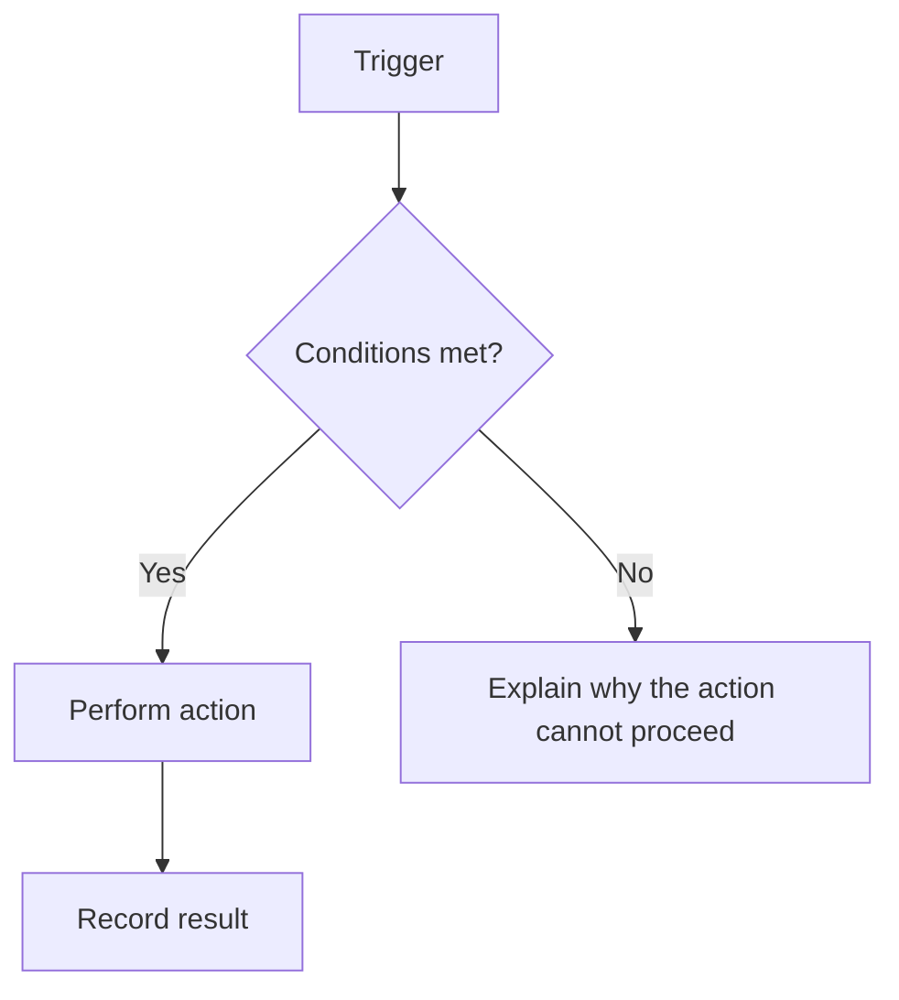
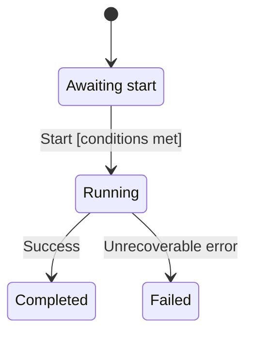
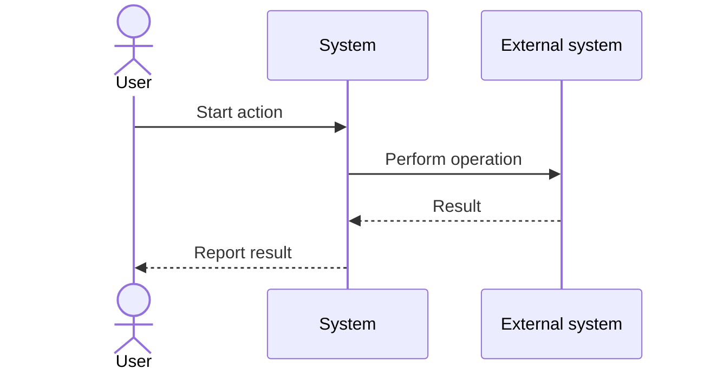

# UC-XXX. [User goal] — [Feature name]

> Status: Draft.

<!-- Choose one status:
Draft — requirements are still being discussed.
Plan — an agreed functional plan, not a description of implemented behavior.
Implemented — the use case is implemented and the description has been verified against the current code.
The status applies to the entire document. Mark unimplemented additions to
an Implemented document separately or move them to a document with Plan status.
-->

## Business Need

**Problem:** [What needs to be solved and why.]

**Scope:** [What this use case covers and which tasks are handled separately.
Supported variants or networks, if applicable. Link to detailed documentation.]

## Main Scenario

**Starting conditions:** [Preconditions and the action or event that triggers the scenario.]

**Input data and parameters:** [Source data and settings.
Where the user configures parameters; which are shared and which apply to the selected context.]

1. The user [performs an action].
2. The system [responds or performs an action meaningful to the user].
3. The user [receives the result or continues interacting].
4. When [parameters change or new data arrives], the system [updates the result].
5. If needed, the user [filters the result or pauses its display].

Remove steps that do not apply. Keep this section focused on the user scenario.
Describe internal checks, branches, and transitions in the next section.

## Algorithm and Diagrams

Choose only the diagrams needed. Use multiple diagrams when each explains
a distinct aspect of the behavior.

| Mermaid format | When to use |
|---|---|
| Flowchart (`flowchart`) | Checks, branches, loops, and execution paths |
| State Machine (`stateDiagram-v2`) | Object or algorithm states, events, and transition conditions |
| Sequence Diagram (`sequenceDiagram`) | Significant ordering of interactions between users, components, and external systems |

A short description is sufficient for a simple linear algorithm. When using
a diagram, do not repeat its steps in prose: add only necessary notation,
precise conditions, or details that are difficult to express visually.
Use consistent names in the text and diagrams.

The following are starting points; remove those you do not use.

### [Data preparation or another process] — Flowchart

[Brief explanation of the process scope, if needed.]

[Link to the process implementation.]

### [Object or algorithm lifecycle] — State Machine

[Whose states are shown. Explain notation and initial conditions
that are not covered by the diagram.]

[Link to the algorithm implementation.]

Describe independent constraints or flags separately from the lifecycle:
if needed, add a small diagram for a specific rule without duplicating
the main State Machine. Do not create a separate state for every combination of flags.

### [Interaction between the user, system, and external services] — Sequence Diagram

## Business Rules and Special Cases

- **[Input data].** [Ordering, precision, valid data boundaries, and prohibited substitutions.]
- **[Parameters].** [Units, ranges, defaults, and compatibility conditions.
  How an optional rule is disabled and what happens to existing settings.]
- **[States and flags].** [What each significant flag means, when it
  resets, and its consequences. Which independent processes continue.]
- **[Result and display].** [Rules for aggregating or interpreting the result;
  what filters and Pause affect, if applicable.]

Keep only applicable rules that are not already covered by the diagrams.
Link to formulas and definitions already described in the main documentation.

| Special case | Behavior and consequences |
|---|---|
| [Error, partial execution, or repeated request] | [What the user receives, what is retained, and which actions are prohibited] |
| [Parameters or context change during processing] | [How stale results are prevented from being applied] |

Specify timeouts, retries, concurrent actions, and cancellation only when
they matter to the task. If a branch is already shown in a diagram, add its
consequences instead of repeating its condition and sequence of steps.
Place implementation links next to the relevant rule or diagram.

## Outcome and Verification

**On success:** [Observable result and changes to the system.]

**When an up-to-date result cannot be obtained:** [Preparation, refusal, or diagnostics.
Whether the previous result can be displayed and how its freshness is indicated.]

[If needed, add a separate short paragraph about an independent outcome,
such as action availability. Do not repeat conditions from diagrams and rules.]

| Initial conditions and action | Expected result |
|---|---|
| [Concrete example of successful execution] | [Verifiable outcome] |
| [Boundary or error case] | [Verifiable outcome, including the absence of prohibited changes] |
| [Parameter change, retry, or state restoration] | [Verifiable outcome] |

Use concrete values rather than restating the algorithm. An independent
rule can have its own table. For example, checking Reversal Limit:

| Initial conditions and action | Expected result |
|---|---|
| Low = 60, Reversal Threshold = 10%, Reversal Limit = 20%; the price reaches 72 | Dead: entry is not allowed; rebound measurement continues. |
| After reaching 72, the price returns to 70 | Dead persists; entry for this episode remains prohibited. |
| The price then rises to High = 80 and falls to 72 | Completed under the existing rule of a 10% drop from High; statistics include the entire rebound up to 80. |

Replace this example with checks for your use case. When testing a new rule,
also verify that it preserves behavior it is not intended to change.
