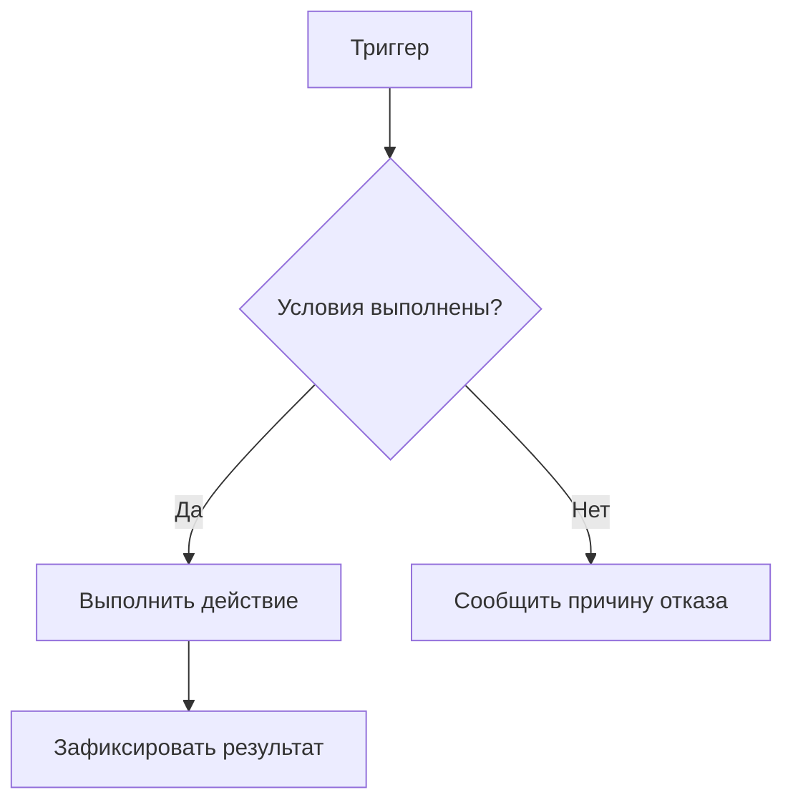
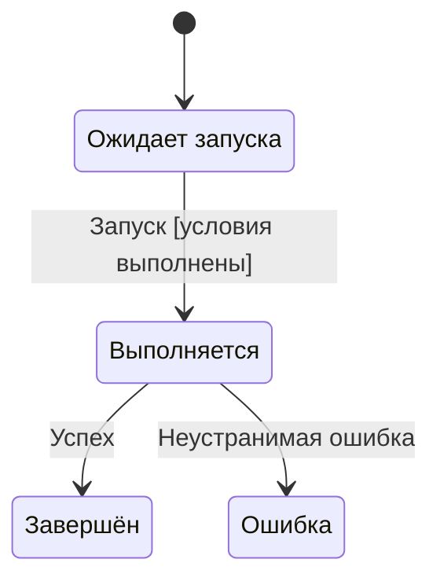
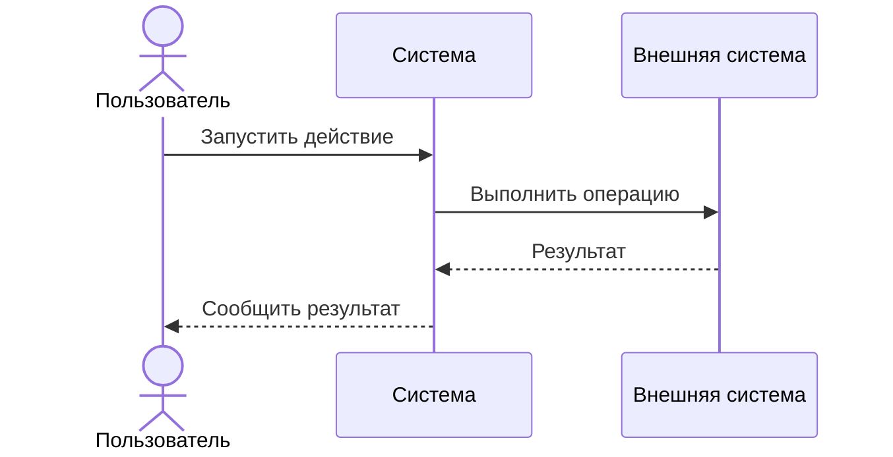

# UC-XXX. [Цель пользователя] — [Название функции]

> Статус: Draft.

<!-- Выберите один статус:
Draft — черновик, требования ещё обсуждаются.
Plan — согласованный функциональный план, не описание реализованного поведения.
Implemented — use case реализован, описание сверено с текущим кодом.
Статус относится ко всему документу. Ещё не реализованные дополнения к
Implemented помечайте отдельно или выносите в документ со статусом Plan.
-->

## Бизнес-задача

**Проблема:** [Что требуется решить и зачем это нужно.]

**Границы:** [Что входит в use case и какие задачи выполняются отдельно.
Поддерживаемые варианты или сети, если применимо. Ссылка на подробную документацию.]

## Основной сценарий

**Условия начала:** [Предусловия и действие или событие, запускающее сценарий.]

**Входные данные и параметры:** [Исходные данные и настройки.
Где пользователь задаёт параметры; какие из них общие, а какие относятся к выбранному контексту.]

1. Пользователь [выполняет действие].
2. Система [отвечает или выполняет значимое для пользователя действие].
3. Пользователь [получает результат или продолжает взаимодействие].
4. При [изменении параметров или поступлении новых данных] система [обновляет результат].
5. При необходимости пользователь [фильтрует результат или приостанавливает его отображение].

Удаляйте неприменимые шаги. Оставляйте здесь пользовательский сценарий. Внутренние проверки, ветвления
и переходы раскрывайте в следующем разделе.

## Алгоритм и схемы

Выберите только необходимые схемы. Несколько схем нужны, если каждая
объясняет отдельный аспект поведения.

| Формат Mermaid | Когда использовать                                                              |
|---|---------------------------------------------------------------------------------|
| Flowchart (`flowchart`) | Проверки, ветвления, циклы и пути выполнения                                    |
| State Machine (`stateDiagram-v2`) | Состояния объекта или алгоритма, события и условия переходов                    |
| Sequence Diagram (`sequenceDiagram`) | Существенный порядок взаимодействий пользователей, компонентов и внешних систем |

Простому линейному алгоритму достаточно короткого текста. Если используется
схема, не пересказывайте её шаги: добавьте лишь необходимые обозначения,
точные условия или подробности, которые неудобно выразить графически.
Сохраняйте одинаковые названия в тексте и схемах.

Ниже заготовки; удалите неиспользуемые.

### [Подготовка данных или другой процесс] — Flowchart

[Короткое пояснение границ процесса, если оно необходимо.]

[Ссылка на реализацию процесса.]

### [Жизненный цикл объекта или алгоритма] — State Machine

[Чьи состояния показаны. Значение обозначений и начальные условия,
которые не раскрыты на схеме.]

[Ссылка на реализацию алгоритма.]

Независимые ограничения или признаки описывайте отдельно от жизненного цикла:
при необходимости добавьте небольшую схему конкретного правила, не дублируя
основную State Machine. Не создавайте отдельное состояние для каждой комбинации признаков.

### [Взаимодействие пользователя, системы и внешних сервисов] — Sequence Diagram

## Бизнес-правила и особые случаи

- **[Входные данные].** [Порядок, точность, границы допустимых данных и недопустимые подмены.]
- **[Параметры].** [Единицы, диапазоны, значения по умолчанию, условия совместимости.
  Как отключается необязательное правило и что происходит со старыми настройками.]
- **[Состояния и признаки].** [Что означает каждый значимый признак, когда он
  сбрасывается и какие последствия имеет. Какие независимые процессы продолжаются.]
- **[Результат и отображение].** [Правила агрегации или интерпретации результата;
  что меняют фильтры и Pause, если применимо.]

Оставляйте только применимые правила, не раскрытые в схемах. Формулы и определения,
уже описанные в основной документации, указывайте ссылками.

| Особый случай | Поведение и последствия                                                 |
|---|-------------------------------------------------------------------------|
| [Ошибка, частичное выполнение или повторный запрос] | [Что получает пользователь, что сохраняется и какие действия запрещены] |
| [Смена параметров или контекста во время обработки] | [Как исключается применение устаревшего результата]                     |

Указывайте таймауты, повторы, конкурентные действия и отмену только при их
значимости для задачи. Если ветка уже описана на схеме, дополняйте её
последствиями, а не повторяйте условие и последовательность шагов.
Ссылки на реализацию размещайте рядом с соответствующим правилом или схемой.

## Результат и проверка

**При успехе:** [Наблюдаемый результат и изменения в системе.]

**При невозможности получить актуальный результат:** [Подготовка, отказ или диагностика.
Можно ли показывать предыдущий результат и как обозначается его актуальность.]

[При необходимости — отдельный короткий абзац о независимом результате,
например доступности действия. Не повторяйте условия из схем и правил.]

| Исходные условия и действие | Ожидаемый результат |
|---|---|
| [Конкретный пример успешного выполнения] | [Проверяемый итог] |
| [Граничный или ошибочный случай] | [Проверяемый итог, включая отсутствие запрещённых изменений] |
| [Изменение параметров, повтор или восстановление состояния] | [Проверяемый итог] |

Используйте конкретные значения, а не пересказ алгоритма. Для независимого
правила можно выделить отдельную таблицу. Например, проверка Reversal Limit:

| Исходные условия и действие | Ожидаемый результат |
|---|---|
| Low = 60, Reversal Threshold = 10%, Reversal Limit = 20%; цена достигает 72 | Dead: вход недопустим, измерение отскока продолжается. |
| После достижения 72 цена возвращается к 70 | Dead сохраняется; вход по этому эпизоду повторно не разрешается. |
| Затем цена растёт до High = 80 и падает до 72 | Completed по прежнему правилу падения на 10% от High; статистика учитывает весь отскок до 80. |

Замените этот пример проверками своего use case. Новое правило проверяйте
также на сохранение поведения, которое оно не должно менять.
